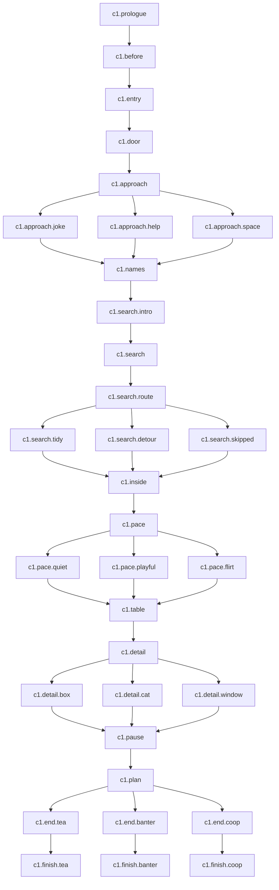

# Глава 1 · «Случайная встреча»

Актуальный runtime content23 · 19 ноября 2026. Источник авторского текста: [SEASON_01_02_POLISH_SPEC_2026_11_19.md](SEASON_01_02_POLISH_SPEC_2026_11_19.md). Сценарное ядро: [NARRATIVE_CORE.md](NARRATIVE_CORE.md).

Вход: `c1.prologue`. Узлов: 33. Основных реплик: 143.

### `c1.prologue` · dialogue

Фон: `bg.cafe.approach`; без персонажей.

1. **Описание:** Рабочий день наконец закончился. На улице свежо, и по дороге домой ты замедляешь шаг у светящегося окна небольшого кафе.
2. **Описание:** На вывеске — «Пауза». У стекла пустует маленький столик, внутри негромко звенит посуда.
3. **Описание:** Ты убираешь телефон в карман: возвращаться в пустую квартиру прямо сейчас не хочется. Пять минут с чем-нибудь горячим звучат куда лучше.
→ `c1.before`

### `c1.before` · dialogue

Фон: `bg.cafe.entry`; персонаж: `vlad.city.neutral`.

1. **Описание:** По ту сторону стекла Влад допивает остывший кофе. Сегодня он впервые за неделю закрыл ноутбук пораньше и выбрался забрать заказанную настолку.
2. **Описание:** Зашёл к Нине на десять минут, не удержался, снял плёнку с коробки и разложил деревянные фигурки с маленьким мостиком.
3. **Описание:** Теперь кофе закончился, а детали упрямо не помещаются обратно в ячейки. Влад прижимает крышку ладонью, подхватывает пустой стакан и идёт к выходу.
→ `c1.entry`

### `c1.entry` · dialogue

Фон: `bg.cafe.entry`; персонаж: `vlad.city.neutral`.

1. **Описание:** Ты тянешься к ручке ровно в ту секунду, когда дверь распахивается изнутри и на улицу выплывает запах кофе и корицы.
2. **Влад:** ой, проходи. я сейчас…
3. **Описание:** Он пытается придержать тяжёлую дверь локтем, чтобы не задеть тебя, но коробка под другой рукой решает открыться сама.
4. **Описание:** Крышка съезжает, и три круглых деревянных жетона со стуком разбегаются по коврику. Один упирается прямо в носок твоей обуви.
5. **Влад:** так. вход бесплатный. это не касса рассыпалась.
   - Выражение: `awkward`.
→ `c1.door`

### `c1.door` · dialogue

Фон: `bg.cafe.entry`; персонаж: `vlad.city.awkward`.

1. **Описание:** Ты придерживаешь жетон и поднимаешь глаза. Перед тобой парень в сером пальто с непослушными кудрями: он одновременно удерживает дверь, стакан и непокорную коробку.
2. **Влад:** спасибо. вообще-то план был просто красиво придержать тебе дверь.
3. **Влад:** дверь, если что, придержал. по остальным пунктам есть вопросы.
4. **Описание:** От его шарфа пахнет кофе, а в голосе слышится такая искренняя растерянность, что сдержать смешок трудно.
5. **Описание:** Из-под ближайшего столика неспешно выходит рыжевато-кремовый кот и с видом ревизора смотрит на рассыпанные детали.
→ `c1.approach`

### `c1.approach` · choice

Фон: `bg.cafe.entry`; персонаж: `vlad.city.awkward`.

- `joke` — «Это настолка или эффектное знакомство?» → `c1.approach.joke` · эффекты `[{"kind":"set","key":"approach","value":"joke"}]`
- `help` — «Держи коробку. Я помогу собрать» → `c1.approach.help` · эффекты `[{"kind":"set","key":"approach","value":"help"}]`
- `space` — «Давай сначала освободим проход» → `c1.approach.space` · эффекты `[{"kind":"set","key":"approach","value":"space"}]`

### `c1.approach.joke` · dialogue

Фон: `bg.cafe.entry`; персонаж: `vlad.city.awkward`.

1. **Влад:** до этой секунды была настолка.
2. **Влад:** но раз уж ты остановилась, я срочно пытаюсь понять, как засчитать оба варианта.
3. **Ты:** Сначала посмотрим, сколько деталей пережило твоё вступление.
4. **Описание:** Влад коротко усмехается, поправляет сползающий шарф и ставит коробку на край ближайшего столика.
5. **Влад:** справедливо. начинаем с инвентаризации.
→ `c1.names`

### `c1.approach.help` · dialogue

Фон: `bg.cafe.entry`; персонаж: `vlad.city.smile`.

1. **Влад:** давай. я тогда беру на себя обязательство не высыпать вторую половину.
2. **Описание:** Он ставит пустой стакан на стол и приседает рядом у коврика. Когда ты поднимаешь первый жетон, вы одновременно тянетесь к маленькому деревянному мостику.
3. **Описание:** Его пальцы на долю секунды задевают твои. Влад чуть дёргает руку назад, уступая деталь тебе.
4. **Ты:** Ответственная у тебя должность.
5. **Влад:** пока на испытательном сроке. спасибо, что выручаешь.
→ `c1.names`

### `c1.approach.space` · dialogue

Фон: `bg.cafe.entry`; персонаж: `vlad.city.neutral`.

1. **Влад:** да, точно. устроил пробку прямо на пороге.
2. **Описание:** Он отступает к свободному столику, пропуская тебя внутрь. Дверь наконец захлопывается за спиной, отсекая уличный шум.
3. **Ты:** Вот. Теперь хотя бы сквозняка нет.
4. **Влад:** уже половина успеха. осталось разобраться с моей маленькой катастрофой.
→ `c1.names`

### `c1.names` · dialogue

Фон: `bg.cafe.entry`; персонаж: `vlad.city.smile`.

1. **Влад:** я Влад, кстати. обычно я знакомлюсь без спецэффектов и деталей на полу.
2. **Ты:** Приятно познакомиться, Влад. Зато такой способ точно запомнится.
3. **Влад:** хех. значит, не зря ронял.
4. **Описание:** Он на секунду задерживает на тебе взгляд — чуть внимательнее, чем полагается простому прохожему, — и переводит глаза на коробку.
5. **Нина:** Влад, если ты открываешь здесь игровой клуб, Пончик уже записался первым.
6. **Описание:** Кот чинно укладывается на коврике рядом с забытым у стены серым зонтиком.
7. **Влад:** у него, как всегда, лучшие места в зале.
→ `c1.search.intro`

### `c1.search.intro` · dialogue

Фон: `bg.cafe.entry`; персонаж: `vlad.city.thinking`.

1. **Описание:** Влад приоткрывает крышку. Внутри пустуют три круглых гнезда с подписью «Дорожные жетоны».
2. **Влад:** я придержу остальные детали, чтобы не разбежались. посмотришь со своей стороны?
3. **Ты:** А если один окажется под котом?
4. **Влад:** тогда придётся вести сложные переговоры. но давай сначала проверим вокруг.
→ `c1.search`

### `c1.search` · minigame

Фон: `bg.cafe.entry`; персонаж: `vlad.city.neutral`.

Мини-игра: `token-search`.
→ `c1.search.route`

### `c1.search.tidy` · dialogue

Фон: `bg.cafe.entry`; персонаж: `vlad.city.surprised`.

1. **Описание:** Ты вкладываешь третий жетон в ячейку на весу, пока Влад держит коробку открытой.
2. **Влад:** ого. ты так быстро их нашла, будто сама эту игру прятала.
3. **Ты:** Просто у меня сегодня хороший обзор.
4. **Влад:** а я только настроился долго и вдумчиво искать вместе с тобой.
5. **Описание:** Поймав смысл собственной фразы, он чуть тушуется, прокашливается и поспешно закрывает крышку.
→ `c1.inside`

### `c1.search.detour` · dialogue

Фон: `bg.cafe.entry`; персонаж: `vlad.city.smile`.

1. **Описание:** Все три жетона наконец на месте — за время поисков вы успели проверить каждый угол у входа.
2. **Влад:** игру спасли, заодно изучили весь интерьер у двери.
3. **Ты:** Коврик особенно старался запутать следы.
4. **Влад:** да, он явно был в сговоре с коробкой. но искать с тобой оказалось веселее, чем одному.
5. **Описание:** Он закрывает крышку, но не спешит отходить, будто прикидывает, как продлить разговор ещё на пару минут.
→ `c1.inside`

### `c1.search.skipped` · dialogue

Фон: `bg.cafe.entry`; персонаж: `vlad.city.neutral`.

1. **Влад:** давай я сам дотянусь до дальних. а ты придержи крышку, ладно?
2. **Описание:** Ты берёшь коробку, а Влад быстро собирает оставшиеся жетоны и аккуратно раскладывает их по ячейкам.
3. **Ты:** Вот теперь все дома.
4. **Влад:** да. вдвоём получилось куда быстрее, чем одному на пороге.
5. **Описание:** Забирая коробку, он едва заметно задевает пальцами твою ладонь и кивает на свободный зал.
→ `c1.inside`

### `c1.inside` · dialogue

Фон: `bg.cafe.window`; персонаж: `vlad.city.smile`.

1. **Нина:** Что ж вы у порога стоите? Ставьте свою спасённую коробку к окну, столик свободен.
2. **Описание:** Внутри пахнет печёным яблоком, у стойки тихо звякает фарфор, а за окном уже сгустились сумерки.
3. **Влад:** кот остался дежурить у входа. видимо, ждёт второй раунд.
4. **Описание:** Влад перехватывает коробку поудобнее и на секунду заминается.
5. **Влад:** слушай… я как раз хотел немного передохнуть перед дорогой. если у тебя есть пять минут — посидишь со мной?
6. **Описание:** Ты смотришь на спокойный столик у окна, потом на его открытое, чуть смущённое лицо — и понимаешь, что уходить прямо сейчас действительно не хочется.
→ `c1.pace`

### `c1.pace` · choice

Фон: `bg.cafe.window`; персонаж: `vlad.city.smile`.

- `quiet` — «Есть пять минут. Только давай спокойно» → `c1.pace.quiet` · эффекты `[{"kind":"set","key":"pace","value":"quiet"}]`
- `playful` — «Ладно, рассказывай, что ещё умеет эта коробка» → `c1.pace.playful` · эффекты `[{"kind":"set","key":"pace","value":"playful"}]`
- `flirt` — «Могу задержаться. Ты забавно знакомишься» → `c1.pace.flirt` · эффекты `[{"kind":"set","key":"pace","value":"flirt"}]`

### `c1.pace.quiet` · dialogue

Фон: `bg.cafe.window`; персонаж: `vlad.city.neutral`.

1. **Влад:** договорились. никакой суеты и громких презентаций.
2. **Описание:** Он отодвигает для тебя стул у окна, кладёт коробку на соседнее сиденье и садится напротив, снимая шарф.
3. **Ты:** Вот так гораздо лучше. На улице сегодня слишком шумно.
4. **Влад:** да. а тут время как будто замедляется.
5. **Описание:** Он смотрит на меню перед собой, но пару секунд явно прислушивается не к залу, а к тишине за вашим столиком.
→ `c1.table`

### `c1.pace.playful` · dialogue

Фон: `bg.cafe.window`; персонаж: `vlad.city.smile`.

1. **Влад:** о, она умеет притворяться простой семейной игрой на двадцать минут.
2. **Ты:** А на практике?
3. **Влад:** на практике один человек говорит «сейчас быстренько разложим», а за окном уже другое время года.
4. **Описание:** Он садится напротив и разворачивает коробку крышкой к тебе — его пальцы случайно касаются твоих на узком столике.
5. **Описание:** Вы оба чуть замираете на долю секунды и почти одновременно усмехаетесь, будто ничего особенного не случилось.
→ `c1.table`

### `c1.pace.flirt` · dialogue

Фон: `bg.cafe.window`; персонаж: `vlad.city.awkward`.

1. **Влад:** тогда я очень рад, что обычный скучный выход из кафе сегодня сорвался.
2. **Ты:** Только не привыкай. Вторую коробку на лету я ловить не обещала.
3. **Влад:** понял. значит, дальше придётся справляться без падающих предметов.
4. **Описание:** Он отвечает вполне уверенно, почти с вызовом, но через секунду сам смущается собственной смелости и трёт затылок.
5. **Описание:** Выглядит это неожиданно живо и по-настоящему искренне.
→ `c1.table`

### `c1.table` · dialogue

Фон: `bg.cafe.window`; персонаж: `vlad.city.neutral`.

1. **Описание:** Нина ставит на стол кувшин с водой и два стакана. Влад сразу придвигает один ближе к тебе.
2. **Влад:** я сегодня весь день просидел за кодом. в какой-то момент понял, что если не выйду на улицу, начну разговаривать с монитором.
3. **Ты:** И чтобы отвлечься от логики, купил коробку со схемами и правилами?
4. **Влад:** привычка. я бэкенд пишу — мне спокойно, когда внутри всё разложено по полочкам.
5. **Влад:** правда, сегодня весь мой порядок рассыпался прямо на входе.
6. **Описание:** Он говорит это без лишнего пафоса, чуть крутя в руках пустой стакан.
7. **Описание:** На крышке коробки между вами нарисованы лесная тропа, два маленьких путешественника с флажками и домик с фонарём у крыльца.
8. **Ты:** Ты, кажется, здесь свой человек. Нина даже не удивилась твоим полётам у входа.
9. **Влад:** захожу иногда после работы. дома слишком легко сказать себе «ещё одну задачу» и очнуться глубокой ночью.
10. **Ты:** Знакомое чувство. Я тоже шла домой, увидела свет в окне и решила сделать паузу.
11. **Влад:** значит, мы оба вовремя свернули.
12. **Описание:** За окном проезжает автобус, полоса света скользит по столу. Влад слушает не перебивая — спокойно и действительно внимательно.
→ `c1.detail`

### `c1.detail` · choice

Фон: `bg.cafe.window`; персонаж: `vlad.city.neutral`.

- `box` — «Показать на два флажка: “Тут играют вместе?”» → `c1.detail.box`
- `cat` — «Посмотреть, куда устроился кот» → `c1.detail.cat`
- `window` — «На минуту отвлечься на окно» → `c1.detail.window`

### `c1.detail.box` · dialogue

Фон: `bg.cafe.window`; персонаж: `vlad.city.thinking`.

1. **Влад:** да, это кооператив. нужно провести двух путешественников через реку и старый карьер к одному домику до темноты.
2. **Ты:** И никто не играет друг против друга?
3. **Влад:** в этом и смысл. тут либо дошли вдвоём, либо оба остались ночевать в лесу.
4. **Описание:** Он достаёт из коробки тот самый деревянный мостик и ставит его на стол между вами.
5. **Влад:** мне и в жизни больше нравится, когда люди на одной стороне, а не выясняют, кто кого переиграл.
6. **Ты:** Звучит как хорошая стратегия. Хотя за право ставить мостик мы ещё поспорим.
7. **Описание:** Влад хмыкает, глядя на крошечную деталь.
8. **Влад:** с тобой я готов поспорить даже за мостик.
→ `c1.pause`

### `c1.detail.cat` · dialogue

Фон: `bg.cafe.window`; персонаж: `vlad.city.smile`.

1. **Описание:** Пончик бесшумно перебирается от двери и запрыгивает на свободный стул сбоку от стола, сворачиваясь клубком.
2. **Ты:** Смотри. Второй игрок уже на месте.
3. **Влад:** он у нас наблюдатель. следит, чтобы я опять чего-нибудь не уронил.
4. **Нина:** Он просто выбирает столики, где людям спокойно сидится. К шумным не подходит.
5. **Описание:** После слов Нины Влад чуть отводит взгляд и сдвигает коробку, чтобы коту было просторнее.
6. **Влад:** ну вот. даже у кота к нам никаких претензий.
7. **Описание:** Ты легонько гладишь кошачью спинку — Пончик тут же отвечает тихим мурлыканьем.
→ `c1.pause`

### `c1.detail.window` · dialogue

Фон: `bg.cafe.window`; персонаж: `vlad.city.neutral`.

1. **Описание:** В тёмном стекле отражается ваш столик и лампа над ним, пока снаружи ветер гонит по тротуару сухие листья.
2. **Ты:** Как хорошо, что здесь так тихо.
3. **Влад:** да. я обычно хожу в бассейн, когда нужно вытряхнуть лишние мысли из головы.
4. **Влад:** но посидеть вот так у окна оказалось ничуть не хуже заплыва.
5. **Описание:** В отражении стекла ты ловишь его взгляд — когда ты смеёшься или просто молчишь, он смотрит с простым, неподдельным интересом.
6. **Ты:** Здесь хотя бы шапочка для плавания не нужна.
7. **Влад:** огромный плюс. в шапочке я бы точно не рискнул с тобой знакомиться.
→ `c1.pause`

### `c1.pause` · dialogue

Фон: `bg.cafe.window`; персонаж: `vlad.city.neutral`.

1. **Описание:** На столе коротко вспыхивает экран его телефона. Влад даже не смотрит, кто пишет — одним движением переворачивает телефон экраном вниз.
2. **Влад:** знаешь… я ведь зашёл сюда буквально на десять минут. а в итоге это лучший кусок всей моей недели.
3. **Ты:** Даже с учётом спасательной операции на коврике?
4. **Влад:** особенно с ней. без неё ты бы просто взяла кофе с собой и ушла.
5. **Описание:** В этих словах нет дежурного подката — только простая констатация факта, от которой за столиком становится удивительно легко.
6. **Описание:** У стойки Нина раскладывает вечернее меню, но никто вас не торопит.
→ `c1.plan`

### `c1.plan` · choice

Фон: `bg.cafe.window`; персонаж: `vlad.city.smile`.

- `tea` — «Давай всё-таки возьмём чай» → `c1.end.tea` · эффекты `[{"kind":"set","key":"plan","value":"tea"}]`
- `banter` — «У меня ещё пять минут на твою авторскую методику» → `c1.end.banter` · эффекты `[{"kind":"set","key":"plan","value":"banter"}]`
- `coop` — «В следующий раз покажешь эту игру?» → `c1.end.coop` · эффекты `[{"kind":"set","key":"plan","value":"coop"}]`

### `c1.end.tea` · dialogue

Фон: `bg.cafe.window`; персонаж: `vlad.city.smile`.

1. **Влад:** давай. чашку чая я точно удержу обеими руками.
2. **Ты:** А коробка пусть пока отдыхает.
3. **Описание:** Нина приносит две керамические чашки. Вы сидите ещё полчаса, и разговор течёт легко, без единой неловкой паузы.
4. **Влад:** спасибо, что осталась. правда не хотелось, чтобы ты сразу уходила.
5. **Описание:** У выхода он подаёт тебе сумку и на секунду придерживает дверь.
6. **Влад:** давай встретимся завтра здесь же? пройдёмся немного. дверь я беру на себя.
7. **Ты:** Договорились. До завтра, Влад.
8. **Описание:** На улице ты через пару шагов оборачиваешься к витрине: Влад всё ещё стоит у столика и, пойманный с поличным, неловко машет рукой.
9. **Описание:** А у двери Пончик устраивается прямо поверх забытого Владом серого зонтика. Кажется, завтрашний повод для встречи уже готов.
→ `c1.finish.tea`

### `c1.end.banter` · dialogue

Фон: `bg.cafe.window`; персонаж: `vlad.city.laugh`.

1. **Влад:** отлично. тогда правило номер два моей методики: до конца вечера больше ничего не ронять.
2. **Описание:** Стоит ему это произнести, как со спинки соседнего стула бесшумно соскальзывает его шарф.
3. **Ты:** Потрясающая выдержка. Почти три секунды продержался.
4. **Влад:** ладно, сдаюсь. сегодня гравитация явно играет против меня.
5. **Описание:** Он подбирает шарф, вы оба смеётесь, и последняя неловкость первого знакомства куда-то исчезает.
6. **Влад:** давай завтра продолжим? встретимся у «Паузы» и пройдёмся — проверим, как я веду себя на открытой местности.
7. **Ты:** Идёт. Посмотрим на твою методику при дневном свете.
8. **Описание:** На улице ты оборачиваешься у витрины: через стекло видно, как Влад смотрит вслед и чуть растерянно качает головой, будто сам не ожидал такого удачного вечера.
9. **Описание:** А в углу у двери Пончик тем временем сворачивается калачиком прямо на его забытом сером зонтике.
→ `c1.finish.banter`

### `c1.end.coop` · dialogue

Фон: `bg.cafe.window`; персонаж: `vlad.city.smile`.

1. **Влад:** обязательно покажу. там как раз нужен второй человек, с которым можно идти в одну сторону.
2. **Ты:** Опыт спасения путешественников у меня уже есть.
3. **Влад:** да, ты принята в команду без конкурса.
4. **Описание:** Он убирает жетон с двумя точками во внутренний кармашек коробки и аккуратно закрывает крышку.
5. **Влад:** тогда завтра встречаемся у «Паузы»? сначала немного прогуляемся, а коробку я захвачу с собой.
6. **Ты:** Договорились. Главное — донести её целиком.
7. **Описание:** Влад открывает перед тобой дверь, а когда ты через пару шагов оборачиваешься с тротуара, ловишь через стекло его спокойный, внимательный взгляд.
8. **Описание:** Коробку он сегодня не забыл — зато его серый зонтик у входа уже прочно занят спящим Пончиком.
→ `c1.finish.coop`

### `c1.search.route` · route

- При `searchResult = "tidy"` → `c1.search.tidy`
- При `searchResult = "detour"` → `c1.search.detour`
- Иначе → `c1.search.skipped`

### `c1.finish.tea` · end

Открытка: `c1.tea`; endingId: `c1.tea`.

### `c1.finish.banter` · end

Открытка: `c1.banter`; endingId: `c1.banter`.

### `c1.finish.coop` · end

Открытка: `c1.coop`; endingId: `c1.coop`.
