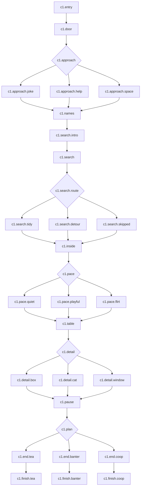

# Глава 1 — «Случайная встреча»: полный сценарий

Версия 1.0. Единственный источник точных реплик и переходов первой главы. Перенесён в `src/content/chapters/ch01.ts`: 31 узел и 114 реплик; отдельная проверка сверяет все реплики и идентификаторы с этим документом. Обозначения и типы — в [ARCHITECTURE.md](ARCHITECTURE.md).

## Постановка и длительность

Поздний мягкий день. Вход в кафе «Пауза», снаружи сухо, изнутри слышна посуда. Влад в сером пальто и шарфе, держит коробку настолки и пустой бумажный стакан. Героиня подходит к двери; никто не назначал эту встречу.

Цель ритма: вход 40 с; знакомство 50 с; жетоны 45–70 с; стол/разговор 100–140 с; план/финал 50–70 с. Итого ориентировочно 5–6 минут первого чтения с паузами, проверить на людях; не задерживать игрока искусственно. В каждой строке ниже одна карточка реплики, кроме явно объединённого текста. Реплики автора обозначены **Описание**, речь игрока **Ты**. Выбранная кнопка сразу продвигает сцену и не требует второго подтверждения. Журнал прочитанных реплик удалён по поручению автора; точные реплики и переходы сценария прежние.

Все варианты ответа видимы без условий. Все развилки возвращаются в общую линию. Никаких очков, штрафов и неявного согласия на встречу в жизни.

## Граф

`c1.detail` — четвёртый выбор без постоянного сюжетного флага: это выбранная микросцена сейчас. Значимые сохраняемые выборы `approach`, `pace`, `plan` + результат поиска. Не вводить переменную ради каждой просмотренной реплики.

## Сцена 1. Дверь, которая победила план

### `c1.entry` · dialogue · фон `bg.cafe.entry` · Влад `city.neutral`

1. **Описание:** Ты подходишь к кафе как раз в тот момент, когда дверь открывается изнутри.
2. **Влад:** ой, проходи. я сейчас…
3. **Описание:** Он придерживает дверь локтем. Коробка под другой рукой решает, что её тоже пригласили открыться.
4. **Описание:** Три круглых жетона скользят на коврик. Один останавливается у твоей обуви.
5. **Влад** (`awkward`): так. вход бесплатный. это не касса рассыпалась.

Далее `c1.door`. Звук мягкого картонного стука, если звук включён. Анимация длится до 500 мс, не блокирует чтение; reduced motion — три жетона уже на полу.

### `c1.door` · dialogue

1. **Описание:** Ты останавливаешь последний жетон носком обуви. На нём две маленькие точки.
2. **Влад:** спасибо. я думал, успею красиво придержать дверь.
3. **Влад:** в целом придержал. остальные задачи обсуждаются.
4. **Описание:** Из-под ближайшего стола появляется кот и внимательно смотрит на коврик.

Далее `c1.approach`.

### `c1.approach` · choice

| ID кнопки | Текст | Эффект | Следующий узел |
|---|---|---|---|
| `joke` | «Это настолка или эффектное знакомство?» | `approach='joke'` | `c1.approach.joke` |
| `help` | «Держи коробку. Я помогу собрать» | `approach='help'` | `c1.approach.help` |
| `space` | «Давай сначала освободим проход» | `approach='space'` | `c1.approach.space` |

### `c1.approach.joke` · dialogue · `city.awkward`

1. **Влад:** до этой секунды была настолка.
2. **Влад:** теперь пытаюсь понять, можно ли оставить оба варианта.
3. **Ты:** Сначала посмотрим, сколько деталей выжило.
4. **Описание:** Он улыбается и переносит коробку на свободный край столика.
5. **Влад:** справедливо. знакомство с проверкой комплектации.

Далее `c1.names`.

### `c1.approach.help` · dialogue · `city.smile`

1. **Влад:** давай. я тогда отвечаю за то, чтобы не высыпать вторую половину.
2. **Описание:** Он ставит пустой стакан и крепко придерживает крышку.
3. **Ты:** Сложная должность.
4. **Влад:** пока испытательный срок. спасибо, что выручаешь.

Далее `c1.names`.

### `c1.approach.space` · dialogue · `city.neutral`

1. **Влад:** да, конечно. я тут целый филиал открыл.
2. **Описание:** Он отступает к столику и убирает сумку с прохода. Теперь дверь свободно закрывается.
3. **Ты:** Вот. Уже гораздо лучше.
4. **Влад:** согласен. сначала проход, потом моя маленькая катастрофа.

Далее `c1.names`. Спокойное принятие, без смущённого «минуса к отношениям».

## Сцена 2. Три жетона и один начальник

### `c1.names` · dialogue · `city.smile`

1. **Влад:** я Влад, кстати. обычно знакомлюсь без инвентаря на полу.
2. **Ты:** Приятно познакомиться. Хотя этот способ запоминается.
3. **Влад:** хех. тогда пусть будет авторская методика.
4. **Нина** (из-за стойки): Влад, если это новая игра, кот уже занял первое место.
5. **Описание:** Кот укладывается на коврике рядом с зонтиком.
6. **Влад:** у него очень сильная стартовая позиция.

Далее `c1.search.intro`. Не запрашивать имя игрока.

### `c1.search.intro` · dialogue · `city.thinking`

1. **Описание:** Под коробкой написано: «Три дорожных жетона». Все три сейчас где-то у входа.
2. **Влад:** я придержу коробку. посмотришь вокруг?
3. **Ты:** А кота передвигать надо?
4. **Влад:** думаю, это отдельная платная механика. обойдём.

Далее `c1.search`. Кнопка помощи находится уже внутри события, не создаёт дополнительный вопрос.

### `c1.search` · minigame `token-search`

Точное поле, слева направо, сверху вниз:

| Область / ID | Первое открытие | Реплика | Итог |
|---|---|---|---|
| Сумка / `bag` | Жетон сбоку | **Влад:** один попытался уехать со мной | Найденный жетон +1 |
| Коврик / `mat` | Только рисунок | **Ты:** Это нарисованный. **Влад:** неплохая маскировка | Не жетон |
| Листок / `paper` | Жетон под меню | **Влад:** этот сразу изучает цены | Найденный жетон +1 |
| Кот / `cat` | Кот приоткрывает глаз | **Влад:** проверка пройдена. работать он не будет | `catNoticed=true`, секрет |
| Стакан / `cup` | Жетон за пустым стаканом | **Ты:** Последний? **Влад:** считаем. я уже не доверяю коробке | Найденный жетон +1; «Последний?» заменить «Ещё один» если найдено <2 до тапа |
| Зонтик / `umbrella` | Кот задевает ручку хвостом | **Описание:** Зонтик чуть качается. **Влад:** хотя бы это на месте | Не жетон, предвестник главы 2 |

Нажатие показывает короткую реплику в зоне под полем; следующий тап по другой области разрешён после полного появления текста, не раньше 250 мс. Нет бесконечного накопления уведомлений. Открытая область больше не даёт результат. Подсказка: «Найди 3 жетона. Можно осмотреть все места».

После третьего жетона кнопка «Готово»; можно ещё осмотреть кота. Результат вычисляется при «Готово»: 3 открытых области → `tidy`, больше → `detour`. Раннее «Собрать вместе с Владом» → `skipped`, даже если некоторые жетоны уже найдены. Флаг кота сохраняется и при таком выходе. Событие возвращает `{kind:'token-search', outcome, catNoticed}`. Движок одним переходом записывает `searchResult`, `catNoticed`, секрет, затем идёт на `c1.search.route`.

`c1.search.route` — автоматический route: `tidy→c1.search.tidy`, `detour→c1.search.detour`, иначе `c1.search.skipped`. Не отдельный экран.

### `c1.search.tidy` · dialogue · `city.surprised`

1. **Описание:** Все три жетона возвращаются в коробку. Кот даже не успевает вмешаться.
2. **Влад:** вот это быстро. ты раньше работала с убегающими настолками?
3. **Ты:** У меня просто хороший вид на пол.
4. **Влад:** а я уже приготовился впечатляться. оставлю чуть-чуть.

Далее `c1.inside`.

### `c1.search.detour` · dialogue · `city.smile`

1. **Описание:** Жетоны найдены. Заодно вы знаете почти всё о коврике.
2. **Влад:** собрали игру и провели исследование помещения.
3. **Ты:** Коврик подозрительный.
4. **Влад:** да. слишком хорошо притворяется жетоном.

Далее `c1.inside`.

### `c1.search.skipped` · dialogue · `city.neutral`

1. **Влад:** давай я закончу. а ты придержи крышку, пожалуйста.
2. **Описание:** Он собирает оставшиеся жетоны и закрывает коробку обеими руками.
3. **Ты:** Вот теперь надёжно.
4. **Влад:** командная работа. у коробки больше нет шансов.

Далее `c1.inside`. Никаких «ты не справилась» или сожаления.

## Сцена 3. Маленькая пауза

### `c1.inside` · dialogue · фон `bg.cafe.window`

1. **Нина:** Можете поставить коробку сюда. И сами сесть, если хотите.
2. **Описание:** У окна свободный столик. На улице кто-то торопится мимо, а здесь тихо звякает ложка.
3. **Влад:** кот остался у двери. видимо, охраняет место происшествия.
4. **Влад:** я как раз собирался сделать перерыв. только начал с физкультуры.
5. **Влад:** если есть пять минут, можно посидеть. если нет — коробка всё равно благодарна.

Далее `c1.pace`. Все варианты означают короткую паузу в вымышленной истории; выйти из игры можно через постоянное меню.

### `c1.pace` · choice

| ID | Текст | Эффект | Переход |
|---|---|---|---|
| `quiet` | «Есть пять минут. Только давай спокойно» | `pace='quiet'` | `c1.pace.quiet` |
| `playful` | «Ладно, рассказывай, что ещё умеет эта коробка» | `pace='playful'` | `c1.pace.playful` |
| `flirt` | «Могу задержаться. Ты забавно знакомишься» | `pace='flirt'` | `c1.pace.flirt` |

### `c1.pace.quiet` · dialogue · `city.neutral`

1. **Влад:** давай. без обязательной развлекательной программы.
2. **Описание:** Он ставит коробку на соседний стул и садится напротив, оставив проход свободным.
3. **Ты:** Вот так хорошо.
4. **Влад:** угу. иногда лучший план — просто сесть.

Далее `c1.table`.

### `c1.pace.playful` · dialogue · `city.smile`

1. **Влад:** умеет делать вид, что правила короткие.
2. **Ты:** А на самом деле?
3. **Влад:** сначала говорят «сейчас объясню». потом меняется время года.
4. **Описание:** Он разворачивает коробку картинкой к тебе, но инструкцию пока не достаёт.

Далее `c1.table`.

### `c1.pace.flirt` · dialogue · `city.awkward`

1. **Влад:** тогда хорошо, что обычный способ сегодня не сработал.
2. **Ты:** Не привыкай. Вторую коробку я ловить не обещала.
3. **Влад:** понял. тогда буду очаровывать без реквизита.
4. **Описание:** Он улыбается так, будто эта задача ему как раз по душе.

Далее `c1.table`. Румянец едва заметный; без сердечного дождя.

### `c1.table` · dialogue · `city.neutral`

1. **Описание:** Нина ставит на стол воду. Влад освобождает место, сдвинув коробку подальше от края.
2. **Влад:** я сегодня весь день сидел над своим проектом. решил выйти и побыть нормальным человеком.
3. **Ты:** И взял с собой инструкцию.
4. **Влад:** привычка. я backend пишу. люблю, когда внутри понятно, что происходит.
5. **Влад:** с коробкой, как видишь, пока есть вопросы.
6. **Описание:** На крышке нарисованы маленькая дорожка, чайник, два флажка и домик в конце дорожки.

Далее `c1.detail`.

### `c1.detail` · choice · немедленное действие, без постоянного флага

| ID | Текст | Следующий узел |
|---|---|---|
| `box` | «Показать на два флажка: “Тут играют вместе?”» | `c1.detail.box` |
| `cat` | «Посмотреть, куда устроился кот» | `c1.detail.cat` |
| `window` | «На минуту отвлечься на окно» | `c1.detail.window` |

### `c1.detail.box` · dialogue · `city.thinking`

1. **Влад:** да. надо довести двух путешественников до домика.
2. **Ты:** И никто никого не съедает?
3. **Влад:** только если очень голодный игрок. вообще тут помогают друг другу.
4. **Описание:** Он показывает маленький деревянный мостик, затем аккуратно убирает его обратно.
5. **Влад:** мне такие больше нравятся. можно спорить с игрой, а не между собой.
6. **Ты:** Хотя про мостик мы ещё можем поспорить.

Далее `c1.pause`.

### `c1.detail.cat` · dialogue · `city.smile`

1. **Описание:** Пончик ушёл с коврика и занял стул рядом с коробкой.
2. **Ты:** Кажется, у вас уже есть второй игрок.
3. **Влад:** он больше по управлению персоналом.
4. **Нина:** И по перерывам. Сейчас как раз работает.
5. **Описание:** Кот зажмуривается. Влад тихо отодвигает коробку, чтобы ему было просторнее.
6. **Влад:** сильный специалист. мне бы так закрывать рабочий день.

Далее `c1.pause`. Этот просмотр не выдаёт секрет поиска: секрет относится только к исследованию поля `c1.search`.

### `c1.detail.window` · dialogue · `city.neutral`

1. **Описание:** На стекле дрожит отражение лампы. Снаружи у остановки ветер выворачивает чей-то капюшон.
2. **Ты:** Хорошо, что здесь тепло.
3. **Влад:** да. я обычно в бассейн иду, когда надо голову проветрить.
4. **Влад:** только звучит странно. голова в воде, а проветривается.
5. **Ты:** Тут можно хотя бы без шапочки.
6. **Описание:** Он кивает. Несколько секунд вы просто смотрите на улицу.

Далее `c1.pause`. Пауза декоративная, кнопка доступна сразу.

### `c1.pause` · dialogue · `city.neutral`

1. **Описание:** В телефоне Влада коротко загорается экран. Он переворачивает его, не начиная объяснять, насколько занят.
2. **Влад:** я вообще шёл отдохнуть минут десять. пока что самая удачная часть дня.
3. **Ты:** Даже с жетонами?
4. **Влад:** ну без них я бы уже ушёл. так что у меня к ним смешанные чувства.
5. **Описание:** Нина кладёт у стойки меню. Кот вытягивает лапу, но до него не достаёт.

Далее `c1.plan`. Предложение делает героиня; не ещё один вопрос Влада.

### `c1.plan` · choice

| ID | Текст | Эффект | Переход |
|---|---|---|---|
| `tea` | «Давай всё-таки возьмём чай» | `plan='tea'` | `c1.end.tea` |
| `banter` | «У меня ещё пять минут на твою авторскую методику» | `plan='banter'` | `c1.end.banter` |
| `coop` | «В следующий раз покажешь эту игру?» | `plan='coop'` | `c1.end.coop` |

## Сцена 4. Три локальных финала

### `c1.end.tea` · dialogue · `city.smile`

1. **Влад:** давай. чай я хотя бы могу удержать двумя руками.
2. **Ты:** Коробку оставим на испытательном сроке.
3. **Описание:** Вы выбираете чай по меню. Нина ставит на стол две чашки, оставив ручки с удобной стороны.
4. **Влад:** спасибо, что задержалась.
5. **Описание:** Разговор ненадолго стихает. Теперь тишина не кажется неловкой.
6. **Влад:** давай повторим. завтра, здесь же. дверь беру на себя.
7. **Описание:** У входа Пончик укладывается на серый зонтик. Влад смотрит в другую сторону.
8. **Описание:** Кажется, у следующего плана уже появился маленький пушистый недостаток.

Далее `c1.finish.tea` — end, `endingId='c1.tea'`, карточка **«Маленькая пауза»**. Подпись: «Иногда хороший день начинается с того, что никуда не торопишься».

### `c1.end.banter` · dialogue · `city.laugh`

1. **Влад:** тогда пункт второй: больше ничего не ронять.
2. **Описание:** С соседнего стула падает его шарф.
3. **Ты:** Сильная программа. Сразу практика.
4. **Влад:** ладно. пункт второй перенесён на следующую встречу.
5. **Описание:** Он поднимает шарф. Вы оба смеётесь, уже не стараясь выглядеть особенно собранными.
6. **Влад:** хорошо посидели. неожиданно буквально.
7. **Описание:** Пончик возвращается ко входу и ложится на серый зонтик.
8. **Описание:** До следующего пункта программы зонтик, похоже, не доживёт незамеченным.

Далее `c1.finish.banter` — end, `endingId='c1.banter'`, карточка **«Нелепо познакомились»**. Подпись: «План знакомиться красиво заменён на план смеяться вместе».

### `c1.end.coop` · dialogue · `city.smile`

1. **Влад:** покажу. там как раз нужен второй человек, который замечает, что я делаю.
2. **Ты:** То есть должность уже знакомая.
3. **Влад:** опыт с коробкой засчитывается.
4. **Описание:** Он кладёт на крышку жетон с двумя точками, затем убирает его в отдельный кармашек.
5. **Влад:** сохраним место. у нас тут ещё мостик непостроенный.
6. **Ты:** Главное, чтобы в следующий раз детали остались внутри.
7. **Описание:** Пончик занимает забытый у двери зонтик. Влад проверяет только застёжку коробки.
8. **Описание:** Одна проблема решена. Следующая пока уютно лежит под котом.

Далее `c1.finish.coop` — end, `endingId='c1.coop'`, карточка **«Второй игрок найден»**. Подпись: «Сначала собрали жетоны. Кажется, теперь собралась команда».

### Общие правила end-узлов

На входе атомарно: зафиксировать завершение главы 1; `endStates[1]` = текущий снимок истории; выдать карточку варианта; добавить секрет, если получен в событии; закрыть активный прогон; открыть экран результата. Повторный рендер end не создаёт второе завершение. Право на главу 2 остаётся зависимым от кода автора и `available`; свободного ручного открытия нет.

Кнопки: «Сохранить открытку», «Поделиться», «Копировать текст», «К главам». Текст для копирования: «Пять случайных встреч · Глава 1. Мой финал: [название]. [подпись]». Только явное действие запускает экспорт или отправку. Для первой сборки следующая карточка честно говорит «Глава 2 ещё в разработке».

## Возвраты в следующих главах

- `approach=joke`: в гл. 5 «методику знакомства я больше не улучшал. боюсь, придётся ронять мебель».
- `approach=help`: «ты тогда просто взяла и помогла. я это запомнил». Без подразумеваемого долга.
- `approach=space`: «начали с того, что освободили проход. хороший был план, кстати».
- `catNoticed=true`: Нина в гл. 2 «С начальником вы уже знакомы». Иначе: «Это Пончик. У него здесь кресло, у меня работа».
- `pace=quiet`: Влад в гл. 2 приносит термос/реквизит, не начинает со стендапа; если `playful` — шутка про погоду; если `flirt` — «рад, что ты пришла» без ранних прозвищ.
- `plan=tea/banter/coop`: термос / прогноз нелепостей / карманная игра. Ни одна ветка не требует согласия на дом.
- `searchResult`: только реакция и подпись детали на карточке: «Три точных находки» / «Провели расследование» / «Собрали вместе». Не использовать как характеристику интеллекта.

## Контрольные маршруты

1. **Спокойный:** space → помощь Влада в поиске → quiet → window → tea. Проверить тёплый полный финал без флирта и секрета.
2. **Игривый:** joke → bag/paper/cup → Готово → playful → box → banter. `tidy`, без секрета; шарф падает только здесь.
3. **С интересом:** help → cat/bag/paper/cup → Готово → flirt → cat → coop. `detour`, секрет один раз; не показывать романтического признания.
4. **Отказ от мини-игры после исследования:** cat → помощь Влада. `skipped` и `catNoticed=true` совместимы.
5. Перезагрузка после каждого выбора возвращает к следующей сцене, не повторяет эффект. Перезагрузка посреди поиска возвращает к началу поиска и обнуляет только незавершённые находки.
6. Все 3×3×3 сочетания сохраняемых выборов достижимы; 3 ветки detail также покрываются валидатором. Количество перестановок тапов поля не требует отдельных сценарных веток.
