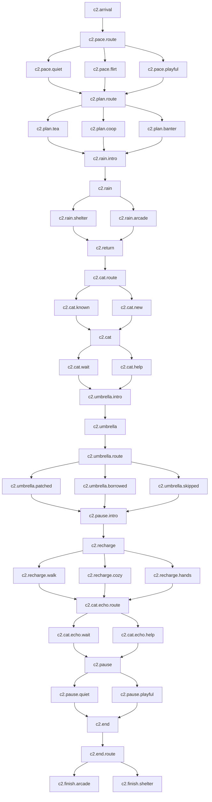

# Глава 2 · «Свидание пошло не по плану»

Сценарное зеркало редакции content27. [Исходник главы](../src/content/chapters/ch02.ts) · [Сценарное ядро](NARRATIVE_CORE.md).

Вход: `c2.arrival`. Узлов: 41. Основных реплик: 143.

### `c2.arrival` · dialogue

Фон: `bg.rain.awning`; персонаж: `vlad.city.smile`.

1. **Описание:** Через пару дней небо затянуто низкими облаками, а на тротуаре у «Паузы» блестят следы недавнего дождя.
2. **Описание:** Влад уже ждёт под полосатым навесом. Заметив тебя, он сразу отлипает от витрины и делает шаг навстречу.
3. **Влад:** привет. я пришёл чуть раньше — на всякий случай проверил дверь, сегодня она ведёт себя прилично.
4. **Ты:** Привет. Значит, сегодня без летающих деталей?
5. **Влад:** пока держусь. но день только начинается, так что ни за что не ручаюсь.
6. **Описание:** Он криво усмехается, и пасмурная погода за спиной сразу перестаёт раздражать.
→ `c2.pace.route`

### `c2.pace.route` · route

- Если `pace = "quiet"` → `c2.pace.quiet`
- Если `pace = "flirt"` → `c2.pace.flirt`
- Иначе → `c2.pace.playful`

### `c2.pace.quiet` · dialogue

Фон: `bg.rain.awning`; персонаж: `vlad.city.neutral`.

1. **Влад:** я прикинул тихий маршрут через сквер. без спешки и без толпы.
2. **Описание:** Он убирает телефон глубоко в карман пальто, освобождая руки.
3. **Ты:** Мне нравится. Особенно часть, где никуда не нужно бежать.
4. **Влад:** мне тоже. после того вечера я поймал себя на мысли, как легко с тобой было сидеть.
→ `c2.plan.route`

### `c2.pace.flirt` · dialogue

Фон: `bg.rain.awning`; персонаж: `vlad.city.smile`.

1. **Влад:** рад, что ты пришла. честно говоря, с утра пару раз поглядывал на часы.
2. **Ты:** Решила проверить, чем ты будешь удерживать внимание без падающей коробки.
3. **Влад:** ну, ронять коробку второй раз подряд было бы слишком очевидно. ты бы сразу раскусила план.
4. **Описание:** Он чуть прищуривается, явно довольный тем, как легко вы подхватываете шутки друг друга.
→ `c2.plan.route`

### `c2.pace.playful` · dialogue

Фон: `bg.rain.awning`; персонаж: `vlad.city.smile`.

1. **Влад:** синоптики обещали отличную погоду для прогулки. правда, со мной они почему-то не сверились.
2. **Ты:** После прошлого раза я в вопросах планирования больше доверяю Пончику.
3. **Влад:** справедливо. он хотя бы спит на одном месте и не придумывает приключений на ходу.
4. **Описание:** Влад коротко смеётся, и сырой пасмурный день сразу кажется заметно веселее.
→ `c2.plan.route`

### `c2.plan.route` · route

- Если `plan = "tea"` → `c2.plan.tea`
- Если `plan = "coop"` → `c2.plan.coop`
- Иначе → `c2.plan.banter`

### `c2.plan.tea` · dialogue

Фон: `bg.rain.awning`; персонаж: `vlad.city.smile`.

1. **Описание:** Влад расстёгивает сумку и достаёт небольшой матовый термос и два бумажных стаканчика.
2. **Влад:** взял чай с собой. подумал, вчерашняя идея согреться была слишком хорошей, чтобы оставлять её только внутри кафе.
3. **Ты:** Выездная чайная пауза? Ты подготовился.
4. **Влад:** старался. если у сквера поднимется ветер, пригодится.
5. **Описание:** Он наливает горячий чай до краёв, закрывает термос и передаёт первый стаканчик тебе, придерживая за донышко, чтобы картон не обжёг ладони.
6. **Описание:** В этом простом жесте нет громких слов, но согреваешься от него сразу.
→ `c2.rain.intro`

### `c2.plan.coop` · dialogue

Фон: `bg.rain.awning`; персонаж: `vlad.city.thinking`.

1. **Описание:** Влад достаёт из сумки ту самую коробку с игрой, аккуратно перетянутую резинкой, и кладёт на столик под навесом.
2. **Влад:** принёс, как обещал. видишь резинку? учёл ошибки прошлого.
3. **Ты:** Тренировался дома над ковром?
4. **Влад:** над диваном. я серьёзно отношусь к нашему кооперативу.
5. **Описание:** На крышке нарисован всё тот же маленький мостик через реку.
→ `c2.rain.intro`

### `c2.plan.banter` · dialogue

Фон: `bg.rain.awning`; персонаж: `vlad.city.awkward`.

1. **Описание:** Влад с предельно серьёзным видом достаёт из кармана пальто сложенный вдвое плотный листок.
2. **Влад:** составил официальный прогноз возможных нелепостей на сегодняшний вечер. нарисовал три тучки и стрелку.
3. **Ты:** И какие у нас шансы уцелеть?
4. **Влад:** умеренная неловкость с моей стороны и высокая вероятность, что мы всё равно будем смеяться.
5. **Описание:** На обороте от руки приписано: «Не является прогнозом погоды». Ты с усмешкой прячешь карточку в сумку.
→ `c2.rain.intro`

### `c2.rain.intro` · dialogue

Фон: `bg.rain.awning`; персонаж: `vlad.city.awkward`.

1. **Описание:** Стоит вам сделать шаг к краю тротуара, как по асфальту часто и гулко бьют тяжёлые капли — редкая морось за секунды превращается в плотный ливень.
2. **Влад:** так. вообще-то ровно для такого случая у меня есть большой зонт.
3. **Описание:** Он приоткрывает сумку, заглядывает внутрь, замирает на секунду и медленно застёгивает молнию обратно.
   - Вариант при `plan = "coop"`: Влад торопливо прячет коробку с игрой со столика обратно в сумку, чтобы не намокла, заглядывает внутрь глубже — и вдруг замирает, медленно застёгивая молнию.
4. **Влад:** кажется, мой зонт сегодня решил остаться дома. точнее… не дома.
5. **Ты:** В прошлый раз у двери под котом?
6. **Влад:** именно там. ладно, признаю: как организатор прогулок я пока держусь исключительно на твоём терпении.
   - Вариант при `plan = "coop"`: именно там. нашу партию, похоже, отложим до сухого вечера — а как организатор я пока держусь исключительно на твоём терпении.
7. **Описание:** Порыв ветра бросает под край козырька мелкие брызги, и Влад без лишних слов сдвигается с внешней стороны, прикрывая тебя от ветра.
→ `c2.rain`

### `c2.rain` · choice

Фон: `bg.rain.awning`; персонаж: `vlad.city.awkward`.

- `shelter` — «Вернёмся под навес. Здесь вполне уютно» → `c2.rain.shelter` · эффекты `[{"kind":"set","key":"rainRoute","value":"shelter"}]`
- `arcade` — «Давай добежим до соседней арки» → `c2.rain.arcade` · эффекты `[{"kind":"set","key":"rainRoute","value":"arcade"}]`

### `c2.rain.shelter` · dialogue

Фон: `bg.rain.awning`; персонаж: `vlad.city.neutral`.

1. **Описание:** Вы отступаете глубже под полосатый навес. Снаружи стеной шумит вода, пахнет мокрым асфальтом, а сухой полосы у витрины хватает ровно на двоих.
2. **Описание:** С бокового края до тебя всё равно долетает водяная пыль, и Влад сдвигается на полшага ближе к каплям, заслоняя тебя от ветра.
3. **Ты:** Влад, ты же сам сейчас промокнешь.
4. **Описание:** Из-за тесноты под козырьком вы стоите совсем рядом; под шум ливня его голос звучит ниже и спокойнее.
5. **Влад:** переживу. главное, чтобы ты осталась сухой.
6. **Описание:** Он стряхивает каплю с рукава и кивает на мокрую улицу.
7. **Влад:** да и дождь, если честно, неплохой. когда есть крыша.
8. **Описание:** В шуме воды и прохладном воздухе неожиданно уютно просто стоять рядом и никуда не спешить.
9. **Нина:** А я всё гадала, когда вы вспомните про своего серого пленника! Заходите внутрь, пока совсем не вымокли.
→ `c2.return`

### `c2.rain.arcade` · dialogue

Фон: `bg.rain.arcade`; персонаж: `vlad.city.laugh`.

1. **Описание:** Влад придерживает тебя за локоть, и за несколько быстрых шагов сквозь косые струи вы ныряете под свод соседней каменной арки.
2. **Описание:** Под низким сводом гулко отдаётся шум ливня. Вы оба переводите дыхание, отряхивая капли с рукавов.
3. **Влад:** ну вот. зато маршрут получился камерный. без посторонних.
4. **Ты:** Потому что все нормальные люди посмотрели прогноз погоды?
5. **Влад:** потому что у них не было хорошего повода так спешить.
6. **Описание:** Он замечает каплю дождя у тебя на щеке, на секунду тянется рукой, но останавливается и просто протягивает чистую салфетку из кармана.
7. **Описание:** Ты с усмешкой забираешь салфетку — Влад от этой заминки сам чуть краснеет и отворачивается к улице.
8. **Описание:** Когда первый заряд ливня стихает до ровного дождя, вы по сухой кромке вдоль стены перебегаете обратно к двери «Паузы».
→ `c2.return`

### `c2.return` · dialogue

Фон: `bg.cafe.window`; персонаж: `vlad.city.thinking`.

1. **Описание:** Внутри кафе после сырой улицы пахнет свежей выпечкой и корицей. У окна, целый и невредимый, стоит забытый в прошлый раз серый зонтик.
2. **Влад:** вот и пропажа. провёл эти дни в гораздо более комфортных условиях, чем его хозяин.
3. **Описание:** На стуле рядом восседает Пончик, аккуратно обвив хвостом изогнутую ручку.
4. **Ты:** Кажется, просто так имущество со склада не выдают.
→ `c2.cat.route`

### `c2.cat.route` · route

- Если `catNoticed = true` → `c2.cat.known`
- Иначе → `c2.cat.new`

### `c2.cat.known` · dialogue

Фон: `bg.cafe.window`; персонаж: `vlad.city.smile`.

1. **Нина:** С нашим начальником охраны вы с прошлого вечера уже знакомы. Он этот зонтик тут сторожил.
2. **Влад:** ценю такую преданность делу. осталось выяснить, принимает ли он взятки поглаживанием.
3. **Описание:** Пончик приоткрывает один глаз и лениво переводит взгляд с Влада на тебя.
→ `c2.cat`

### `c2.cat.new` · dialogue

Фон: `bg.cafe.window`; персонаж: `vlad.city.smile`.

1. **Нина:** Знакомьтесь, это Пончик. У него здесь личное кресло и полный контроль над забытыми вещами.
2. **Влад:** очень приятно, Пончик. мы только заберём зонтик и на вашу территорию не претендуем.
3. **Описание:** Кот лениво щурится, явно ожидая вашего следующего хода.
→ `c2.cat`

### `c2.cat` · choice

Фон: `bg.cafe.window`; персонаж: `vlad.city.smile`.

- `wait` — «Пусть сам подойдёт. Подождём рядом» → `c2.cat.wait` · эффекты `[{"kind":"set","key":"catApproach","value":"wait"}]`
- `help` — «Попросим Нину помочь» → `c2.cat.help` · эффекты `[{"kind":"set","key":"catApproach","value":"help"}]`

### `c2.cat.wait` · dialogue

Фон: `bg.cafe.window`; персонаж: `vlad.city.neutral`.

1. **Описание:** Ты присаживаешься на край соседнего стула и просто протягиваешь раскрытую ладонь, не торопя кота. Влад останавливается неподалёку, наблюдая за переговорами.
2. **Влад:** мне нравится, как у тебя всё получается без давления. даже коты сразу доверяют.
3. **Описание:** Через полминуты Пончик спрыгивает на пол, трётся лбом о твои пальцы и освобождает ручку зонтика.
4. **Ты:** Переговоры прошли успешно.
5. **Описание:** Влад забирает зонтик и сразу надёжно пристёгивает его к ремню сумки, чтобы больше не терять.
→ `c2.umbrella.intro`

### `c2.cat.help` · dialogue

Фон: `bg.cafe.window`; персонаж: `vlad.city.neutral`.

1. **Нина:** Сейчас решим вопрос мирным путём. Пончик, смотри, твой плед у стойки освободился.
2. **Описание:** Нина приносит корзинку с мягкой подстилкой, и кот с достоинством перебирается туда.
3. **Ты:** Секрет был в правильной недвижимости.
4. **Влад:** запишу себе на будущее: уютный плед решает половину вопросов. спасибо, Нина.
5. **Описание:** Забрав зонтик, Влад пристёгивает его к сумке и кивает на окно.
→ `c2.umbrella.intro`

### `c2.umbrella.intro` · dialogue

Фон: `bg.cafe.window`; персонаж: `vlad.city.thinking`.

1. **Описание:** На подоконнике лежит маленький декоративный зонтик для осенней витрины. В его куполе три аккуратных прорехи.
2. **Нина:** Хотела украсить окно к дождливой неделе, да всё руки не доходят подобрать заплатки по форме.
3. **Влад:** наш зонт мы спасли. поможем и этому, пока дождь всё равно не пускает?
4. **Описание:** Нина выкладывает на подоконник пуговицу, треугольный лоскуток ткани и узкую ленту. Вы встаёте рядом у окна, склоняясь над маленьким куполом.
5. **Ты:** Давай попробуем. Держи купол, чтобы не крутился.
6. **Влад:** держу. командуй, мастер.
→ `c2.umbrella`

### `c2.umbrella` · minigame

Фон: `bg.cafe.window`; персонаж: `vlad.city.thinking`.

Мини-игра: `umbrella-patch`.
→ `c2.umbrella.route`

### `c2.umbrella.route` · route

- Если `umbrella = "patched"` → `c2.umbrella.patched`
- Если `umbrella = "borrowed"` → `c2.umbrella.borrowed`
- Иначе → `c2.umbrella.skipped`

### `c2.umbrella.patched` · dialogue

Фон: `bg.cafe.window`; персонаж: `vlad.city.smile`.

1. **Описание:** Последний лоскуток ложится точно на место. Когда ты разглаживаешь ленту, ладонь Влада изнутри купола оказывается прямо под твоей через тонкую ткань.
2. **Нина:** Красота какая! Вот, возьмите маленькую нашивку с облаком на память.
3. **Описание:** Ты убираешь тканевую нашивку в кармашек сумки, а Влад с довольным видом осматривает вашу работу.
4. **Влад:** с мелким ремонтом погоды мы справились. теперь можно и отдохнуть.
→ `c2.pause.intro`

### `c2.umbrella.borrowed` · dialogue

Фон: `bg.cafe.window`; персонаж: `vlad.city.smile`.

1. **Нина:** Оставьте декорации мне, я вечером доклею. А вам за помощь с Пончиком — сухой чехол для вашего зонта, чтобы сумку не мочить.
2. **Описание:** Влад аккуратно укладывает серый зонт в сухой чехол и затягивает шнурок одним точным движением.
3. **Ты:** Зато теперь твой зонт упакован лучше, чем мы сами.
4. **Влад:** ничего, сейчас и нами займёмся.
→ `c2.pause.intro`

### `c2.umbrella.skipped` · dialogue

Фон: `bg.cafe.window`; персонаж: `vlad.city.neutral`.

1. **Влад:** знаешь, давай оставим витрину Нине. я сегодня пришёл поговорить с тобой, а не открывать мастерскую.
2. **Нина:** И правильно! Идите за столик, я сейчас сделаю вам горячего чая.
3. **Описание:** Влад подхватывает твою сумку, чтобы перенести её к сухому столику у входа, и от этой простоты становится легко на душе.
4. **Ты:** Мне нравится такое распределение обязанностей.
→ `c2.pause.intro`

### `c2.pause.intro` · dialogue

Фон: `bg.rain.awning`; персонаж: `vlad.city.neutral`.

1. **Описание:** Дождь становится тише. Нина выносит две дымящиеся кружки какао на сухой угловой столик под глубоким навесом.
2. **Описание:** По мокрой брусчатке бегут ручьи, пахнет озоном и листвой, а сверху падает мелкая водяная пыль.
3. **Влад:** ну вот. прогулка сократилась до двух метров, зато какао настоящее.
4. **Ты:** И никто не заставляет бежать по лужам ради галочки в маршруте.
5. **Влад:** у меня после тяжёлой недели голова ещё долго гудит — спасает только проплыть десяток дорожек. а ты как выдыхаешь?
   - Эмоция Влада: `thinking`.
6. **Описание:** Он сдвигает твой стул подальше от влажного края навеса и ждёт, что ответишь.
→ `c2.recharge`

### `c2.recharge` · choice

Фон: `bg.rain.awning`; персонаж: `vlad.city.thinking`.

Вопрос: Как ты обычно перезагружаешься?
- `walk` — «Ухожу гулять одна с музыкой в наушниках» → `c2.recharge.walk` · эффекты `[{"kind":"set","key":"herRecharge","value":"walk"}]`
- `cozy` — «Заворачиваюсь дома с вкусным и хорошим кино, чтобы никто не трогал» → `c2.recharge.cozy` · эффекты `[{"kind":"set","key":"herRecharge","value":"cozy"}]`
- `hands` — «Переключаюсь на что-то руками — готовлю или навожу уют» → `c2.recharge.hands` · эффекты `[{"kind":"set","key":"herRecharge","value":"hands"}]`

### `c2.recharge.walk` · dialogue

Фон: `bg.rain.awning`; персонаж: `vlad.city.smile`.

1. **Ты:** Надеваю наушники и иду гулять без маршрута, пока ритм шагов не выветрит всю усталость.
2. **Влад:** завидую. я если выхожу «просто пройтись», через десять минут всё равно достаю карту и начинаю оптимизировать маршрут.
3. **Влад:** если у тебя как-нибудь будет тяжёлый день — пойдём гулять без карты, обещаю не командовать поворотами.
   - Эмоция Влада: `thinking`.
→ `c2.cat.echo.route`

### `c2.recharge.cozy` · dialogue

Фон: `bg.rain.awning`; персонаж: `vlad.city.smile`.

1. **Ты:** Устраиваю себе тихий вечер дома: вкусное, хороший фильм — и никаких звонков.
2. **Влад:** хороший навык. я так пробую отдыхать, но на двадцатой минуте фильма вечно вспоминаю какую-нибудь мелочь и лезу в телефон.
3. **Влад:** значит, если позовёшь смотреть кино — телефон у меня придётся отбирать на входе.
   - Эмоция Влада: `thinking`.
→ `c2.cat.echo.route`

### `c2.recharge.hands` · dialogue

Фон: `bg.rain.awning`; персонаж: `vlad.city.smile`.

1. **Ты:** Мне проще всего переключиться через руки: приготовить что-нибудь вкусное или разобрать вещи вокруг себя.
2. **Влад:** о, смело. у меня любая попытка «разобрать ящик» заканчивается тем, что я сижу на полу посреди кучи проводов и думаю, зачем начал.
   - Эмоция Влада: `surprised`.
3. **Влад:** а вот готовить вдвоём — другое дело. как-нибудь проверим, кто кого спасёт у плиты.
   - Эмоция Влада: `smile`.
→ `c2.cat.echo.route`

### `c2.cat.echo.route` · route

- Если `catApproach = "wait"` → `c2.cat.echo.wait`
- Иначе → `c2.cat.echo.help`

### `c2.cat.echo.wait` · dialogue

Фон: `bg.rain.awning`; персонаж: `vlad.city.smile`.

1. **Описание:** Из приоткрытой двери бесшумно выходит Пончик и сворачивается у сухой ножки твоего стула, мурлыча под стук капель.
2. **Влад:** смотри-ка. окончательно перешёл на твою сторону.
3. **Ты:** Он просто ценит спокойную компанию.
→ `c2.pause`

### `c2.cat.echo.help` · dialogue

Фон: `bg.rain.awning`; персонаж: `vlad.city.smile`.

1. **Описание:** Нина переставляет корзинку с Пончиком на сухую лавку прямо у порога.
2. **Нина:** Пусть подышит свежим воздухом вместе с вами, ему отсюда весь тротуар видно.
3. **Описание:** Кот сонно приоткрывает глаза, осматривает ваш столик и снова утыкается носом в лапу.
→ `c2.pause`

### `c2.pause` · choice

Фон: `bg.rain.awning`; персонаж: `vlad.city.smile`.

- `quiet` — «Давай немного помолчим и послушаем дождь» → `c2.pause.quiet` · эффекты `[{"kind":"set","key":"eveningMood","value":"quiet"}]`
- `playful` — «Во что ты ещё любишь играть?» → `c2.pause.playful` · эффекты `[{"kind":"set","key":"eveningMood","value":"playful"}]`

### `c2.pause.quiet` · dialogue

Фон: `bg.rain.awning`; персонаж: `vlad.city.neutral`.

1. **Влад:** давай. дождь сегодня так ровно шумит, что перебивать его жалко.
2. **Описание:** Вы обхватываете ладонями горячие чашки и замолкаете. Капли мерно срываются с края навеса, разбиваясь об один и тот же блестящий лист на тротуаре.
3. **Описание:** Влад не тянется к телефону, чтобы заполнить паузу — просто смотрит на улицу, а потом на твои руки у чашки.
4. **Описание:** Через минуту его рука на столе чуть сдвигается, и кончик его пальца едва заметно касается твоего мизинца.
5. **Описание:** Он не настаивает, но и не убирает руку сразу — оставляет решение за тобой, и в этой тихой точке соприкосновения нет ни капли неловкости.
6. **Ты:** Удивительно. Обычно с новыми людьми в тишине неловко, а сейчас — совсем нет.
7. **Влад:** потому что мне не нужно перед тобой кем-то казаться. просто хорошо сидеть рядом.
8. **Описание:** Он говорит это тихо, опустив глаза в свою чашку, и пауза после этих слов звучит честнее любого комплимента.
→ `c2.end`

### `c2.pause.playful` · dialogue

Фон: `bg.rain.awning`; персонаж: `vlad.city.smile`.

1. **Влад:** у меня дома есть любимая игра на двоих — про двух безумных поваров на крошечной кухне.
   - Вариант при `plan = "coop"`: раз с настолкой сегодня не вышло — расскажу про ещё одну любимую игру на двоих. про двух безумных поваров на крошечной кухне.
2. **Ты:** После той коробки и сегодняшнего зонта мы на кухне точно устроим пожар.
3. **Влад:** там это почти поощряется. главное — вовремя передавать друг другу продукты и не путаться у плиты.
4. **Описание:** Он достаёт телефон и показывает смешной набросок двух человечков в колпаках. Чтобы рассмотреть экран без бликов, ты чуть наклоняешься ближе.
5. **Описание:** Влад вдруг замолкает на полуслове. Подняв глаза, ты замечаешь, что он смотрит уже не на экран, а на тебя.
6. **Влад:** подожди… я забыл, какое там было второе правило.
7. **Ты:** Наверное, не отвлекаться от плиты?
8. **Влад:** вот с этим, чувствую, будут серьёзные проблемы.
9. **Описание:** Он хмыкает и убирает телефон в карман, чуть смущённо потирая переносицу.
→ `c2.end`

### `c2.end` · dialogue

Фон: `bg.rain.awning`; персонаж: `vlad.city.smile`.

1. **Описание:** Дождь почти стихает, оставляя свежий воздух и светлую полосу за крышами, но с веток лип вдоль тротуара всё ещё срываются крупные капли.
2. **Описание:** Вы поднимаетесь из-за столика. Влад отстёгивает от сумки серый зонт и раскрывает купол над твоей головой.
3. **Ты:** Дождь ведь уже почти закончился.
4. **Влад:** с деревьев ещё капает. да и должен же этот зонт сегодня хоть раз честно поработать.
5. **Описание:** Под одним куполом приходится идти в одном темпе, совсем рядом — рукава пальто пару раз задевают друг друга над блестящим асфальтом.
6. **Влад:** слушай… давай в выходные сходим на набережную? обещают ясное небо. возьмём кофе навынос и посидим у воды, без всяких крыш.
7. **Ты:** Давай. Посмотрим, что у тебя за программа для хорошей погоды.
8. **Влад:** договорились. буду ждать у скамейки возле фонарей. и смотри под ноги на мокрой плитке, ладно?
9. **Описание:** У твоего подъезда Влад складывает зонт, встряхивает капли с купола, кивает тебе на прощание и уходит по блестящему тротуару обратно к перекрёстку.
→ `c2.end.route`

### `c2.end.route` · route

- Если `rainRoute = "arcade"` → `c2.finish.arcade`
- Иначе → `c2.finish.shelter`

### `c2.finish.shelter` · end

Открытка: `c2.shelter`; endingId: `c2.shelter`.

### `c2.finish.arcade` · end

Открытка: `c2.arcade`; endingId: `c2.arcade`.
