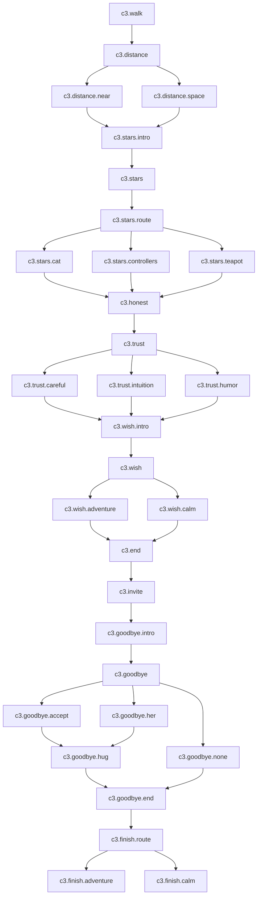

# Глава 3 · «Разговор под звёздами»

Сценарное зеркало редакции content27. [Исходник главы](../src/content/chapters/ch03.ts) · [Сценарное ядро](NARRATIVE_CORE.md).

Вход: `c3.walk`. Узлов: 31. Основных реплик: 102.

### `c3.walk` · dialogue

Фон: `bg.river.evening`; персонаж: `vlad.city.smile`.

1. **Описание:** Через несколько дней вы встречаетесь вечером на набережной. Над тёмной водой уже зажглись фонари, и их дорожки покачиваются на мелкой ряби.
2. **Описание:** Влад встречает тебя у парапета с двумя высокими стаканчиками кофе — ветер растрепал его кудри.
3. **Влад:** привет. сегодня я сверил прогноз в трёх местах. за небо и горячие стаканы ручаюсь лично.
4. **Ты:** Привет. Ты эти места у воды, кажется, знаешь наизусть?
5. **Влад:** ага. летом часто езжу здесь на велосипеде. за тем мостом обычно разворачиваюсь.
6. **Описание:** Он передаёт тебе более горячий стаканчик, придерживая его снизу, пока ты обхватываешь картон.
7. **Описание:** Вы идёте вдоль гранитной дорожки. С реки тянет вечерней прохладой; заметив, как ветер треплет полу твоего пальто, Влад без слов переходит со стороны воды, закрывая тебя от сквозняка.
8. **Описание:** Он легко подстраивается под твой шаг — не торопит, но ведёт уверенно.
9. **Влад:** вон там впереди тихая скамейка с отличным обзором на тот берег. присядем?
→ `c3.distance`

### `c3.distance` · choice

Фон: `bg.river.evening`; персонаж: `vlad.city.smile`.

Вопрос: Где тебе удобнее сесть?
- `near` — «Посижу рядом» → `c3.distance.near` · эффекты `[{"kind":"set","key":"bench","value":"near"}]`
- `space` — «Мне удобнее с этого края» → `c3.distance.space` · эффекты `[{"kind":"set","key":"bench","value":"space"}]`

### `c3.distance.near` · dialogue

Фон: `bg.river.evening`; персонаж: `vlad.city.smile`.

1. **Описание:** Ты садишься на скамейку совсем рядом с ним — так, что край твоего пальто ложится у его колена.
2. **Описание:** Влад на мгновение замирает, затем сдвигает свой стаканчик, освобождая место, и поворачивается к тебе вполоборота.
3. **Влад:** вот так гораздо лучше. и реку видно, и чай торопить некуда.
4. **Ты:** Тогда никуда отсюда пока и не пойдём.
5. **Описание:** От речной прохлады спасает горячий картон в руках и то, как спокойно он сидит рядом, не заполняя паузу пустой болтовнёй.
→ `c3.stars.intro`

### `c3.distance.space` · dialogue

Фон: `bg.river.evening`; персонаж: `vlad.city.neutral`.

1. **Описание:** Ты садишься у резного чугунного подлокотника с краю скамейки. Влад спокойно убирает сумку к своим ногам и устраивается вполоборота к тебе, опираясь локтем о спинку.
2. **Влад:** отсюда, кстати, фонарь красивее всего в воде отражается.
3. **Ты:** Да, мне здесь очень удобно.
4. **Описание:** Даже на расстоянии вытянутой руки между вами нет скованности — сидеть так оказывается на удивление легко.
→ `c3.stars.intro`

### `c3.stars.intro` · dialogue

Фон: `bg.river.evening`; персонаж: `vlad.city.thinking`.

1. **Описание:** Над крышами на противоположном берегу проступают первые крупные звёзды. Влад поднимает голову, пару секунд вдумчиво смотрит в тёмное небо.
2. **Влад:** каждый раз, когда вижу такое чистое небо, вспоминаю «Интерстеллар». обожаю хорошие драмы, но этот фильм готов пересматривать бесконечно.
3. **Ты:** Из-за чёрных дыр и космической физики?
4. **Влад:** за физику и саундтрек Ханса Циммера я готов спорить часами, это святое. но на самом деле он цепляет другим: там за всем космосом и временем в центре остаётся простая человеческая связь и обещание вернуться.
   - Эмоция Влада: `smile`.
5. **Описание:** Чтобы ты увидела ту же линию, он чуть наклоняется в твою сторону:
   - Вариант при `bench = "near"`: Его рука вытянута над водой, и когда ты поворачиваешь голову, ваши взгляды встречаются на расстоянии полшага. Влад на секунду сбивается с мысли, коротко прокашливается и снова кивает на небо.
   - Вариант при `bench = "space"`: Он подаётся чуть вперёд вдоль спинки скамейки, показывая направление ладонью, и когда ты оборачиваешься, на секунду забывает, куда именно указывал.
6. **Влад:** в общем… там был ковш. но мы можем соединить их по-своему — на небе всё равно никто не проверяет названия.
7. **Описание:** Выбери кота, геймпад или чайник и соедини подсвеченные звёзды в ваш собственный рисунок.
→ `c3.stars`

### `c3.stars` · minigame

Фон: `bg.river.evening`; персонаж: `vlad.city.thinking`.

Мини-игра: `constellation`.
→ `c3.stars.route`

### `c3.stars.route` · route

- Если `constellation = "cat"` → `c3.stars.cat`
- Если `constellation = "controllers"` → `c3.stars.controllers`
- Иначе → `c3.stars.teapot`

### `c3.stars.cat` · dialogue

Фон: `bg.river.evening`; персонаж: `vlad.city.laugh`.

1. **Описание:** Между звёздами складывается узнаваемый силуэт с острыми ушками и загнутым хвостом. Вы называете созвездие «Пончик».
2. **Влад:** по-моему, Пончик бы оценил. особенно то, что даже на небе его главная задача — просто красиво сидеть.
3. **Ты:** И сверху присматривать за тем, где ты оставил свой зонтик.
4. **Влад:** с такой высоты у меня вообще не останется от тебя секретов.
5. **Описание:** Он качает головой и смотрит на тебя так открыто и весело, что ты невольно задерживаешь на нём взгляд.
→ `c3.honest`

### `c3.stars.controllers` · dialogue

Фон: `bg.river.evening`; персонаж: `vlad.city.laugh`.

1. **Описание:** Линии над крышами складываются в контур геймпада с кнопками, и у созвездия появляется имя — «Наша команда».
2. **Ты:** Ну вот. Теперь второй игрок официально закреплён даже на небе.
3. **Влад:** тогда земному второму игроку мне тем более нужно соответствовать.
4. **Описание:** Влад прячет озябшие руки в карманы пальто и пару секунд смотрит не вверх, а на тебя в отблесках воды.
→ `c3.honest`

### `c3.stars.teapot` · dialogue

Фон: `bg.river.evening`; персонаж: `vlad.city.smile`.

1. **Описание:** На ночном небе проступает пузатый чайник с носиком, наклонённым прямо к реке. Вы даёте ему имя «Ещё по чашке?».
2. **Влад:** вот это созвездие я теперь найду в любую погоду. самое нужное напоминание.
3. **Ты:** Напоминание вовремя делать паузу?
4. **Влад:** напоминание о том, с кем именно эти паузы хочется делать.
5. **Описание:** Сказав это, он чуть тушуется и переводит взгляд на свой стаканчик, но фраза успевает прозвучать удивительно просто и честно.
→ `c3.honest`

### `c3.honest` · dialogue

Фон: `bg.river.evening`; персонаж: `vlad.city.thinking`.

1. **Описание:** Кофе в стаканчиках постепенно остывает. Вдалеке по мосту шуршит редкая машина, у гранита мерно плещется вода.
2. **Описание:** Влад замолкает на несколько секунд, глядя на огни в реке.
3. **Ты:** У тебя сейчас такой вид, будто ты в голове сложную задачу на три хода вперёд решаешь.
   - Эмоция Влада: `smile`.
4. **Влад:** почти угадала. просто поймал себя на странной штуке.
   - Эмоция Влада: `smile`.
5. **Влад:** обычно на новых встречах я всё время думаю, о чём говорить дальше и не пора ли сворачиваться. долго раскачиваюсь с людьми.
   - Эмоция Влада: `neutral`.
6. **Влад:** а с тобой вообще не смотрю на часы — и днём уже пару раз ловил себя на том, что хочу скинуть тебе какую-нибудь ерунду.
7. **Описание:** Он крутит в пальцах остывший стаканчик и смотрит на тебя уже без обычной усмешки.
8. **Влад:** а у тебя как? быстро понимаешь, что человек свой, или долго присматриваешься?
   - Эмоция Влада: `thinking`.
→ `c3.trust`

### `c3.trust` · choice

Фон: `bg.river.evening`; персонаж: `vlad.city.thinking`.

Вопрос: Что ответишь о себе?
- `careful` — «Обычно долго присматриваюсь и не тороплюсь» → `c3.trust.careful` · эффекты `[{"kind":"set","key":"herTrust","value":"careful"}]`
- `intuition` — «Если человек свой, я чувствую это почти сразу» → `c3.trust.intuition` · эффекты `[{"kind":"set","key":"herTrust","value":"intuition"}]`
- `humor` — «Сначала шучу и держусь легко, пока внутри присматриваюсь» → `c3.trust.humor` · эффекты `[{"kind":"set","key":"herTrust","value":"humor"}]`

### `c3.trust.careful` · dialogue

Фон: `bg.river.evening`; персонаж: `vlad.city.smile`.

1. **Ты:** Если честно, я тоже не из тех, кто открывается сразу. Обычно держу дистанцию и смотрю по поступкам.
2. **Описание:** Влад кивает, не пытаясь сразу перевести это в комплимент себе.
3. **Влад:** справедливо. тогда и торопить тебя не буду — посмотрим, как дальше пойдёт.
4. **Описание:** Он запускает руку во внутренний карман пальто и достаёт небольшую находку.
→ `c3.wish.intro`

### `c3.trust.intuition` · dialogue

Фон: `bg.river.evening`; персонаж: `vlad.city.smile`.

1. **Ты:** Я полагаюсь на внутреннее чутьё. Если рядом с человеком не нужно играть роль — я чувствую это с первых минут.
2. **Влад:** смелый подход. завидую — я обычно куда дольше в голове всё перебираю.
3. **Влад:** рад, что у двери кафе оно тебя не заставило сразу развернуться.
   - Эмоция Влада: `smile`.
4. **Описание:** Он нащупывает что-то во внутреннем кармане пальто и достаёт на свет.
→ `c3.wish.intro`

### `c3.trust.humor` · dialogue

Фон: `bg.river.evening`; персонаж: `vlad.city.laugh`.

1. **Ты:** Я обычно сначала отшучиваюсь и держу лёгкую дистанцию, пока тихонько наблюдаю за человеком.
2. **Влад:** ага, значит, все мои падающие коробки с первой минуты проходили строгую скрытую проверку.
3. **Ты:** Пока держишься неплохо.
4. **Влад:** значит, не зря старался. кстати, раз уж мы про совпадения…
   - Эмоция Влада: `smile`.
5. **Описание:** Он достаёт что-то из внутреннего кармана пальто.
→ `c3.wish.intro`

### `c3.wish.intro` · dialogue

Фон: `bg.river.evening`; персонаж: `vlad.city.thinking`.

1. **Описание:** На его ладони лежат два гладких деревянных жетона из той самой первой коробки и тонкая ручка. Один жетон с двумя точками тебе уже знаком, а второй — чистый.
2. **Влад:** я вчера разбирал коробку и нашёл два запасных пустых жетона. подумал — давай оставим на обороте по паре слов от сегодняшнего вечера?
3. **Описание:** Он прикрывает свой жетон ладонью, склонившись к колену, и быстро выводит на дереве короткую строчку.
4. **Описание:** Потом протягивает чистый жетон и ручку тебе. Когда ты поднимаешь глаза, обдумывая слова, то ловишь Влада на том, что он смотрит не на реку, а на тебя.
5. **Ты:** Подглядываешь?
6. **Влад:** нет. просто… нравится, как серьёзно ты подходишь к секретным документам. пиши, чего тебе самой хочется побольше.
   - Эмоция Влада: `awkward`.
→ `c3.wish`

### `c3.wish` · choice

Фон: `bg.river.evening`; персонаж: `vlad.city.thinking`.

Вопрос: Чего хочется побольше?
- `adventure` — «Больше маленьких приключений» → `c3.wish.adventure` · эффекты `[{"kind":"set","key":"wish","value":"adventure"}]`
- `calm` — «Больше спокойных вечеров» → `c3.wish.calm` · эффекты `[{"kind":"set","key":"wish","value":"calm"}]`

### `c3.wish.adventure` · dialogue

Фон: `bg.river.evening`; персонаж: `vlad.city.smile`.

1. **Описание:** Ты выводишь на светлом дереве: «Больше маленьких приключений» — таких, где не нужно спасать мир, а достаточно свернуть на новую улицу вдвоём.
2. **Влад:** маленькие приключения — это моя специальность. особенно те, которые начинаются с забытого зонтика или рассыпанной коробки.
3. **Ты:** Главное, чтобы после них оставалось время на чай у воды.
4. **Влад:** это гарантирую.
→ `c3.end`

### `c3.wish.calm` · dialogue

Фон: `bg.river.evening`; персонаж: `vlad.city.smile`.

1. **Описание:** Ты пишешь на чистой стороне: «Больше спокойных вечеров» — таких, как этот, где можно просто сидеть у реки и никуда не торопиться.
2. **Влад:** подпишусь под каждым словом. без спешки и лишнего шума.
3. **Ты:** Только фонари, река и горячий чай.
4. **Влад:** и правильный человек на соседней половине скамейки.
→ `c3.end`

### `c3.end` · dialogue

Фон: `bg.river.evening`; персонаж: `vlad.city.smile`.

1. **Описание:** Влад достаёт крафтовый конверт и укладывает туда оба жетона, а ты рисуешь на уголке маленький значок вашего созвездия.
2. **Ты:** А что ты написал на своём? Покажешь?
3. **Влад:** покажу. давай откроем конверт, когда снова сядем за наш столик в «Паузе».
4. **Описание:** Влад аккуратно запечатывает клапан конверта, будто прячет туда маленькое вещественное доказательство этого вечера.
5. **Описание:** Вы нехотя поднимаетесь со скамейки и идёте к выходу с набережной. Влад выбрасывает пустые стаканчики у лестницы, и с каждым шагом к перекрёстку вы оба замедляетесь.
6. **Описание:** У последнего фонаря перед улицей Влад останавливается и поворачивается к тебе.
→ `c3.invite`

### `c3.invite` · dialogue

Фон: `bg.river.evening`; персонаж: `vlad.city.smile`.

1. **Влад:** слушай… зайдёшь ко мне на днях вечером? устроим игровой вечер — у меня дома есть смешная игра на двоих про двух поваров на крошечной кухне.
   - Вариант при `eveningMood = "playful"`: слушай… зайдёшь ко мне на днях вечером? устроим игровой вечер — покажу ту самую игру с двумя поварами, про которую рассказывал под дождём.
2. **Ты:** Зайду. Только чур правила объясняешь по ходу дела.
3. **Влад:** договорились. с меня пицца или вкусняшки, которые точно не сгорят.
→ `c3.goodbye.intro`

### `c3.goodbye.intro` · dialogue

Фон: `bg.river.evening`; персонаж: `vlad.city.awkward`.

1. **Описание:** Он убирает конверт во внутренний карман пальто, делает полшага, будто собирается привычно помахать на прощание, — но останавливается.
2. **Описание:** В свете фонаря видно, что он немного волнуется: запускает руку в кудри на затылке, делает короткий вдох и смотрит прямо на тебя.
3. **Влад:** слушай… а обнять тебя напоследок можно?
→ `c3.goodbye`

### `c3.goodbye` · choice

Фон: `bg.river.evening`; персонаж: `vlad.city.awkward`.

Вопрос: Как попрощаемся?
- `accept` — «Можно. Иди сюда» → `c3.goodbye.accept` · эффекты `[{"kind":"set","key":"c4Goodbye","value":"accept"}]`
- `her` — «Я сама» → `c3.goodbye.her` · эффекты `[{"kind":"set","key":"c4Goodbye","value":"her"}]`
- `none` — «Давай сегодня без объятий. До встречи» → `c3.goodbye.none` · эффекты `[{"kind":"set","key":"c4Goodbye","value":"none"}]`

### `c3.goodbye.accept` · dialogue

Фон: `bg.river.evening`; персонаж: `vlad.city.warm`.

1. **Ты:** Можно. Иди сюда.
2. **Описание:** Влад делает шаг навстречу и крепко, аккуратно обнимает тебя. От его пальто пахнет речным воздухом и кофе, а под прохладной шерстью сразу чувствуется живое тепло.
3. **Описание:** Его ладонь ложится тебе на спину, и ты слышишь, как у твоего виска он тихо и с облегчением выдыхает.
→ `c3.goodbye.hug`

### `c3.goodbye.her` · dialogue

Фон: `bg.river.evening`; персонаж: `vlad.city.warm`.

1. **Ты:** Я сама.
2. **Описание:** Не давая ему засомневаться, ты первой делаешь шаг и обнимаешь его.
3. **Описание:** На долю секунды Влад замирает от неожиданности, а в следующее мгновение его руки смыкаются у тебя на спине — спокойно и надёжно.
4. **Влад:** вот это… мне нравится ещё больше.
→ `c3.goodbye.hug`

### `c3.goodbye.hug` · dialogue

Фон: `bg.river.evening`; персонаж: `vlad.city.warm`.

1. **Описание:** Вы не разжимаете рук сразу — стоите несколько спокойных секунд под фонарём, пока мимо по тротуару проходят редкие прохожие.
2. **Описание:** Когда вы отстраняетесь, голос у Влада звучит чуть тише обычного:
3. **Влад:** до встречи?
4. **Ты:** До встречи, Влад.
→ `c3.goodbye.end`

### `c3.goodbye.none` · dialogue

Фон: `bg.river.evening`; персонаж: `vlad.city.smile`.

1. **Ты:** Давай сегодня без объятий. До встречи.
2. **Влад:** конечно. без проблем. спасибо тебе за этот вечер.
3. **Описание:** В его лице нет ни тени обиды — всё та же лёгкость, с которой вы сидели у воды. Он машет рукой на прощание, и ты отвечаешь ему тем же.
→ `c3.goodbye.end`

### `c3.goodbye.end` · dialogue

Фон: `bg.river.evening`; персонаж: `vlad.city.smile`.

1. **Описание:** На перекрёстке у спуска с набережной вы расходитесь каждый в свою сторону. Ветер приносит с реки прохладу и далёкий гудок теплохода.
2. **Описание:** Ты идёшь к дому, улыбаясь про себя — следующей встречи уже ждёшь без всяких «случайностей».
→ `c3.finish.route`

### `c3.finish.route` · route

- Если `wish = "adventure"` → `c3.finish.adventure`
- Иначе → `c3.finish.calm`

### `c3.finish.adventure` · end

Открытка: `c4.adventure`; endingId: `c4.adventure`.

### `c3.finish.calm` · end

Открытка: `c4.calm`; endingId: `c4.calm`.
