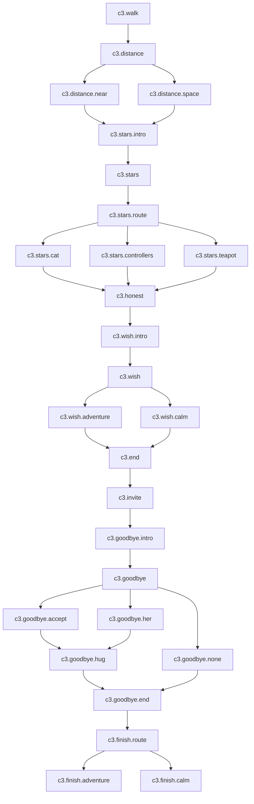

# Глава 3 · «Разговор под звёздами»

Актуальный runtime content23 · 19 ноября 2026. Источник авторского текста: [SEASON_01_02_POLISH_SPEC_2026_11_19.md](SEASON_01_02_POLISH_SPEC_2026_11_19.md). Сценарное ядро: [NARRATIVE_CORE.md](NARRATIVE_CORE.md).

Вход: `c3.walk`. Узлов: 27. Основных реплик: 91.

### `c3.walk` · dialogue

Фон: `bg.river.evening`; персонаж: `vlad.city.smile`.

1. **Описание:** На следующий вечер вы встречаетесь на набережной. Над тёмной водой уже зажглись фонари, и их дорожки покачиваются на мелкой ряби.
2. **Описание:** Влад ждёт у парапета с двумя высокими стаканчиками чая. Увидев тебя, он сразу выпрямляется — ветер растрепал ему кудри, но вид у него самый довольный.
3. **Влад:** привет. сегодня я проверил прогноз в трёх разных местах. за погоду и чай отвечаю лично.
4. **Ты:** Привет. А за реку и звёзды кто отвечает?
5. **Влад:** с ними пришлось договариваться отдельно. сказал, что ты придёшь — согласились без споров.
6. **Описание:** Он протягивает тебе более горячий стаканчик, придерживая его снизу, пока ты обхватываешь картон.
7. **Описание:** Вы неспешно идёте вдоль гранитной дорожки. С воды тянет прохладой; заметив, как ветер треплет полу твоего пальто, Влад без слов переходит со стороны реки, заслоняя тебя от сквозняка.
8. **Описание:** Ты делаешь глоток и ловишь себя на том, как легко он подстраивается под твой шаг — никуда не тянет и не отстаёт.
9. **Влад:** вон там впереди тихая скамейка с хорошим видом на тот берег. присядем?
→ `c3.distance`

### `c3.distance` · choice

Фон: `bg.river.evening`; персонаж: `vlad.city.smile`.

Вопрос: Где тебе удобнее сесть?
- `near` — «Посижу рядом» → `c3.distance.near` · эффекты `[{"kind":"set","key":"bench","value":"near"}]`
- `space` — «Мне удобнее с этого края» → `c3.distance.space` · эффекты `[{"kind":"set","key":"bench","value":"space"}]`

### `c3.distance.near` · dialogue

Фон: `bg.river.evening`; персонаж: `vlad.city.smile`.

1. **Описание:** Ты садишься на скамейку совсем рядом с ним — так, что край твоего пальто ложится у его колена.
2. **Описание:** Влад на мгновение замирает, затем сдвигает свой стаканчик, освобождая место, и поворачивается к тебе вполоборота.
3. **Влад:** вот так гораздо лучше. и реку видно, и чай торопить некуда.
4. **Ты:** Тогда никуда отсюда пока и не пойдём.
5. **Описание:** От речной прохлады спасает горячий картон в руках и то, как спокойно он сидит рядом, не заполняя паузу пустой болтовнёй.
→ `c3.stars.intro`

### `c3.distance.space` · dialogue

Фон: `bg.river.evening`; персонаж: `vlad.city.neutral`.

1. **Описание:** Ты садишься у резного чугунного подлокотника с краю скамейки. Влад спокойно убирает сумку к своим ногам и устраивается вполоборота к тебе, опираясь локтем о спинку.
2. **Влад:** отсюда, кстати, фонарь красивее всего в воде отражается.
3. **Ты:** Да, мне здесь очень удобно.
4. **Описание:** Даже на расстоянии вытянутой руки между вами нет ни капли скованности — наоборот, чувствуется, что он искренне уважает твой комфорт.
→ `c3.stars.intro`

### `c3.stars.intro` · dialogue

Фон: `bg.river.evening`; персонаж: `vlad.city.thinking`.

1. **Описание:** Над тёмными крышами на противоположном берегу проступают первые крупные звёзды. Влад поднимает голову и чуть прищуривается.
2. **Влад:** смотри, сейчас покажу созвездие. …правда, из настоящих я уверенно нахожу только ковш, но показываю очень убедительно.
3. **Ты:** У тебя и к звёздам приложена инструкция?
4. **Описание:** Влад тихо смеётся и поднимает руку, указывая на россыпь ярких точек над мостом.
5. **Описание:** Чтобы ты увидела ту же линию, он чуть наклоняется в твою сторону:
   - Вариант при `bench = "near"`: Его рука вытянута над водой, и когда ты поворачиваешь голову, ваши взгляды встречаются на расстоянии полшага. Влад на секунду сбивается с мысли, коротко прокашливается и снова кивает на небо.
   - Вариант при `bench = "space"`: Он подаётся чуть вперёд вдоль спинки скамейки, показывая направление ладонью, и когда ты оборачиваешься, на секунду забывает, куда именно указывал.
6. **Влад:** в общем… там был ковш. но мы можем соединить их по-своему — на небе всё равно никто не проверяет названия.
7. **Описание:** Выбери кота, геймпад или чайник и соедини подсвеченные звёзды в ваш собственный рисунок.
→ `c3.stars`

### `c3.stars` · minigame

Фон: `bg.river.evening`; персонаж: `vlad.city.thinking`.

Мини-игра: `constellation`.
→ `c3.stars.route`

### `c3.stars.route` · route

- При `constellation = "cat"` → `c3.stars.cat`
- При `constellation = "controllers"` → `c3.stars.controllers`
- Иначе → `c3.stars.teapot`

### `c3.stars.cat` · dialogue

Фон: `bg.river.evening`; персонаж: `vlad.city.laugh`.

1. **Описание:** Между звёздами складывается узнаваемый силуэт с острыми ушками и загнутым хвостом. Вы называете созвездие «Пончик».
2. **Влад:** по-моему, Пончик бы оценил. особенно то, что даже на небе его главная задача — просто красиво сидеть.
3. **Ты:** И сверху присматривать за тем, где ты оставил свой зонтик.
4. **Влад:** с такой высоты у меня вообще не останется от тебя секретов.
5. **Описание:** Он качает головой и смотрит на тебя так открыто и весело, что ты невольно задерживаешь на нём взгляд.
→ `c3.honest`

### `c3.stars.controllers` · dialogue

Фон: `bg.river.evening`; персонаж: `vlad.city.laugh`.

1. **Описание:** Линии над крышами складываются в контур геймпада с кнопками, и у созвездия появляется имя — «Наша команда».
2. **Ты:** Ну вот. Теперь второй игрок официально закреплён даже на небе.
3. **Влад:** тогда земному второму игроку мне тем более нужно соответствовать.
4. **Описание:** Влад прячет озябшие руки в карманы пальто и пару секунд смотрит не вверх, а на тебя в отблесках воды.
→ `c3.honest`

### `c3.stars.teapot` · dialogue

Фон: `bg.river.evening`; персонаж: `vlad.city.smile`.

1. **Описание:** На ночном небе проступает пузатый чайник с носиком, наклонённым прямо к реке. Вы даёте ему имя «Ещё по чашке?».
2. **Влад:** вот это созвездие я теперь найду в любую погоду. самое нужное напоминание.
3. **Ты:** Напоминание вовремя делать паузу?
4. **Влад:** напоминание о том, с кем именно эти паузы хочется делать.
5. **Описание:** Сказав это, он чуть тушуется и переводит взгляд на свой стаканчик, но фраза успевает прозвучать удивительно просто и честно.
→ `c3.honest`

### `c3.honest` · dialogue

Фон: `bg.river.evening`; персонаж: `vlad.city.smile`.

1. **Описание:** Чай в стаканчиках постепенно остывает. Вдалеке по мосту шуршит редкая машина, у парапета мерно плещется вода.
2. **Описание:** Некоторое время вы молчите, глядя на огни в реке. Потом Влад поворачивается к тебе — уже без шуток:
3. **Влад:** знаешь… я сегодня за день раз десять поймал себя на одной мысли: вижу что-то смешное или просто смотрю в окно и сразу думаю — надо вечером рассказать это тебе.
4. **Описание:** В этой фразе нет ни грамма рисовки — просто честно сказанное вслух, и от этого внутри становится особенно тихо и хорошо.
5. **Ты:** И как, всё успел рассказать?
6. **Влад:** даже половины не успел. рядом с тобой время почему-то летит раза в три быстрее, чем за работой.
7. **Влад:** я сегодня вообще ничего специально не выдумывал — и всё равно мне ужасно не хочется, чтобы этот вечер заканчивался.
8. **Ты:** Так не заканчивай его прямо сейчас.
9. **Влад:** не буду. сидеть здесь с тобой — мой любимый пункт в расписании.
10. **Описание:** Он на секунду задумывается, нащупывает что-то во внутреннем кармане пальто и достаёт на свет.
→ `c3.wish.intro`

### `c3.wish.intro` · dialogue

Фон: `bg.river.evening`; персонаж: `vlad.city.thinking`.

1. **Описание:** На его ладони лежат два гладких деревянных жетона из той самой первой коробки и тонкая ручка. Один жетон с двумя точками тебе уже знаком, а второй — чистый.
2. **Влад:** я вчера разбирал коробку и нашёл два запасных пустых жетона. подумал — давай оставим на обороте по паре слов от сегодняшнего вечера?
3. **Описание:** Он прикрывает свой жетон ладонью, склонившись к колену, и быстро выводит на дереве короткую строчку.
4. **Описание:** Потом протягивает чистый жетон и ручку тебе. Когда ты поднимаешь глаза, обдумывая слова, то ловишь Влада на том, что он смотрит не на реку, а на тебя.
5. **Ты:** Подглядываешь?
6. **Влад:** нет. просто… нравится, как серьёзно ты подходишь к секретным документам. пиши, чего тебе самой хочется побольше.
   - Выражение: `awkward`.
→ `c3.wish`

### `c3.wish` · choice

Фон: `bg.river.evening`; персонаж: `vlad.city.thinking`.

Вопрос: Чего хочется побольше?
- `adventure` — «Больше маленьких приключений» → `c3.wish.adventure` · эффекты `[{"kind":"set","key":"wish","value":"adventure"}]`
- `calm` — «Больше спокойных вечеров» → `c3.wish.calm` · эффекты `[{"kind":"set","key":"wish","value":"calm"}]`

### `c3.wish.adventure` · dialogue

Фон: `bg.river.evening`; персонаж: `vlad.city.smile`.

1. **Описание:** Ты выводишь на светлом дереве: «Больше маленьких приключений» — таких, где не нужно спасать мир, а достаточно свернуть на новую улицу вдвоём.
2. **Влад:** маленькие приключения — это моя специальность. особенно те, которые начинаются с забытого зонтика или рассыпанной коробки.
3. **Ты:** Главное, чтобы после них оставалось время на чай у воды.
4. **Влад:** это гарантирую.
→ `c3.end`

### `c3.wish.calm` · dialogue

Фон: `bg.river.evening`; персонаж: `vlad.city.smile`.

1. **Описание:** Ты пишешь на чистой стороне: «Больше спокойных вечеров» — таких, как этот, где можно просто сидеть у реки и никуда не торопиться.
2. **Влад:** подпишусь под каждым словом. без спешки и лишнего шума.
3. **Ты:** Только фонари, река и горячий чай.
4. **Влад:** и правильный человек на соседней половине скамейки.
→ `c3.end`

### `c3.end` · dialogue

Фон: `bg.river.evening`; персонаж: `vlad.city.smile`.

1. **Описание:** Влад достаёт крафтовый конверт и укладывает туда оба жетона, а ты рисуешь на уголке маленький значок вашего созвездия.
2. **Ты:** А что ты написал на своём? Покажешь?
3. **Влад:** покажу обязательно. только чуть позже — на нашей пятой встрече, ладно? пусть будет повод открыть конверт снова.
4. **Описание:** Ваши пальцы на секунду касаются на краю конверта.
5. **Описание:** Вы нехотя поднимаетесь со скамейки и идёте к выходу с набережной. Влад выбрасывает пустые стаканчики у лестницы, и с каждым шагом к перекрёстку вы оба замедляетесь.
6. **Описание:** У последнего фонаря перед улицей Влад останавливается и поворачивается к тебе.
→ `c3.invite`

### `c3.invite` · dialogue

Фон: `bg.river.evening`; персонаж: `vlad.city.smile`.

1. **Влад:** слушай… приходи ко мне завтра вечером в гости? устроим игровой вечер — у меня дома есть отличная игра на двоих про двух поваров на крошечной кухне.
   - Вариант при `eveningMood = "playful"`: слушай… приходи ко мне завтра вечером в гости? устроим тот самый игровой вечер, покажу тебе игру с двумя поварами, про которую рассказывал под дождём.
2. **Ты:** Приду. Только чур правила объясняешь по ходу дела.
3. **Влад:** договорились. с меня горячий чай, плед и вкусняшки, которые точно не сгорят.
→ `c3.goodbye.intro`

### `c3.goodbye.intro` · dialogue

Фон: `bg.river.evening`; персонаж: `vlad.city.awkward`.

1. **Описание:** Он убирает конверт во внутренний карман пальто, делает полшага, будто собирается привычно помахать на прощание, — но останавливается.
2. **Описание:** В свете фонаря видно, что он немного волнуется: запускает руку в кудри на затылке, делает короткий вдох и смотрит прямо на тебя.
3. **Влад:** слушай… а обнять тебя напоследок можно?
→ `c3.goodbye`

### `c3.goodbye` · choice

Фон: `bg.river.evening`; персонаж: `vlad.city.awkward`.

Вопрос: Как попрощаемся?
- `accept` — «Можно. Иди сюда» → `c3.goodbye.accept` · эффекты `[{"kind":"set","key":"c4Goodbye","value":"accept"}]`
- `her` — «Я сама» → `c3.goodbye.her` · эффекты `[{"kind":"set","key":"c4Goodbye","value":"her"}]`
- `none` — «Давай сегодня без объятий. До завтра» → `c3.goodbye.none` · эффекты `[{"kind":"set","key":"c4Goodbye","value":"none"}]`

### `c3.goodbye.accept` · dialogue

Фон: `bg.river.evening`; персонаж: `vlad.city.warm`.

1. **Ты:** Можно. Иди сюда.
2. **Описание:** Влад делает шаг навстречу и крепко, аккуратно обнимает тебя. От его пальто пахнет речным воздухом и кофе, а под прохладной шерстью сразу чувствуется живое тепло.
3. **Описание:** Его ладонь ложится тебе на спину, и ты слышишь, как у твоего виска он тихо и с облегчением выдыхает.
→ `c3.goodbye.hug`

### `c3.goodbye.her` · dialogue

Фон: `bg.river.evening`; персонаж: `vlad.city.warm`.

1. **Ты:** Я сама.
2. **Описание:** Не давая ему засомневаться, ты первой делаешь шаг и обнимаешь его.
3. **Описание:** На долю секунды Влад замирает от неожиданности, а в следующее мгновение его руки смыкаются у тебя на спине — спокойно и надёжно.
4. **Влад:** вот это… мне нравится ещё больше.
→ `c3.goodbye.hug`

### `c3.goodbye.hug` · dialogue

Фон: `bg.river.evening`; персонаж: `vlad.city.warm`.

1. **Описание:** Вы не разжимаете рук сразу — стоите несколько спокойных секунд под фонарём, пока мимо по тротуару проходят редкие прохожие.
2. **Описание:** Когда вы отстраняетесь, голос у Влада звучит чуть тише обычного:
3. **Влад:** до завтра?
4. **Ты:** До завтра, Влад.
→ `c3.goodbye.end`

### `c3.goodbye.none` · dialogue

Фон: `bg.river.evening`; персонаж: `vlad.city.smile`.

1. **Ты:** Давай сегодня без объятий. До завтра.
2. **Влад:** конечно. без проблем. спасибо тебе за этот вечер.
3. **Описание:** В его лице нет ни тени обиды — всё та же спокойная лёгкость, с которой вы сидели у воды. Он машет рукой на прощание, и ты отвечаешь ему тем же.
→ `c3.goodbye.end`

### `c3.goodbye.end` · dialogue

Фон: `bg.river.evening`; персонаж: `vlad.city.smile`.

1. **Описание:** Вы расходитесь у выхода с набережной. Отойдя на несколько шагов к переходу, ты не удерживаешься и оборачиваешься.
2. **Описание:** Влад обернулся ровно в ту же секунду — пойманный на горячем, он широко усмехается под светом фонаря и поднимает руку, прежде чем свернуть на свою улицу.
→ `c3.finish.route`

### `c3.finish.route` · route

- При `wish = "adventure"` → `c3.finish.adventure`
- Иначе → `c3.finish.calm`

### `c3.finish.adventure` · end

Открытка: `c4.adventure`; endingId: `c4.adventure`.

### `c3.finish.calm` · end

Открытка: `c4.calm`; endingId: `c4.calm`.
