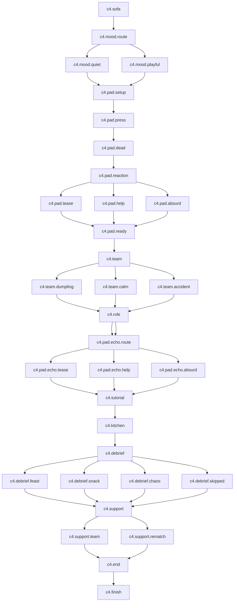

# Глава 4 · «Игровой вечер»

Актуальный runtime content23 · 19 ноября 2026. Источник авторского текста: [SEASON_01_02_POLISH_SPEC_2026_11_19.md](SEASON_01_02_POLISH_SPEC_2026_11_19.md). Сценарное ядро: [NARRATIVE_CORE.md](NARRATIVE_CORE.md).

Вход: `c4.sofa`. Узлов: 33. Основных реплик: 98.

### `c4.sofa` · dialogue

Фон: `bg.home.living`; персонаж: `vlad.casual.smile`.

1. **Описание:** Вечером следующего дня ты поднимаешься к квартире Влада. Из открытой двери сразу пахнет свежезаваренным чаем и домашним уютом.
2. **Описание:** Влад встречает тебя в домашней футболке, чуть взъерошенный, и помогает снять пальто в прихожей.
3. **Влад:** привет. проходи, я тут всё подготовил. честно признаюсь, три раза переставлял подушки на диване, пока тебя ждал.
4. **Описание:** В комнате приглушён свет, горит торшер у дивана, а на книжной полке на самом видном месте стоит та самая коробка с двумя путешественниками из первой встречи.
5. **Описание:** По всему этому порядку до мелочей сразу видно, как серьёзно он отнёсся к твоему приходу.
6. **Влад:** располагайся где удобнее. чайник только вскипел, печенье на столике, плед тоже в твоём распоряжении.
7. **Ты:** У пледа сегодня нет других планов на вечер?
8. **Влад:** сказал, что никуда не уйдёт, пока ты не согреешься с улицы.
→ `c4.mood.route`

### `c4.mood.route` · route

- При `eveningMood = "quiet"` → `c4.mood.quiet`
- Иначе → `c4.mood.playful`

### `c4.mood.quiet` · dialogue

Фон: `bg.home.living`; персонаж: `vlad.casual.smile`.

1. **Описание:** Влад убавляет звук телевизора почти до шёпота. За окном в тёмном дворе качаются ветви деревьев, а в комнате тихо и спокойно.
2. **Влад:** можем вообще никуда не спешить. сначала попьём чаю, а уже потом решим судьбу виртуального ресторана.
3. **Ты:** Мне нравится, когда ужин умеет подождать.
4. **Влад:** особенно когда компания важнее любого расписания.
→ `c4.pad.setup`

### `c4.mood.playful` · dialogue

Фон: `bg.home.living`; персонаж: `vlad.casual.laugh`.

1. **Влад:** ну что, ты тогда под дождём хотела посмотреть на эту кулинарную игру. сразу предупреждаю: шеф-повара из нас получатся сомнительные.
2. **Ты:** Главное, чтобы настоящий чай и печенье не зависели от наших игровых талантов.
3. **Влад:** о настоящей еде я позаботился заранее — открыл коробки и разложил по мискам. это мой самый надёжный рецепт, без риска спалить кухню.
→ `c4.pad.setup`

### `c4.pad.setup` · dialogue

Фон: `bg.home.living`; персонаж: `vlad.casual.smile`.

1. **Описание:** На экране светится мультяшная кухня. На столике дымятся две чашки, а на правый геймпад наклеен маленький бумажный стикер с нарисованным от руки вашим вчерашним созвездием.
2. **Ты:** Подожди… это наше созвездие с набережной?
3. **Влад:** ага. нарисовал перед твоим приходом. чтобы второй игрок сразу видел, какой геймпад здесь его по праву.
   - Выражение: `awkward`.
4. **Описание:** Он садится на диван рядом и с лёгкой гордостью кивает на экран:
5. **Влад:** такс, всё на месте, игру запустил, два геймпада наготове. в этот раз я предусмотрел вообще всё.
→ `c4.pad.press`

### `c4.pad.press` · choice

Фон: `bg.home.living`; персонаж: `vlad.casual.smile`.

Вопрос: Проверим второго игрока
- `press` — «Нажать кнопку второго геймпада» → `c4.pad.dead`

### `c4.pad.dead` · dialogue

Фон: `bg.home.living`; персонаж: `vlad.casual.awkward`.

1. **Описание:** Ты берёшь геймпад со стикером-созвездием и нажимаешь центральную кнопку. У Влада послушно загорается белый огонёк, а твой остаётся тёмным.
2. **Влад:** так.
3. **Влад:** беру свои слова обратно. кажется, я подготовил ровно полтора геймпада.
4. **Описание:** Он смотрит на погасший индикатор с таким комичным отчаянием, что сдержать смех невозможно.
→ `c4.pad.reaction`

### `c4.pad.reaction` · choice

Фон: `bg.home.living`; персонаж: `vlad.casual.awkward`.

Вопрос: Как отреагируешь?
- `tease` — «Вторую половину вечера тоже потом подготовишь?» → `c4.pad.tease` · эффекты `[{"kind":"set","key":"controllerReaction","value":"tease"}]`
- `help` — «Запасные батарейки есть? Давай поменяем» → `c4.pad.help` · эффекты `[{"kind":"set","key":"controllerReaction","value":"help"}]`
- `absurd` — «Посадим его на скамейку запасных. Пусть подумает» → `c4.pad.absurd` · эффекты `[{"kind":"set","key":"controllerReaction","value":"absurd"}]`

### `c4.pad.tease` · dialogue

Фон: `bg.home.living`; персонаж: `vlad.casual.awkward`.

1. **Влад:** вторую половину вечера я оставил на живую импровизацию. со мной она работает надёжнее техники.
2. **Ты:** Очень удобное оправдание, Влад.
3. **Влад:** ладно, раскусила. я так ждал звонка в дверь, что забыл проверить заряд. батарейки в тумбочке, одна секунда.
4. **Описание:** Он достаёт свежую пару батареек и быстро меняет их прямо на диване, время от времени поглядывая на тебя с виноватой усмешкой.
→ `c4.pad.ready`

### `c4.pad.help` · dialogue

Фон: `bg.home.living`; персонаж: `vlad.casual.smile`.

1. **Влад:** есть, в верхнем ящике у торшера. сейчас достану.
2. **Описание:** Влад протягивает две новые батарейки. Ты вставляешь их в отсек, а он придерживает пластиковую крышку, помогая её защёлкнуть.
3. **Описание:** Ваши пальцы на секунду сталкиваются на корпусе геймпада — Влад коротко хмыкает и возвращает джойстик тебе.
4. **Ты:** Готово. Проверяем?
5. **Влад:** спасибо. у нас с тобой даже замена батареек превращается в командную работу.
→ `c4.pad.ready`

### `c4.pad.absurd` · dialogue

Фон: `bg.home.living`; персонаж: `vlad.casual.laugh`.

1. **Описание:** Ты с серьёзным видом откладываешь провинившийся геймпад на дальний край диванной подушки.
2. **Влад:** суровый подход. мне тоже стоит бояться попасть на скамейку запасных, если уроню чашку?
3. **Ты:** У тебя иммунитет хозяина квартиры. Но батарейки ему всё-таки принеси.
4. **Описание:** Влад со смехом достаёт из ящика новую пару, возвращает геймпад к жизни и вкладывает его обратно в твои руки.
→ `c4.pad.ready`

### `c4.pad.ready` · dialogue

Фон: `bg.home.living`; персонаж: `vlad.casual.smile`.

1. **Описание:** Белый индикатор рядом со стикером созвездия загорается, и на экране бок о бок появляются два маленьких повара.
2. **Влад:** ура. комплект полный, оба игрока в строю. осталось дать имя нашей кулинарной бригаде.
→ `c4.team`

### `c4.team` · choice

Фон: `bg.home.living`; персонаж: `vlad.casual.smile`.

Вопрос: Как назовём команду?
- `dumpling` — «Пельмень и партнёры» → `c4.team.dumpling` · эффекты `[{"kind":"set","key":"teamName","value":"dumpling"}]`
- `calm` — «Два спокойных человека» → `c4.team.calm` · эффекты `[{"kind":"set","key":"teamName","value":"calm"}]`
- `accident` — «Отдел случайных побед» → `c4.team.accident` · эффекты `[{"kind":"set","key":"teamName","value":"accident"}]`

### `c4.team.dumpling` · dialogue

Фон: `bg.home.living`; персонаж: `vlad.casual.laugh`.

1. **Влад:** роль пельменя скромно беру на себя. а партнёрам по уставу полагается горячий чай и лучшее место на диване.
2. **Ты:** Мне нравятся такие условия труда.
3. **Влад:** перерыв на чай и разговоры — по первому требованию.
→ `c4.role`

### `c4.team.calm` · dialogue

Фон: `bg.home.living`; персонаж: `vlad.casual.smile`.

1. **Влад:** идеальное название. сразу снимает обязательство куда-то суетиться и бежать.
2. **Ты:** Мы просто сохраняем достоинство на кухне.
3. **Влад:** и уют на диване. придвигайся чуть ближе, чтобы экран было видно под одним углом.
→ `c4.role`

### `c4.team.accident` · dialogue

Фон: `bg.home.living`; персонаж: `vlad.casual.laugh`.

1. **Влад:** о, у всех наших совпадений с первой встречи наконец-то появилось собственное название.
2. **Ты:** Причём самая главная случайная победа была ещё у двери кафе.
3. **Влад:** с этим согласен на все сто.
4. **Описание:** Влад качает головой и подтверждает название на экране — кажется, оно действительно попало в точку.
→ `c4.role`

### `c4.role` · choice

Фон: `bg.home.living`; персонаж: `vlad.casual.smile`.

Вопрос: Как будем готовить?
- `planner` — «Давай распределим работу» → `c4.pad.echo.route` · эффекты `[{"kind":"set","key":"kitchenStyle","value":"planner"}]`
- `improv` — «Будем меняться и импровизировать» → `c4.pad.echo.route` · эффекты `[{"kind":"set","key":"kitchenStyle","value":"improv"}]`

### `c4.pad.echo.route` · route

- При `controllerReaction = "tease"` → `c4.pad.echo.tease`
- При `controllerReaction = "help"` → `c4.pad.echo.help`
- Иначе → `c4.pad.echo.absurd`

### `c4.pad.echo.tease` · dialogue

Фон: `bg.home.living`; персонаж: `vlad.casual.smile`.

1. **Описание:** Влад ещё раз шутливо проверяет огонёк на твоём геймпаде и удобнее устраивается на подушках.
2. **Влад:** техника больше не подведёт. выбирай наш первый заказ.
→ `c4.tutorial`

### `c4.pad.echo.help` · dialogue

Фон: `bg.home.living`; персонаж: `vlad.casual.smile`.

1. **Описание:** Он убирает упаковку от батареек со столика и пододвигает твою чашку чая поближе к краю.
2. **Влад:** ты спасла мой геймпад, а я слежу, чтобы у тебя не остыл чай. честный обмен.
→ `c4.tutorial`

### `c4.pad.echo.absurd` · dialogue

Фон: `bg.home.living`; персонаж: `vlad.casual.laugh`.

1. **Описание:** Ты освобождаешь на столике маленькое блюдце для «штрафников», а Влад с серьёзным видом кладёт туда пульт от телевизора.
2. **Влад:** пульт наказан до конца вечера, а мы переходим к практике.
→ `c4.tutorial`

### `c4.tutorial` · dialogue

Фон: `bg.home.living`; персонаж: `vlad.casual.smile`.

1. **Описание:** На экране крошечная кухня: один повар в высоком колпаке — твой, а второй, в полосатом фартуке, — Влада.
2. **Влад:** смотри: ты берёшь заказ и кладёшь на стойку первый ингредиент, потом передаёшь эстафету мне, я добавляю второй — и подаём.
3. **Описание:** Он наклоняется чуть ближе, показывая нужную кнопку на твоём геймпаде, и сразу откидывается обратно на спинку дивана.
4. **Ты:** То есть главное — не съесть настоящие печеньки раньше, чем мы подадим виртуальные?
5. **Влад:** вот тут я за себя не ручаюсь. поехали!
6. **Описание:** Сначала два пробных заказа без таймера, затем можно выбрать быстрый режим или спокойную готовку.
→ `c4.kitchen`

### `c4.kitchen` · minigame

Фон: `bg.home.living`; персонаж: `vlad.casual.smile`.

Мини-игра: `kitchen`.
→ `c4.debrief`

### `c4.debrief` · route

- При `kitchenResult = "feast"` → `c4.debrief.feast`
- При `kitchenResult = "snack"` → `c4.debrief.snack`
- При `kitchenResult = "chaos"` → `c4.debrief.chaos`
- Иначе → `c4.debrief.skipped`

### `c4.debrief.feast` · dialogue

Фон: `bg.home.living`; персонаж: `vlad.casual.laugh`.

1. **Описание:** На последнем заказе вы оба так увлекаетесь, что подаётесь вперёд на край дивана, смеясь в унисон. Виртуальный стол на экране ломится от готовых блюд.
2. **Описание:** Таймер останавливается, в комнате снова тихо — вы откидываетесь на подушки и переводите дыхание.
3. **Влад:** ничего себе. мы накормили целый ресторан и даже ни разу не поссорились у плиты.
4. **Ты:** Из нас получилась отличная команда.
5. **Влад:** я бы этот состав не менял.
→ `c4.support`

### `c4.debrief.snack` · dialogue

Фон: `bg.home.living`; персонаж: `vlad.casual.smile`.

1. **Описание:** В финале раунда на виртуальной стойке красуется один-единственный, но очень гордый бутерброд.
2. **Описание:** Игра встаёт на паузу; Влад откладывает геймпад и со смехом указывает на экран.
3. **Влад:** ну, по крайней мере, голодным никто не уйдёт. если разделить этот шедевр поровну.
4. **Ты:** По половинке бутерброда на повара?
5. **Влад:** и по горсти настоящего печенья здесь, на диване.
→ `c4.support`

### `c4.debrief.chaos` · dialogue

Фон: `bg.home.living`; персонаж: `vlad.casual.awkward`.

1. **Описание:** Пытаясь спасти последний заказ, вы оба смеётесь до слёз, пока виртуальные повара торжественно выносят совершенно пустые тарелки.
2. **Описание:** Смех постепенно стихает; Влад откладывает геймпад и пододвигает к тебе миску с настоящим печеньем.
3. **Влад:** скажем так: мы проявили максимальную бережность к виртуальным продуктам. ни один помидор не пострадал.
4. **Ты:** Зато подача была очень уверенной.
5. **Влад:** именно. а настоящие вкусняшки, к счастью, готовил не наш ресторан.
→ `c4.support`

### `c4.debrief.skipped` · dialogue

Фон: `bg.home.living`; персонаж: `vlad.casual.smile`.

1. **Описание:** Влад ставит игру на паузу и откладывает геймпад на столик. Комната сразу кажется ещё спокойнее.
2. **Влад:** ну её, эту виртуальную суету. мне гораздо больше хочется просто посидеть и поговорить с тобой.
3. **Ты:** И перейти сразу к настоящему чаю с печеньем?
4. **Влад:** с этим раундом мы справимся идеально.
→ `c4.support`

### `c4.support` · choice

Фон: `bg.home.living`; персонаж: `vlad.casual.smile`.

Вопрос: Влад: «мне нравится с тобой играть. даже когда ужин виртуальный»
- `team` — «Ты был хорошим напарником» → `c4.support.team` · эффекты `[{"kind":"set","key":"gameAftercare","value":"team"}]`
- `rematch` — «Я хочу реванш» → `c4.support.rematch` · эффекты `[{"kind":"set","key":"gameAftercare","value":"rematch"}]`

### `c4.support.team` · dialogue

Фон: `bg.home.living`; персонаж: `vlad.casual.smile`.

1. **Влад:** спасибо. с тобой вообще всё получается как-то удивительно легко — даже когда всё идёт не по правилам.
2. **Описание:** Он не запускает новый раунд: берёт со спинки дивана мягкий плед и разворачивает его, укрывая тебя и край своих колен.
   - Вариант при `c4Goodbye = "none"`: Он не запускает новый раунд: берёт со спинки дивана мягкий плед и протягивает тебе, чтобы ты могла укутаться с ногами.
3. **Описание:** В спокойном свете торшера совсем не хочется смотреть ни на экран, ни на часы.
→ `c4.end`

### `c4.support.rematch` · dialogue

Фон: `bg.home.living`; персонаж: `vlad.casual.laugh`.

1. **Влад:** реванш официально принят. только сначала устроим перерыв для шеф-поваров.
2. **Описание:** Он откладывает оба геймпада, достаёт со спинки дивана большой плед и накидывает его на двоих, придвигая поближе чашки с чаем.
   - Вариант при `c4Goodbye = "none"`: Он откладывает оба геймпада, передаёт тебе большой плед со спинки дивана и пододвигает поближе чашки с чаем.
3. **Ты:** Главное — к реваншу не забыть название нашей команды.
4. **Влад:** его я теперь точно не забуду.
→ `c4.end`

### `c4.end` · dialogue

Фон: `bg.home.living`; персонаж: `vlad.casual.smile`.

1. **Описание:** Телевизор уходит в спящий режим, оставляя в комнате только мягкий свет торшера. Вы ещё долго сидите на диване, допивая чай и разговаривая вполголоса.
2. **Влад:** замёрзла?
3. **Ты:** Нет. Просто под пледом гораздо уютнее.
   - Вариант при `c4Goodbye = "none"`: Нет, в пледе самое то.
4. **Описание:** Влад чуть поворачивается к тебе и говорит тихо, без обычной шутки в голосе:
5. **Влад:** знаешь, если ты и дальше будешь так уютно здесь сидеть, я в следующем раунде вообще забуду, на какие кнопки нажимать.
6. **Описание:** В этой тихой комнате игра действительно давно ушла на второй план — прощаться совершенно не хочется.
7. **Описание:** Когда за окном становится поздно, вы всё-таки поднимаетесь. В прихожей Влад снимает с вешалки твоё пальто и помогает одеться.
8. **Описание:** У закрытой двери вы на секунду останавливаетесь друг напротив друга: Никто не спрашивает разрешения, как вчера на набережной: Влад просто шагает ближе и крепко обнимает тебя — спокойнее и увереннее, чем в первый раз.
   - Вариант при `c4Goodbye = "none"`: У закрытой двери вы на секунду останавливаетесь друг напротив друга: Влад аккуратно поправляет воротник твоего пальто и включает свет на лестничной площадке, чтобы тебе не пришлось спускаться в темноте.
9. **Влад:** давай завтра вечером встретимся в «Паузе»? там, где всё началось. на этот раз доверим кухню Нине, а я принесу наш конверт с набережной.
10. **Ты:** Давай. До завтра, Влад.
11. **Влад:** до завтра. напиши мне, когда дойдёшь, ладно? буду ждать.
→ `c4.finish`

### `c4.finish` · end

Открытка: `c3.dinner`; endingId: `c3.dinner`.
