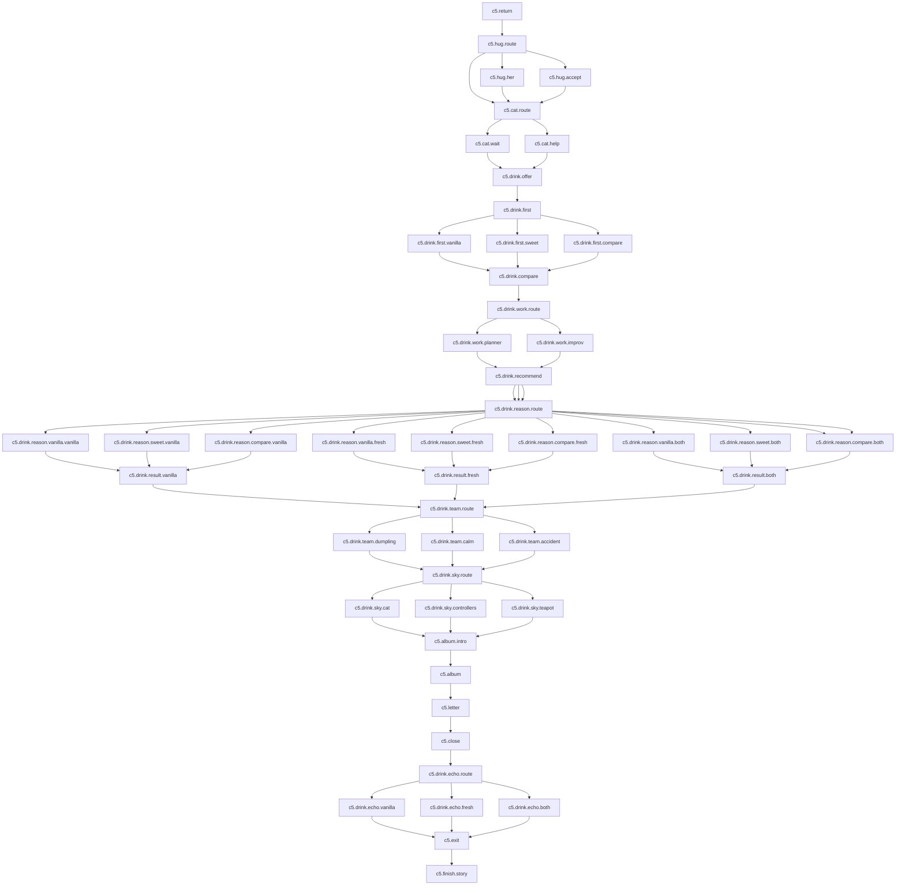

# Глава 5 · «А что, если это не конец?»

Актуальный runtime content23 · 19 ноября 2026. Источник авторского текста: [SEASON_01_02_POLISH_SPEC_2026_11_19.md](SEASON_01_02_POLISH_SPEC_2026_11_19.md). Сценарное ядро: [NARRATIVE_CORE.md](NARRATIVE_CORE.md).

Вход: `c5.return`. Узлов: 48. Основных реплик: 120.

### `c5.return` · dialogue

Фон: `bg.cafe.sunset`; персонаж: `vlad.elegant.smile`.

1. **Описание:** К пятой встрече вы возвращаетесь в «Паузу». За высоким окном садится солнце, и в зале особенно тихо перед вечерним часом.
2. **Описание:** Влад уже ждёт за вашим столиком. Сегодня на нём чёрный пиджак поверх тёмной водолазки — непривычно собранный вид, и только кудри на висках остались всё такими же непослушными.
3. **Описание:** Увидев тебя в дверях, он сразу встаёт навстречу.
4. **Влад:** привет. сегодня я пришёл совсем без коробок и зонтиков. решил не отвлекать внимание от главного.
5. **Ты:** А чёрный пиджак разве не считается спецэффектом? Тебе очень идёт.
6. **Описание:** От комплимента Влад на секунду тушуется, чуть поводит плечами, но смотрит прямо на тебя:
7. **Влад:** хотел выглядеть достойно рядом с тобой за нашим столиком. ты сегодня очень красивая.
8. **Описание:** Он произносит это просто, без тени шутки, и отодвигает для тебя стул. Когда Влад на секунду наклоняется ближе, ты ловишь чистый свежий запах его парфюма — лёгкий цитрус с едва заметной древесной нотой.
9. **Ты:** Кстати, отличный парфюм. Очень тебе подходит.
10. **Влад:** заметила? значит, сегодня я реально подготовился лучше, чем в прошлые разы.
    - Выражение: `awkward`.
→ `c5.hug.route`

### `c5.hug.route` · route

- При `c4Goodbye = "her"` → `c5.hug.her`
- При `c4Goodbye = "accept"` → `c5.hug.accept`
- Иначе → `c5.cat.route`

### `c5.hug.her` · dialogue

Фон: `bg.cafe.sunset`; персонаж: `vlad.elegant.laugh`.

1. **Влад:** знаешь, я всё вспоминал, как ты тогда на набережной обняла меня первой. я потом полдороги до дома шёл и улыбался как дурак.
2. **Ты:** Только полдороги?
3. **Влад:** вторую половину тоже. просто там уже люди на светофоре начали оглядываться.
→ `c5.cat.route`

### `c5.hug.accept` · dialogue

Фон: `bg.cafe.sunset`; персонаж: `vlad.elegant.smile`.

1. **Влад:** после вечера на набережной и вчерашних посиделок под пледом я всё время ловил себя на том, что мне ужасно не хочется прощаться с тобой у двери.
2. **Ты:** Поэтому сегодня пришёл в «Паузу» раньше времени?
3. **Влад:** поэтому. хотелось украсть для нас лишние пять минут.
→ `c5.cat.route`

### `c5.cat.route` · route

- При `catApproach = "wait"` → `c5.cat.wait`
- Иначе → `c5.cat.help`

### `c5.cat.wait` · dialogue

Фон: `bg.cafe.sunset`; персонаж: `vlad.elegant.smile`.

1. **Описание:** Из-за барной стойки выходит Пончик, узнаёт вас и с тихим мурлыканьем запрыгивает на соседний стул. Ты сдвигаешь сумку, уступая ему солнечное пятно.
2. **Нина:** О, моя любимая команда снова на своём месте! Сейчас подойду, не разбегайтесь.
→ `c5.drink.offer`

### `c5.cat.help` · dialogue

Фон: `bg.cafe.sunset`; персонаж: `vlad.elegant.smile`.

1. **Нина:** Ваш пушистый знакомый сегодня дремлет у стойки на своём пледе. А я как раз ждала, когда вы придёте!
2. **Описание:** Влад помогает тебе снять пальто, вешает его на спинку свободного стула и садится напротив.
→ `c5.drink.offer`

### `c5.drink.offer` · dialogue

Фон: `bg.cafe.sunset`; персонаж: `vlad.elegant.thinking`.

1. **Нина:** Слушайте, я тут колдую над новым осенним чаем для вечернего меню — печёное яблоко и ваниль. Дадите честный совет, если налью вам на пробу?
2. **Ты:** С удовольствием. Только мы эксперты исключительно по спокойным паузам.
3. **Нина:** Вот именно такие люди мне и нужны!
4. **Описание:** Нина ставит между вами две небольшие фарфоровые чашки — над столом сразу поднимается запах ванили, корицы и печёного яблока.
5. **Влад:** пахнет так, будто здесь только что вытащили из духовки домашний пирог.
6. **Описание:** Он делает первый глоток и поворачивает чашку ручкой к тебе.
7. **Влад:** попробуй. интересно, совпадут ли у нас впечатления.
→ `c5.drink.first`

### `c5.drink.first` · choice

Фон: `bg.cafe.sunset`; персонаж: `vlad.elegant.thinking`.

Вопрос: Как тебе первая проба?
- `vanilla` — «Мне тоже нравится. Я бы оставила так» → `c5.drink.first.vanilla` · эффекты `[{"kind":"set","key":"c5FirstTaste","value":"vanilla"}]`
- `sweet` — «Для меня сладковато» → `c5.drink.first.sweet` · эффекты `[{"kind":"set","key":"c5FirstTaste","value":"sweet"}]`
- `compare` — «Давай сравним с менее сладким вариантом» → `c5.drink.first.compare` · эффекты `[{"kind":"set","key":"c5FirstTaste","value":"compare"}]`

### `c5.drink.first.vanilla` · dialogue

Фон: `bg.cafe.sunset`; персонаж: `vlad.elegant.smile`.

1. **Ты:** Мне очень нравится. Ваниль мягкая, и вкус яблока совсем не теряется.
2. **Влад:** вот. значит, вкусы к осенним вещам у нас совпадают.
3. **Нина:** А у меня есть ещё вторая версия — с кислинкой лимона и меньшей сладостью. Принести для сравнения?
4. **Ты:** Давайте! Проверим оба варианта.
→ `c5.drink.compare`

### `c5.drink.first.sweet` · dialogue

Фон: `bg.cafe.sunset`; персонаж: `vlad.elegant.laugh`.

1. **Ты:** Вкусно, но для меня чуть сладковато — за ванилью почти не слышно самого яблока.
2. **Влад:** а мне эта мягкая сладость как раз по душе. люблю, когда у вечера такой оттенок.
3. **Нина:** Тогда сейчас принесу вторую пробу — там меньше сиропа и добавлена долька лимона!
4. **Ты:** Отлично, устроим честное сравнение.
→ `c5.drink.compare`

### `c5.drink.first.compare` · dialogue

Фон: `bg.cafe.sunset`; персонаж: `vlad.elegant.thinking`.

1. **Ты:** А можно попробовать рядом менее сладкую версию, чтобы почувствовать разницу?
2. **Нина:** Конечно! Сейчас сделаю вам вариант с лимонной цедрой.
3. **Влад:** я всё равно ставлю на ванильную. она сразу задаёт настроение.
4. **Ты:** Подожди защищать свой пирог, сначала попробуем вторую.
→ `c5.drink.compare`

### `c5.drink.compare` · dialogue

Фон: `bg.cafe.sunset`; персонаж: `vlad.elegant.smile`.

1. **Описание:** Нина приносит вторую пару проб с тонкой долькой лимона и оставляет вас вдвоём у окна.
2. **Описание:** Ты делаешь глоток лимонной версии, а Влад неожиданно подвигает свою первую, ванильную чашку через середину столика прямо к тебе:
3. **Влад:** сравни сразу — глоток из твоей и глоток из моей. вдруг в моей чашке ваниль убедительнее?
4. **Описание:** Ты берёшь его чашку и делаешь маленький глоток. Влад на секунду замолкает, наблюдая за твоей реакцией так сосредоточенно, словно от этого зависит судьба кафе.
5. **Ты:** Во второй яблоко свежее, и лимон совсем не резкий. Но твоя ванильная и правда очень уютная.
6. **Влад:** да… я же говорил. очень уютная.
   - Выражение: `awkward`.
→ `c5.drink.work.route`

### `c5.drink.work.route` · route

- При `kitchenStyle = "planner"` → `c5.drink.work.planner`
- Иначе → `c5.drink.work.improv`

### `c5.drink.work.planner` · dialogue

Фон: `bg.cafe.sunset`; персонаж: `vlad.elegant.smile`.

1. **Описание:** Ты аккуратно выстраиваешь чашки попарно и кладёшь между вами карточку для отзыва — так же слаженно, как вчера вы делили заказы на диване.
2. **Ты:** Сначала решим, за какой вкус голосуем, а потом напишем Нине записку.
3. **Влад:** мне нравится, как мы с тобой уже понимаем друг друга с полуслова.
→ `c5.drink.recommend`

### `c5.drink.work.improv` · dialogue

Фон: `bg.cafe.sunset`; персонаж: `vlad.elegant.laugh`.

1. **Описание:** Вы одновременно тянетесь к карточке и ручке на середине стола — ваши пальцы сталкиваются, и Влад, усмехнувшись, уступает ручку тебе.
2. **Ты:** Писать буду я, иначе ты просто нарисуешь на весь листок яблочный пирог.
3. **Влад:** нарисую. и рядом подпишу, что пробовал его в лучшей компании.
→ `c5.drink.recommend`

### `c5.drink.recommend` · choice

Фон: `bg.cafe.sunset`; персонаж: `vlad.elegant.smile`.

Вопрос: Что предложим Нине после сравнения?
- `vanilla` — «Оставить исходный ванильный вариант» → `c5.drink.reason.route` · эффекты `[{"kind":"set","key":"c5Recommendation","value":"vanilla"}]`
- `fresh` — «Предложить менее сладкий вариант» → `c5.drink.reason.route` · эффекты `[{"kind":"set","key":"c5Recommendation","value":"fresh"}]`
- `both` — «Попробовать в меню оба» → `c5.drink.reason.route` · эффекты `[{"kind":"set","key":"c5Recommendation","value":"both"}]`

### `c5.drink.reason.vanilla.vanilla` · dialogue

Фон: `bg.cafe.sunset`; персонаж: `vlad.elegant.smile`.

1. **Ты:** После сравнения с твоей чашкой я точно за первую. У ванили здесь самый правильный вечерний вкус.
2. **Влад:** знал, что моя чашка тебя убедит. оставляем наш уютный вариант.
→ `c5.drink.result.vanilla`

### `c5.drink.reason.vanilla.fresh` · dialogue

Фон: `bg.cafe.sunset`; персонаж: `vlad.elegant.smile`.

1. **Ты:** Первая мягкая, но в сравнении вторая раскрылась ярче — там так свежо чувствуется яблоко. Предложу её.
2. **Влад:** а я останусь верен ванили. зато теперь у каждого за этим столиком свой любимый вкус.
→ `c5.drink.result.fresh`

### `c5.drink.reason.vanilla.both` · dialogue

Фон: `bg.cafe.sunset`; персонаж: `vlad.elegant.smile`.

1. **Ты:** Мне близка первая, но обе версии хороши под разное настроение. Давай предложим Нине оставить обе.
2. **Влад:** мудрое решение. главное, что мою ванильную никто не отменяет.
→ `c5.drink.result.both`

### `c5.drink.reason.sweet.vanilla` · dialogue

Фон: `bg.cafe.sunset`; персонаж: `vlad.elegant.smile`.

1. **Ты:** Сначала показалось сладко, но когда попробовала после лимонной из твоей чашки — поняла, что именно ваниль делает этот чай особенным.
2. **Влад:** она просто ждала второго шанса. рад, что ты её распробовала.
→ `c5.drink.result.vanilla`

### `c5.drink.reason.sweet.fresh` · dialogue

Фон: `bg.cafe.sunset`; персонаж: `vlad.elegant.smile`.

1. **Ты:** Да, вторая с лимоном — точно моя. Лёгкая, свежая, и сладость не перебивает яблоко.
2. **Влад:** тебе она и правда подходит. а я буду брать ванильную, чтобы у тебя всегда был повод попробовать из моей чашки.
→ `c5.drink.result.fresh`

### `c5.drink.reason.sweet.both` · dialogue

Фон: `bg.cafe.sunset`; персонаж: `vlad.elegant.smile`.

1. **Ты:** Себе буду заказывать лимонную, но в меню нужно дать шанс обеим — ты ведь свою ваниль ни за что не отдашь.
2. **Влад:** ни за что. тем более теперь с ней связаны хорошие воспоминания.
→ `c5.drink.result.both`

### `c5.drink.reason.compare.vanilla` · dialogue

Фон: `bg.cafe.sunset`; персонаж: `vlad.elegant.smile`.

1. **Ты:** Сравнение всё расставило по местам: первая мягче и спокойнее. Голосую за ваниль.
2. **Влад:** победа яблочного пирога. я в тебе не сомневался.
→ `c5.drink.result.vanilla`

### `c5.drink.reason.compare.fresh` · dialogue

Фон: `bg.cafe.sunset`; персонаж: `vlad.elegant.smile`.

1. **Ты:** Хорошо, что сравнили рядом: вторая с лимоном звучит интереснее и тоньше. Предложу её.
2. **Влад:** принимается. люблю, когда ты так уверенно выбираешь то, что тебе по душе.
→ `c5.drink.result.fresh`

### `c5.drink.reason.compare.both` · dialogue

Фон: `bg.cafe.sunset`; персонаж: `vlad.elegant.smile`.

1. **Ты:** Они такие разные, что выбирать одну даже жалко. Давай предложим Нине сделать пробный день с двумя вкусами.
2. **Влад:** отлично. значит, будет законный повод вернуться сюда и проверить, какая победила.
→ `c5.drink.result.both`

### `c5.drink.reason.route` · route

- При `c5FirstTaste = "vanilla" & c5Recommendation = "vanilla"` → `c5.drink.reason.vanilla.vanilla`
- При `c5FirstTaste = "vanilla" & c5Recommendation = "fresh"` → `c5.drink.reason.vanilla.fresh`
- При `c5FirstTaste = "vanilla" & c5Recommendation = "both"` → `c5.drink.reason.vanilla.both`
- При `c5FirstTaste = "sweet" & c5Recommendation = "vanilla"` → `c5.drink.reason.sweet.vanilla`
- При `c5FirstTaste = "sweet" & c5Recommendation = "fresh"` → `c5.drink.reason.sweet.fresh`
- При `c5FirstTaste = "sweet" & c5Recommendation = "both"` → `c5.drink.reason.sweet.both`
- При `c5FirstTaste = "compare" & c5Recommendation = "vanilla"` → `c5.drink.reason.compare.vanilla`
- При `c5FirstTaste = "compare" & c5Recommendation = "fresh"` → `c5.drink.reason.compare.fresh`
- При `c5FirstTaste = "compare" & c5Recommendation = "both"` → `c5.drink.reason.compare.both`
- Иначе → `c5.drink.reason.compare.both`

### `c5.drink.result.vanilla` · dialogue

Фон: `bg.cafe.sunset`; персонаж: `vlad.elegant.smile`.

1. **Ты:** Нина, мы единогласно за первую, ванильную версию. Я сейчас напишу на карточке почему.
2. **Нина:** Так и знала, что вам захочется уюта! Запишу эту пропорцию сиропа на завтрашний вечер.
3. **Описание:** Нина делает пометку в блокноте, а ты склоняешься над карточкой, чтобы написать короткий отзыв.
→ `c5.drink.team.route`

### `c5.drink.result.fresh` · dialogue

Фон: `bg.cafe.sunset`; персонаж: `vlad.elegant.smile`.

1. **Ты:** Нина, мне больше полюбилась вторая, с лимоном, а Влад защищает ванильную.
2. **Нина:** Тогда завтра запущу лимонную первой партией — проверим, сколько ещё гостей выберут свежесть!
3. **Описание:** Нина записывает рецепт в блокнот, а ты берёшь ручку, чтобы оставить короткую записку.
→ `c5.drink.team.route`

### `c5.drink.result.both` · dialogue

Фон: `bg.cafe.sunset`; персонаж: `vlad.elegant.smile`.

1. **Ты:** Нина, а что если на один вечер поставить в меню обе версии и посмотреть, какую гости выберут чаще?
2. **Нина:** А это отличная мысль! Сделаю завтра две небольшие партии, посмотрим на характер гостей.
3. **Описание:** Ты рисуешь на уголке карточки две маленькие чашки рядом — совсем как ваши на этом столе.
→ `c5.drink.team.route`

### `c5.drink.team.route` · route

- При `teamName = "dumpling"` → `c5.drink.team.dumpling`
- При `teamName = "calm"` → `c5.drink.team.calm`
- Иначе → `c5.drink.team.accident`

### `c5.drink.team.dumpling` · dialogue

Фон: `bg.cafe.sunset`; персонаж: `vlad.elegant.laugh`.

1. **Описание:** В самом низу карточки ты выводишь подпись вашей вчерашней команды: «Пельмень и партнёры».
2. **Влад:** звучит гордо. вчера спасали виртуальную кухню, сегодня влияем на чайную карту города.
→ `c5.drink.sky.route`

### `c5.drink.team.calm` · dialogue

Фон: `bg.cafe.sunset`; персонаж: `vlad.elegant.laugh`.

1. **Описание:** В самом низу карточки ты выводишь подпись вашей вчерашней команды: «Два спокойных человека».
2. **Влад:** два спокойных человека, которые за пять встреч успели пережить дождь, звёзды и кулинарный аврал.
→ `c5.drink.sky.route`

### `c5.drink.team.accident` · dialogue

Фон: `bg.cafe.sunset`; персонаж: `vlad.elegant.laugh`.

1. **Описание:** В самом низу карточки ты выводишь подпись вашей вчерашней команды: «Отдел случайных побед».
2. **Влад:** для отдела случайных побед мы с тобой подозрительно стабильно оказываемся за одним столиком.
→ `c5.drink.sky.route`

### `c5.drink.sky.route` · route

- При `constellation = "cat"` → `c5.drink.sky.cat`
- При `constellation = "controllers"` → `c5.drink.sky.controllers`
- Иначе → `c5.drink.sky.teapot`

### `c5.drink.sky.cat` · dialogue

Фон: `bg.cafe.sunset`; персонаж: `vlad.elegant.smile`.

1. **Описание:** В свободном углу карточки ты быстро дорисовываешь крошечный силуэт кота из вашего созвездия и кладёшь записку рядом с чашками.
→ `c5.album.intro`

### `c5.drink.sky.controllers` · dialogue

Фон: `bg.cafe.sunset`; персонаж: `vlad.elegant.smile`.

1. **Описание:** В свободном углу карточки ты дорисовываешь крошечный геймпад с вашего неба на набережной и кладёшь записку на край стола.
→ `c5.album.intro`

### `c5.drink.sky.teapot` · dialogue

Фон: `bg.cafe.sunset`; персонаж: `vlad.elegant.smile`.

1. **Описание:** В свободном углу карточки ты дорисовываешь маленький пузатый чайник из вашего созвездия и кладёшь записку рядом с чашками.
→ `c5.album.intro`

### `c5.album.intro` · dialogue

Фон: `bg.cafe.sunset`; персонаж: `vlad.elegant.smile`.

1. **Описание:** Нина забирает вашу записку к стойке и приглушает дальний свет в зале. За столиком у окна становится совсем спокойно.
2. **Описание:** Влад освобождает середину стола и выкладывает небольшой альбом, три деревянных жетона с первой встречи и крафтовый конверт с набережной.
3. **Влад:** ну вот. а теперь главная часть вечера. я носил этот конверт во внутреннем кармане с самой набережной.
4. **Ты:** Пришло время рассекретить наши записи?
5. **Влад:** да. и собрать всё, что успело появиться у нас за эти пять дней.
→ `c5.album`

### `c5.album` · minigame

Фон: `bg.cafe.sunset`; персонаж: `vlad.elegant.smile`.

Мини-игра: `memories`.
→ `c5.letter`

### `c5.letter` · dialogue

Фон: `bg.cafe.sunset`; персонаж: `vlad.elegant.smile`.

1. **Описание:** Ты распечатываешь крафтовый конверт. Внутри рядом с рисунком созвездия лежат два гладких деревянных жетона.
2. **Описание:** Влад на секунду замирает — видно, что он немного волнуется, — а потом переворачивает свой жетон надписью вверх и подвигает к тебе.
3. **Описание:** На светлом дереве его почерком, чуть неровно от того, что он писал на весу у реки, выведено: «ещё не один такой вечер».
4. **Описание:** Ты проводишь пальцем по буквам и поднимаешь взгляд. Влад на этот раз не отшучивается — смотрит прямо и очень спокойно.
5. **Ты:** Какое хорошее желание… короткое и очень точное.
6. **Влад:** длинное туда бы не поместилось. пришлось оставить только самое главное.
7. **Описание:** Его рука ложится на стол, и пальцы тихо касаются края твоей ладони рядом с жетоном. Пауза за столом вдруг становится удивительно весомой.
8. **Влад:** я тогда на набережной правда думал только об одном — чтобы эти наши пять случайных встреч не заканчивались на пятой.
→ `c5.close`

### `c5.close` · dialogue

Фон: `bg.cafe.sunset`; персонаж: `vlad.elegant.smile`.

1. **Описание:** Несколько секунд вы сидите молча, пока закат за окном переходит в сумерки.
2. **Описание:** Затем ты закрываешь альбом, а Влад убирает оба жетона обратно в конверт и прячет его во внутренний карман пиджака.
3. **Ты:** Нашу карточку для чая оставляем Нине?
4. **Влад:** конечно. пусть в «Паузе» теперь будет и наш общий рецепт.
→ `c5.drink.echo.route`

### `c5.drink.echo.route` · route

- При `c5Recommendation = "vanilla"` → `c5.drink.echo.vanilla`
- При `c5Recommendation = "fresh"` → `c5.drink.echo.fresh`
- Иначе → `c5.drink.echo.both`

### `c5.drink.echo.vanilla` · dialogue

Фон: `bg.cafe.sunset`; персонаж: `vlad.elegant.smile`.

1. **Нина:** Вашу карточку уже прикрепила над стойкой! Завтра сварю первую партию вашего ванильного чая.
2. **Ты:** Значит, обязательно зайдём проверить, как он прижился в меню.
→ `c5.exit`

### `c5.drink.echo.fresh` · dialogue

Фон: `bg.cafe.sunset`; персонаж: `vlad.elegant.smile`.

1. **Нина:** Лимонную версию записала на завтрашний вечер, а про любимую ваниль Влада тоже запомнила!
2. **Влад:** спасибо, Нина. мы обязательно проверим обе.
→ `c5.exit`

### `c5.drink.echo.both` · dialogue

Фон: `bg.cafe.sunset`; персонаж: `vlad.elegant.smile`.

1. **Нина:** Завтра устрою день двух вкусов по вашему совету — посмотрим, что гости разберут быстрее!
2. **Ты:** Тогда за нами ещё один визит за результатами.
→ `c5.exit`

### `c5.exit` · dialogue

Фон: `bg.cafe.sunset`; персонаж: `vlad.elegant.smile`.

- Фон с индекса 2: `bg.cafe.exterior`, `vlad.elegant.smile`.
1. **Ты:** Спасибо за этот чудесный вечер, Нина. До свидания!
2. **Нина:** Доброго вам вечера, ребята. Заходите почаще — Пончик и ваш столик у окна всегда вас ждут.
3. **Описание:** Вы выходите из «Паузы» на вечернюю улицу. Колокольчик над дверью тихо звякает за спиной, на тротуаре уже зажглись фонари.
4. **Ты:** Ну и как тебе наш пятый вечер?
5. **Влад:** кажется, это первый случай в моей жизни, когда рассыпанная у двери коробка привела к чему-то настолько хорошему.
6. **Описание:** У привычной развилки, где пора расходиться в разные стороны, Влад не останавливается, а спокойно сворачивает на твою улицу.
7. **Ты:** Подожди. Тебе ведь в другую сторону.
8. **Влад:** до следующего угла мне совершенно точно по пути с тобой.
9. **Описание:** Вы идёте медленно вдоль вечерних витрин, в одном шаге, изредка задевая друг друга тыльной стороной ладони — так легко, будто знаете друг друга уже давно.
10. **Описание:** У твоего поворота вы останавливаетесь. Влад смотрит на тебя в свете фонаря без спешки — с тем самым чувством, что самое интересное между вами только начинается, а в конце улицы всё ещё светится окно «Паузы».
→ `c5.finish.story`

### `c5.finish.story` · end

Открытка: `c5.story`; endingId: `c5.story`.

## Приглашение в реальность

Может, как-нибудь увидимся?

можно заглянуть в кафе или выбраться на прогулку.

а если захочется спокойного вечера — поиграть во что-нибудь или посмотреть фильм вместе.
