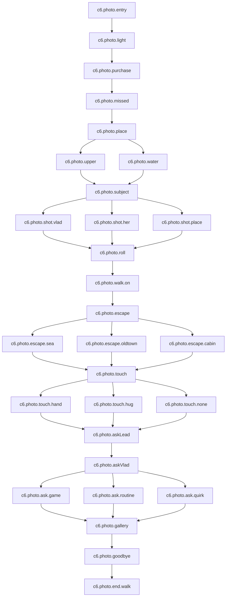

# Глава 6 · «Пока светло»

Сценарное зеркало редакции content27, `scriptRevision: 6`. [Исходник главы](../src/content/chapters/ch06.ts) · [Сценарное ядро](NARRATIVE_CORE.md).

Вход: `c6.photo.entry`. Узлов: 29. Основных реплик: 156.

### `c6.photo.entry` · dialogue

Фон: `bg.photo6.sun`; персонаж: `vlad.city.smile`.

1. **Описание:** Прошло несколько дней тёплых вечерних переписок и того лёгкого предвкушения, когда среди рабочего дня ловишь себя на улыбке экрану телефона.
2. **Описание:** У входа на набережную вы подходите к каменным перилам почти секунда в секунду — Влад идёт быстрым шагом со стороны проспекта, ветер растрепал его кудри, а во взгляде ещё светится энергия насыщенного дня.
3. **Влад:** привет. вот это синхронность — закрыл сложную задачу ровно за минуту до выхода и летел сюда на одном дыхании.
4. **Описание:** Он останавливается в шаге от тебя, переводя дух, и улыбается чуть виновато.
5. **Ты:** Привет, Влад. Люблю, когда рабочая неделя заканчивается у воды. Пойдём по нижней дорожке?
6. **Влад:** пойдём. я до тебя уже добежал, дальше можно не спешить.
   - Эмоция Влада: `smile`.
7. **Описание:** Вы спускаетесь на нижнюю дорожку у воды. От реки тянет осенней свежестью; ты замедляешь шаг у парапета.
→ `c6.photo.light`

### `c6.photo.light` · dialogue

Фон: `bg.photo6.sun`; персонаж: `vlad.city.smile`.

1. **Описание:** В тёмной воде у берега дрожит яркий золотой прямоугольник — отражение освещённого окна с противоположного берега.
2. **Ты:** Подожди, Влад. Смотри — будто кто-то зажёг окно прямо под водой.
3. **Описание:** Влад возвращается на шаг и наклоняется над парапетом рядом с тобой, чтобы увидеть тот же угол.
   - Эмоция Влада: `surprised`.
4. **Влад:** и правда. только ручку забыли приделать.
   - Эмоция Влада: `surprised`.
5. **Ты:** Ты уже собирался его открывать?
   - Эмоция Влада: `laugh`.
6. **Влад:** сначала тихонько постучать. вдруг там кто-то уже ужинает.
   - Эмоция Влада: `laugh`.
7. **Описание:** По воде пробегает рябь, размывая отражение. Ты тянешься за телефоном, но замечаешь витрину маленького киоска у лестницы.
8. **Ты:** Смотри, там на полке зелёные картонные коробочки… это ведь плёночные фотоаппараты?
9. **Влад:** да, одноразовые. те самые, где нужно крутить колёсико пальцем.
10. **Ты:** Давай возьмём один на двоих! Будем снимать наши прогулки, пока плёнка не закончится.
11. **Влад:** мне очень нравится это «наши прогулки». берём. твоё окно в воде будет первым кадром?
12. **Ты:** Если оно нас дождётся!
→ `c6.photo.purchase`

### `c6.photo.purchase` · dialogue

Фон: `bg.photo6.sun`; персонаж: `vlad.city.smile`.

1. **Описание:** Вы берёте один лёгкий аппарат на двоих. Влад снимает шуршащую плёнку упаковки, пока ты разворачиваешь бумажный вкладыш.
   - Эффекты после действия: `[{"kind":"set","key":"c6Film","value":"loaded"},{"kind":"set","key":"c6CameraHolder","value":"vlad"}]`.
2. **Ты:** Двенадцать кадров. И ни одного экрана, чтобы проверить и удалить.
3. **Влад:** да, я уже по привычке чуть не перевернул его посмотреть, где тут предпросмотр.
   - Эмоция Влада: `awkward`.
4. **Ты:** Зато с телефоном я бы сделала двадцать дублей подряд, а здесь каждый щелчок — настоящий.
5. **Влад:** и до самой проявки придётся помнить этот вечер по памяти, а не по галерее.
   - Эмоция Влада: `thinking`.
6. **Описание:** Ты убираешь вкладыш в сумку. Влад с сухим треском прокручивает колёсико взвода до упора и протягивает аппарат тебе.
   - Эффекты после действия: `[{"kind":"set","key":"c6CameraHolder","value":"her"}]`.
7. **Влад:** заряжен. пойдём ловить твоё окно.
→ `c6.photo.missed`

### `c6.photo.missed` · dialogue

Фон: `bg.photo6.shade`; персонаж: `vlad.city.neutral`.

Реплики советчиков идут отдельной вставкой.

1. **Описание:** Вы возвращаетесь к парапету, но солнце за эти две минуты уже скользнуло за карниз на том берегу. Золотой прямоугольник погас, осталась только синяя тень.
2. **Ты:** Опоздали… окно закрылось.
3. **Влад:** ничего. значит, этот кадр останется только для нас двоих — без свидетелей на плёнке.
   - Эмоция Влада: `smile`.
4. **Описание:** Ты делаешь пару шагов влево вдоль перил. Влад подходит рядом и кивает наверх:
5. **Влад:** смотри, на верхнем ярусе солнце ещё держится на крышах — можем подняться туда за светом.
   - Эмоция Влада: `thinking`.
6. **Ты:** Или остаться здесь, у воды: в ней сейчас так необычно отражается лестница.
   - Эмоция Влада: `thinking`.
7. **Ангел:** У самой воды сейчас глубокие тени и тихие отражения — никто не помешает вам двоим.
8. **Дьяволёнок:** А наверху закатный свет ложится прямо на лицо! Тащи его к солнцу — устроим внеплановую фотосессию, пока он не начал высчитывать углы!
→ `c6.photo.place`

### `c6.photo.place` · choice

Фон: `bg.photo6.shade`; персонаж: `vlad.city.smile`.

Вопрос: Где найдём новый кадр?
- `upper` — «Поднимемся. Хочу поймать оставшийся свет» → `c6.photo.upper` · эффекты `[{"kind":"set","key":"c6PhotoPlace","value":"upper"}]`
- `water` — «Останемся у воды. Поищем отражение» → `c6.photo.water` · эффекты `[{"kind":"set","key":"c6PhotoPlace","value":"water"}]`

### `c6.photo.upper` · dialogue

Фон: `bg.photo6.shade`; персонаж: `vlad.city.thinking`.

- Фон с индекса 2: `bg.photo6.upper`, `vlad.city.smile`.
1. **Ты:** Поднимемся наверх. Хочу поймать последний закатный свет.
2. **Описание:** Вы поднимаетесь по каменным ступеням; Влад придерживает кованую калитку на верхней площадке, пропуская тебя вперёд.
3. **Описание:** Наверху ветер мягче, а над крышами тянется узкая розовая полоса неба.
4. **Описание:** Ты подносишь аппарат к глазу, пытаясь поймать линию крыш без яркой уличной вывески.
5. **Влад:** дай гляну, куда она лезет.
6. **Описание:** Влад встаёт рядом с тобой у перил, чуть наклоняется, чтобы посмотреть вдоль корпуса камеры, и легонько касается края аппарата, поправляя угол.
7. **Описание:** Слышно его спокойный голос совсем близко:
8. **Влад:** вот так… если чуть сместить сюда, вывеска уйдёт, а свет останется. видишь?
9. **Ты:** Вижу… только теперь у тебя за спиной будет фонарь.
   - Эмоция Влада: `smile`.
10. **Описание:** Влад усмехается и отступает на шаг к перилам, уступая тебе пространство для кадра.
   - Эмоция Влада: `smile`.
11. **Описание:** С этой точки можно снять самого Влада в полосе света, свой силуэт на фоне неба или уходящие вдаль крыши.
→ `c6.photo.subject`

### `c6.photo.water` · dialogue

Фон: `bg.photo6.shade`; персонаж: `vlad.city.thinking`.

1. **Ты:** Останемся у воды. Здесь сейчас такая тишина.
2. **Описание:** Вы проходите к широкому просвету у парапета, где в тёмной воде опрокинулись ступени лестницы и светлая полоска неба.
3. **Описание:** Ты поворачиваешь камеру вертикально; Влад склоняется рядом к перилам, разглядывая отражение под тем же углом.
4. **Ты:** Смотри, настоящая лестница ведёт вниз, а в воде она уходит куда-то в глубину.
5. **Описание:** Он прикидывает рамку ладонью, чуть прищурившись:
6. **Влад:** а если срезать верхний край берега, вообще не поймёшь, где кончается воздух и начинается вода. можно я посмотрю?
7. **Описание:** Ты протягиваешь ему лёгкий зелёный аппарат за ремешок.
   - Эффекты после действия: `[{"kind":"set","key":"c6CameraHolder","value":"vlad"}]`.
8. **Описание:** Влад заглядывает в видоискатель, одобрительно кивает и возвращает камеру тебе.
   - Эмоция Влада: `smile`.
   - Эффекты после действия: `[{"kind":"set","key":"c6CameraHolder","value":"her"}]`.
9. **Описание:** Вода у парапета затихает. Отсюда можно снять Влада у просвета перил, свой силуэт в отражении или саму опрокинутую лестницу.
→ `c6.photo.subject`

### `c6.photo.subject` · choice

Фон: `bg.photo6.shade`; персонаж: `vlad.city.smile`.

- Фон при c6PhotoPlace = "upper": `bg.photo6.upper`, `vlad.city.smile`.
Вопрос: Что снимем первым?
- `vlad` — «Влад, оставайся в кадре» → `c6.photo.shot.vlad` · эффекты `[{"kind":"set","key":"c6PhotoSubject","value":"vlad"}]`
- `her` — «Теперь ты меня. Только силуэтом» → `c6.photo.shot.her` · эффекты `[{"kind":"set","key":"c6PhotoSubject","value":"her"}]`
- `place` — «Сниму само место» → `c6.photo.shot.place` · эффекты `[{"kind":"set","key":"c6PhotoSubject","value":"place"}]`

### `c6.photo.shot.vlad` · dialogue

Фон: `bg.photo6.shade`; персонаж: `vlad.city.smile`.

- Фон при c6PhotoPlace = "upper": `bg.photo6.upper`, `vlad.city.smile`.
1. **Ты:** Влад, оставайся у перил. Первым на нашей плёнке будешь ты.
2. **Влад:** так и знал. позвали гулять на набережную, а в итоге заставили работать фотомоделью.
   - Эмоция Влада: `laugh`.
3. **Ты:** Причём совершенно бесплатно. Повернись ко мне чуть вполоборота.
4. **Описание:** Он опирается локтем на перила и поворачивает голову к тебе.
5. **Описание:** Мягкий вечерний свет ложится ему на скулу; за его спиной видны крыши, а фонарь остаётся чуть сбоку.
   - Эмоция Влада: `thinking`.
   - Вариант при `c6PhotoPlace = "upper"`: Мягкий вечерний свет ложится ему на скулу; за его спиной видны крыши, а фонарь остаётся чуть сбоку.
   - Вариант при `c6PhotoPlace = "water"`: За ним открывается просвет к воде, где в глубине дрожат линии отражённой лестницы.
6. **Влад:** ну что, мне делать серьёзное и загадочное лицо?
   - Эмоция Влада: `thinking`.
7. **Ты:** Нет. Просто смотри на меня вот так, как сейчас.
8. **Описание:** В маленьком окошке видоискателя видно, как он перестаёт позировать и смотрит прямо на тебя — открыто и спокойно. Ты нажимаешь спуск.
   - Эмоция Влада: `neutral`.
   - Эффекты после действия: `[{"kind":"set","key":"c6Film","value":"key"}]`.
9. **Влад:** и теперь ты мне даже не расскажешь, какое у меня там было лицо?
   - Эмоция Влада: `awkward`.
10. **Ты:** Увидишь, когда проявим плёнку.
11. **Влад:** ладно. но имей в виду: следующий кадр с тобой — за мной.
→ `c6.photo.roll`

### `c6.photo.shot.her` · dialogue

Фон: `bg.photo6.shade`; персонаж: `vlad.city.smile`.

- Фон при c6PhotoPlace = "upper": `bg.photo6.upper`, `vlad.city.smile`.
1. **Ты:** Сними лучше ты меня. Только со спины, силуэтом на фоне неба.
   - Вариант при `c6PhotoPlace = "upper"`: Сними лучше ты меня. Только со спины, силуэтом на фоне неба.
   - Вариант при `c6PhotoPlace = "water"`: Сними лучше ты меня. Только со спины, силуэтом у воды.
2. **Влад:** с удовольствием. давай камеру.
3. **Описание:** Ты передаёшь ему аппарат и подходишь к самым перилам.
   - Эмоция Влада: `thinking`.
   - Эффекты после действия: `[{"kind":"set","key":"c6CameraHolder","value":"vlad"}]`.
4. **Описание:** Ты останавливаешься лицом к светлой полосе неба над крышами, а Влад отступает на пару шагов, поднимая камеру.
   - Эмоция Влада: `thinking`.
   - Вариант при `c6PhotoPlace = "upper"`: Ты останавливаешься лицом к светлой полосе неба над крышами, а Влад отступает на пару шагов, поднимая камеру.
   - Вариант при `c6PhotoPlace = "water"`: Ты становишься у просвета в перилах над самой водой, где вокруг твоего силуэта сходятся отражённые ступени.
5. **Влад:** красиво… ты и полгорода вокруг.
   - Эмоция Влада: `thinking`.
   - Вариант при `c6PhotoPlace = "upper"`: красиво… ты и полгорода вокруг.
   - Вариант при `c6PhotoPlace = "water"`: красиво… ты и опрокинутая в воду лестница.
6. **Ты:** Только не проси меня поворачиваться и позировать.
7. **Влад:** даже не думал. мне нравится просто ловить момент, когда ты задумалась.
8. **Описание:** За спиной раздаётся тихий щелчок затвора, но когда ты оборачиваешься, Влад ещё секунду не опускает камеру, будто досматривает кадр уже просто так.
   - Эмоция Влада: `neutral`.
   - Эффекты после действия: `[{"kind":"set","key":"c6Film","value":"key"}]`.
9. **Ты:** Снял?
   - Эмоция Влада: `neutral`.
10. **Влад:** снял. и этот кадр я жду из проявки больше остальных.
→ `c6.photo.roll`

### `c6.photo.shot.place` · dialogue

Фон: `bg.photo6.shade`; персонаж: `vlad.city.smile`.

- Фон при c6PhotoPlace = "upper": `bg.photo6.upper`, `vlad.city.smile`.
1. **Ты:** Давай сначала сниму само это место — пока свет ещё держится.
2. **Влад:** понял, уступаю сцену архитектуре.
   - Эмоция Влада: `laugh`.
3. **Описание:** Влад делает шаг в сторону, но смотрит больше не на пейзаж, а на то, как сосредоточенно ты прищуриваешься у видоискателя.
4. **Описание:** Между тёмными крышами остаётся чистая полоса неба; ты выравниваешь кадр, убирая лишнюю вывеску.
   - Вариант при `c6PhotoPlace = "upper"`: Между тёмными крышами остаётся чистая полоса неба; ты выравниваешь кадр, убирая лишнюю вывеску.
   - Вариант при `c6PhotoPlace = "water"`: Ты оставляешь в рамке только тёмную воду и опрокинутую лестницу, так что верх и низ почти меняются местами.
5. **Ты:** Вот так. Совсем ничего лишнего.
   - Вариант при `c6PhotoPlace = "upper"`: Вот так. Совсем ничего лишнего.
   - Вариант при `c6PhotoPlace = "water"`: Вот так. Потом даже не сразу угадаешь, где здесь верх.
6. **Влад:** я бы один прошёл мимо и не заметил. а рядом с тобой начинаешь видеть такие вещи.
   - Эмоция Влада: `neutral`.
   - Вариант при `c6PhotoPlace = "upper"`: я бы один прошёл мимо и не заметил. а рядом с тобой начинаешь видеть такие вещи.
   - Вариант при `c6PhotoPlace = "water"`: с тобой даже обычная лестница превращается в загадку.
7. **Описание:** Ты нажимаешь спуск и опускаешь лёгкий аппарат.
   - Эмоция Влада: `neutral`.
   - Эффекты после действия: `[{"kind":"set","key":"c6Film","value":"key"}]`.
8. **Описание:** Влад подходит к перилам, и вы несколько секунд молча смотрите на темнеющую реку.
   - Эмоция Влада: `neutral`.
→ `c6.photo.roll`

### `c6.photo.roll` · dialogue

Фон: `bg.photo6.shade`; персонаж: `vlad.city.smile`.

- Фон при c6PhotoPlace = "upper": `bg.photo6.upper`, `vlad.city.smile`.
1. **Описание:** Ты прокручиваешь колёсико к следующему кадру и протягиваешь аппарат Владу. Ваши пальцы накладываются на корпус одновременно — и кнопка спуска случайно щёлкает сама, пока объектив смотрит вниз.
   - Эмоция Влада: `surprised`.
   - Эффекты после действия: `[{"kind":"set","key":"c6Film","value":"accidental"}]`.
   - Вариант при `c6PhotoSubject = "her"`: Влад прокручивает колёсико к следующему кадру, вы оба тянетесь к аппарату одновременно — ваши пальцы сталкиваются на корпусе, и кнопка спуска случайно щёлкает сама, пока объектив смотрит вниз.
2. **Ты:** Ой… кажется, мы только что сфотографировали землю?
   - Эмоция Влада: `surprised`.
3. **Влад:** зато нажали кнопку вдвоём. куда он смотрел?
4. **Ты:** Прямо на наши ботинки.
   - Эмоция Влада: `laugh`.
5. **Влад:** значит, будет мой любимый документальный кадр — официальный отчёт о прогулке.
   - Эмоция Влада: `laugh`.
6. **Описание:** Вы делаете ещё пару шагов вдоль перил. Ты отворачиваешься к воде, убирая с лица растрёпанные ветром волосы, — и вдруг за спиной раздаётся короткий «щёлк».
   - Эффекты после действия: `[{"kind":"set","key":"c6Film","value":"six"}]`.
   - Вариант при `c6PhotoPlace = "upper"`: Вы делаете ещё пару шагов вдоль верхних перил. Ты отворачиваешься к темнеющим крышам, убирая с лица растрёпанные ветром волосы, — и вдруг за спиной раздаётся короткий «щёлк».
7. **Описание:** Ты оборачиваешься: Влад только что опустил камеру, вид у него виноватый и при этом совершенно довольный.
   - Эмоция Влада: `awkward`.
8. **Ты:** Влад! Ты сейчас меня снял без предупреждения?
   - Эмоция Влада: `awkward`.
9. **Влад:** прости, не удержался. очень уж хороший был момент — жалко было не сохранить.
   - Эмоция Влада: `awkward`.
10. **Описание:** В окошке счётчика остаётся цифра «9». Влад возвращает аппарат тебе, ты прячешь его в сумку, а он выбрасывает обёртку в урну у дорожки.
   - Эффекты после действия: `[{"kind":"set","key":"c6CameraHolder","value":"her"}]`.
→ `c6.photo.walk.on`

### `c6.photo.walk.on` · dialogue

Фон: `bg.photo6.shade`; персонаж: `vlad.city.smile`.

- Фон при c6PhotoPlace = "upper": `bg.photo6.upper`, `vlad.city.smile`.
1. **Описание:** Вы неспешно идёте дальше по вечерней аллее. За спиной остаются лестница и парапет, сумерки над рекой густеют.
   - Вариант при `c6PhotoPlace = "upper"`: Вы идёте дальше по верхней дорожке. За спиной остаются лестница и перила, где вы только что снимали.
   - Вариант при `c6PhotoPlace = "water"`: Вы идёте дальше вдоль воды. Отражённая лестница остаётся позади, аллея под фонарями становится тише.
2. **Влад:** а то золотое окно в воде мы всё-таки упустили.
   - Эмоция Влада: `thinking`.
3. **Ты:** Зато у нас теперь есть общий фотоаппарат и кадр наших ног.
   - Вариант при `c6PhotoPlace = "water"`: Зато на плёнке есть перевёрнутая лестница и кадр наших ног.
4. **Влад:** и один секретный портрет, которым я горжусь.
   - Вариант при `c6PhotoPlace = "water"`: и секретный кадр у воды, ради которого вообще стоило покупать эту плёнку.
5. **Влад:** слушай, мы сегодня так вовремя сбежали от всей этой суеты… а если бы у тебя завтра вдруг освободились три дня без единого дела — куда бы ты сорвалась?
   - Эмоция Влада: `thinking`.
6. **Описание:** Он чуть замедляет шаг рядом с тобой — видно, что ему правда интересно, как ты представляешь свой идеальный отдых.
→ `c6.photo.escape`

### `c6.photo.escape` · choice

Фон: `bg.photo6.shade`; персонаж: `vlad.city.smile`.

- Фон при c6PhotoPlace = "upper": `bg.photo6.upper`, `vlad.city.smile`.
Вопрос: Куда бы ты сорвалась на три свободных дня?
- `sea` — «К холодному морю — дышать ветром и слушать воду» → `c6.photo.escape.sea` · эффекты `[{"kind":"set","key":"c6HerEscape","value":"sea"}]`
- `oldtown` — «В старый тихий город — бродить по улочкам без карты» → `c6.photo.escape.oldtown` · эффекты `[{"kind":"set","key":"c6HerEscape","value":"oldtown"}]`
- `cabin` — «В тихий домик у леса — к природе и полному спокойствию» → `c6.photo.escape.cabin` · эффекты `[{"kind":"set","key":"c6HerEscape","value":"cabin"}]`

### `c6.photo.escape.sea` · dialogue

Фон: `bg.photo6.shade`; персонаж: `vlad.city.smile`.

- Фон при c6PhotoPlace = "upper": `bg.photo6.upper`, `vlad.city.smile`.
1. **Ты:** К морю. Даже не в сезон — в тёплом пальто, идти вдоль пустого берега и слушать воду.
2. **Влад:** красиво. я сам путешественник так себе — меня скорее тянет в тихий домик у леса, где природа и никакой суеты. но пустой берег без толпы я точно понимаю.
   - Эмоция Влада: `smile`.
3. **Описание:** Впереди аллея уходит под кроны старых клёнов. Влад поворачивается к тебе и протягивает раскрытую ладонь:
4. **Влад:** пойдём дальше за руку?
   - Эмоция Влада: `smile`.
→ `c6.photo.touch`

### `c6.photo.escape.oldtown` · dialogue

Фон: `bg.photo6.shade`; персонаж: `vlad.city.smile`.

- Фон при c6PhotoPlace = "upper": `bg.photo6.upper`, `vlad.city.smile`.
1. **Ты:** В небольшой старый город с узкими улочками и маленькими пекарнями — чтобы бродить без плана и карты.
2. **Влад:** смело. я в поездках человек редкий, мне ближе тихий домик у леса и природа, но с тобой бы рискнул потеряться в незнакомых переулках. хотя без карты мне сначала было бы непривычно.
   - Эмоция Влада: `laugh`.
3. **Описание:** Впереди аллея уходит под кроны старых клёнов. Влад поворачивается к тебе и протягивает раскрытую ладонь:
4. **Влад:** пойдём дальше за руку?
   - Эмоция Влада: `smile`.
→ `c6.photo.touch`

### `c6.photo.escape.cabin` · dialogue

Фон: `bg.photo6.shade`; персонаж: `vlad.city.smile`.

- Фон при c6PhotoPlace = "upper": `bg.photo6.upper`, `vlad.city.smile`.
1. **Ты:** В тихий домик где-нибудь у леса: природа, тёплый свет вечером, никуда не спешить и никакой суеты.
2. **Влад:** подожди… серьёзно? ты буквально описала мой идеальный вариант. я сам не фанат дальних поездок, а вот сбежать в домик у леса, где тихо и вокруг природа — это сто процентов моё.
   - Эмоция Влада: `surprised`.
3. **Описание:** Впереди аллея уходит под кроны старых клёнов. Влад смотрит на тебя с открытой, тёплой улыбкой и протягивает раскрытую ладонь:
4. **Влад:** пойдём дальше за руку?
   - Эмоция Влада: `smile`.
→ `c6.photo.touch`

### `c6.photo.touch` · choice

Фон: `bg.photo6.shade`; персонаж: `vlad.city.smile`.

- Фон при c6PhotoPlace = "upper": `bg.photo6.upper`, `vlad.city.smile`.
Вопрос: Как тебе хочется продолжить прогулку?
- `hand` — «Взять его за руку» → `c6.photo.touch.hand` · эффекты `[{"kind":"set","key":"c6Gesture","value":"hand"}]`
- `hug` — «Лучше обниму тебя» → `c6.photo.touch.hug` · эффекты `[{"kind":"set","key":"c6Gesture","value":"hug"}]`
- `none` — «Давай просто рядом» → `c6.photo.touch.none` · эффекты `[{"kind":"set","key":"c6Gesture","value":"none"}]`

### `c6.photo.touch.hand` · dialogue

Фон: `bg.photo6.shade`; персонаж: `vlad.city.smile`.

- Фон при c6PhotoPlace = "upper": `bg.photo6.upper`, `vlad.city.smile`.
1. **Описание:** Ты вкладываешь свою ладонь в его руку. Его пальцы смыкаются вокруг твоих спокойно и уверенно, без лишней суеты.
   - Эмоция Влада: `neutral`.
2. **Описание:** Влад коротко выдыхает и большим пальцем легко проводит по костяшкам твоей руки.
   - Эмоция Влада: `neutral`.
3. **Влад:** вот так… совсем хорошо.
4. **Описание:** На повороте аллеи вы идёте в одном темпе, уже не разжимая рук.
→ `c6.photo.askLead`

### `c6.photo.touch.hug` · dialogue

Фон: `bg.photo6.shade`; персонаж: `vlad.city.smile`.

- Фон при c6PhotoPlace = "upper": `bg.photo6.upper`, `vlad.city.smile`.
1. **Ты:** Лучше обниму тебя.
   - Эмоция Влада: `surprised`.
2. **Описание:** Ты останавливаешься на дорожке и шагаешь в его объятия. Влад отводит сумку в сторону и крепко обнимает тебя.
   - Эмоция Влада: `surprised`.
3. **Описание:** Пару секунд вы стоите посреди тихой аллеи — под пальто чувствуется, как сильно и ровно бьётся его сердце.
   - Эмоция Влада: `smile`.
4. **Влад:** вот такой поворот маршрута мне нравится гораздо больше.
   - Эмоция Влада: `smile`.
5. **Описание:** Когда вы отстраняетесь, Влад мягко перехватывает твою ладонь, и дальше по аллее вы идёте уже за руку.
→ `c6.photo.askLead`

### `c6.photo.touch.none` · dialogue

Фон: `bg.photo6.shade`; персонаж: `vlad.city.smile`.

- Фон при c6PhotoPlace = "upper": `bg.photo6.upper`, `vlad.city.smile`.
1. **Ты:** Давай пока просто пойдём рядом.
   - Эмоция Влада: `neutral`.
2. **Влад:** давай. мне и так хорошо с тобой идти.
3. **Описание:** Он спокойно убирает руку в карман без тени неловкости, и когда на повороте попадается лужа, просто придерживает край прохода, пропуская тебя по сухому месту.
→ `c6.photo.askLead`

### `c6.photo.askLead` · dialogue

Фон: `bg.photo6.shade`; персонаж: `vlad.city.smile`.

- Фон при c6PhotoPlace = "upper": `bg.photo6.upper`, `vlad.city.smile`.
1. **Описание:** Аллея под фонарями пустеет, шаги звучат тише. Хочется узнать про Влада ещё что-нибудь настоящее — вне обычных разговоров.
2. **Ты:** Влад, можно внезапный вопрос — просто чтобы узнать тебя получше?
3. **Влад:** конечно. спрашивай что угодно, скрывать мне от тебя нечего.
   - Эмоция Влада: `smile`.
→ `c6.photo.askVlad`

### `c6.photo.askVlad` · choice

Фон: `bg.photo6.shade`; персонаж: `vlad.city.smile`.

- Фон при c6PhotoPlace = "upper": `bg.photo6.upper`, `vlad.city.smile`.
Вопрос: О чём спросишь Влада?
- `game` — «Чем занимаешься вечером, когда закрываешь рабочие задачи?» → `c6.photo.ask.game` · эффекты `[{"kind":"set","key":"c6AskVlad","value":"game"}]`
- `routine` — «Как устроены твои обычные будни вне работы?» → `c6.photo.ask.routine` · эффекты `[{"kind":"set","key":"c6AskVlad","value":"routine"}]`
- `quirk` — «Признавайся: есть за тобой смешная бытовая привычка?» → `c6.photo.ask.quirk` · эффекты `[{"kind":"set","key":"c6AskVlad","value":"quirk"}]`

### `c6.photo.ask.game` · dialogue

Фон: `bg.photo6.shade`; персонаж: `vlad.city.smile`.

- Фон при c6PhotoPlace = "upper": `bg.photo6.upper`, `vlad.city.smile`.
1. **Ты:** Ты говорил, что легко залипаешь в код. А когда рабочие задачи закрыты — чем занимаешься для души?
2. **Влад:** иногда пишу свою небольшую игру или ковыряю пет-проекты. нравится сам момент, когда из пустого файла потихоньку собирается что-то живое, своё.
   - Эмоция Влада: `smile`.
3. **Ты:** Свою игру с нуля? Вот это неожиданно. Покажешь когда-нибудь?
4. **Влад:** обязательно. только предупреждаю: потом я ещё долго буду расспрашивать, где именно ты улыбнулась, а где захотелось переделать.
   - Эмоция Влада: `laugh`.
→ `c6.photo.gallery`

### `c6.photo.ask.routine` · dialogue

Фон: `bg.photo6.shade`; персонаж: `vlad.city.thinking`.

- Фон при c6PhotoPlace = "upper": `bg.photo6.upper`, `vlad.city.thinking`.
1. **Ты:** Как ты держишь баланс вне работы? Кроме прогулок — на что у тебя ещё хватает сил?
2. **Влад:** занимаюсь дома тренировками, чтобы спина не забыла, как двигаться, и потихоньку учу английский. ничего пафосного — просто люблю понятный ритм без лишней суеты.
   - Эмоция Влада: `thinking`.
3. **Ты:** Звучит на удивление собрано. И ты правда никогда не отлыниваешь?
4. **Влад:** отлыниваю, конечно. но мне проще чуть напрячься вечером и лечь со спокойной головой, чем потом суетиться и всё наверстывать в последний момент.
   - Эмоция Влада: `laugh`.
→ `c6.photo.gallery`

### `c6.photo.ask.quirk` · dialogue

Фон: `bg.photo6.shade`; персонаж: `vlad.city.laugh`.

- Фон при c6PhotoPlace = "upper": `bg.photo6.upper`, `vlad.city.laugh`.
1. **Ты:** Ты всё время такой собранный. Признавайся честно: какая у тебя есть смешная бытовая слабость?
2. **Влад:** самая честная — я могу сорок минут выбирать фильм на вечер. перебираю описания, трейлеры, отзывы… а потом в итоге уже пора спать.
   - Эмоция Влада: `laugh`.
3. **Ты:** Значит, пульт в киновечера я забираю себе.
   - Эмоция Влада: `laugh`.
4. **Влад:** с радостью уступлю. зато в одном я точно надёжен: терпеть не могу опаздывать и суетиться, так что ждать меня на холоде тебе никогда не придётся.
   - Эмоция Влада: `smile`.
→ `c6.photo.gallery`

### `c6.photo.gallery` · dialogue

Фон: `bg.photo6.shade`; персонаж: `vlad.city.smile`.

- Фон при c6PhotoPlace = "upper": `bg.photo6.upper`, `vlad.city.smile`.
1. **Описание:** У выхода с аллеи ты останавливаешься перед подсвеченной тумбой с афишей: чёрно-белые фотографии, косые полосы света, край стены и ступени.
2. **Ты:** Смотри, Влад: фотовыставка «Линии и свет» в камерной галерее.
   - Эмоция Влада: `thinking`.
3. **Влад:** интересно… это там лестница на снимке или край крыши?
   - Эмоция Влада: `thinking`.
4. **Ты:** По плакату не угадаешь. Давай сходим туда вдвоём в следующий раз и разглядим вживую?
5. **Влад:** давай. я с тобой хоть на выставку геометрии пойду. когда ты свободна?
   - Эмоция Влада: `laugh`.
6. **Описание:** Ты достаёшь из кармана телефон одной рукой, не выпуская его ладони, а Влад заглядывает в календарь через твоё плечо, пока вы выбираете свободный вечер.
   - Вариант при `c6Gesture = "none"`: Ты достаёшь из кармана телефон, и Влад склоняется рядом к экрану календаря, пока вы выбираете свободный вечер.
7. **Ты:** Тогда в следующий раз встречаемся у дверей этой галереи.
8. **Влад:** договорились. и наш фотоаппарат бери с собой.
9. **Ты:** Он до следующей встречи остаётся у меня на хранении?
10. **Влад:** конечно. у тебя в сумке наш общий архив.
11. **Ты:** Буду беречь каждый кадр.
12. **Описание:** Ты убираешь телефон. На афише светится белая диагональ, а вокруг уже совсем стемнело.
→ `c6.photo.goodbye`

### `c6.photo.goodbye` · dialogue

Фон: `bg.photo6.shade`; персонаж: `vlad.city.neutral`.

- Фон при c6PhotoPlace = "upper": `bg.photo6.upper`, `vlad.city.smile`.
1. **Описание:** У выхода к улице ты останавливаешься. Влад поворачивается к тебе, всё ещё держа твою ладонь в своей.
   - Вариант при `c6Gesture = "hand"`: У выхода к улице ты останавливаешься. Влад поворачивается к тебе, всё ещё держа твою ладонь в своей.
   - Вариант при `c6Gesture = "hug"`: У выхода к улице вы останавливаетесь рядом; Влад всё ещё держит тебя за руку после вашего объятия.
   - Вариант при `c6Gesture = "none"`: У выхода к улице вы останавливаетесь под фонарём, в шаге друг от друга.
2. **Влад:** ну что… до встречи в галерее?
   - Эмоция Влада: `awkward`.
3. **Ты:** До галереи, Влад.
   - Эмоция Влада: `smile`.
4. **Влад:** хорошего тебе вечера. я уже жду следующего раза.
   - Эмоция Влада: `smile`.
5. **Описание:** Ты машешь ему на прощание и сворачиваешь к переходу.
   - Вариант при `c6Gesture = "hand"`: Прежде чем разжать руки, Влад коротко сжимает твои пальцы и отпускает тебя только на самом шаге к переходу.
   - Вариант при `c6Gesture = "hug"`: На прощание ты легко касаешься его рукава; Влад на секунду накрывает твою руку своей и только потом отпускает.
6. **Описание:** В сумке лежит ваш общий плёночный аппарат — ни одного кадра ещё не видно, но этот спокойный вечер точно хочется продолжить.
   - Вариант при `c6Gesture = "hand"`: В сумке лежит ваш общий плёночный аппарат — ни одного кадра ещё не видно, но ощущение его руки остаётся с тобой всю дорогу до дома.
   - Вариант при `c6Gesture = "hug"`: В сумке лежит ваш общий плёночный аппарат — ни одного кадра ещё не видно, но после его объятия дорога до дома кажется вдвое короче.
→ `c6.photo.end.walk`

### `c6.photo.end.walk` · end

Открытка: `c6.photo.walk`; endingId: `c6.photo.walk`.
