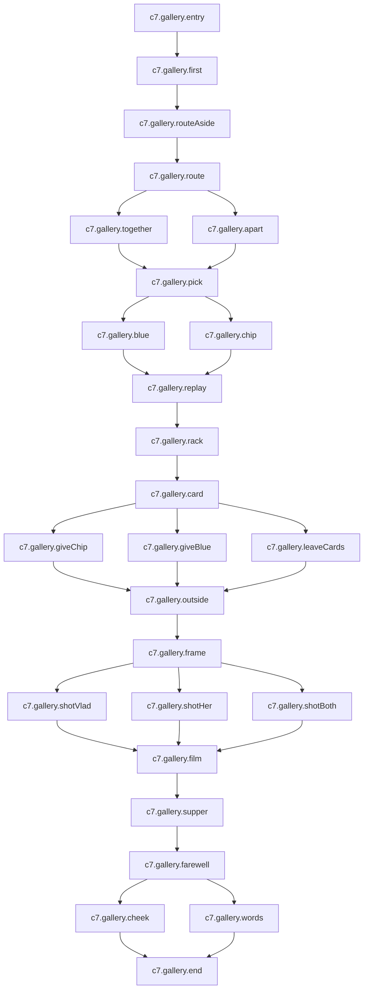

# Глава 7 · «На шаг левее»

Сценарное зеркало редакции content26. [Исходник главы](../src/content/chapters/ch07.ts) · [Сценарное ядро](NARRATIVE_CORE.md).

Вход: `c7.gallery.entry`. Узлов: 26. Основных реплик: 128.

### `c7.gallery.entry` · dialogue

Фон: `bg.gallery7.outside`; персонаж: `vlad.city.smile`.

1. **Описание:** На высокой стеклянной двери галереи висит та самая чёрно-белая афиша с набережной, только почти в человеческий рост.
2. **Описание:** Влад уже ждёт у входа. Заметив тебя, он сразу отрывается от плаката и шагает навстречу.
3. **Ты:** Ну что, разгадал наконец — лестница там или крыша?
4. **Влад:** кручу головой перед плакатом уже третью минуту и всё равно не могу решить — лестница это или крыша.
   - Эмоция Влада: `smile`.
5. **Влад:** рад тебя видеть. пойдём проверим, что они спрятали внутри?
   - Эмоция Влада: `smile`.
6. **Описание:** От него пахнет вечерним воздухом и тем самым свежим, чуть древесным парфюмом.
7. **Ты:** В тот раз с верхней дорожки тоже были видны одни края крыш. А стоило подойти ближе — совсем другой вид.
   - Вариант при `c6PhotoPlace = "upper"`: В тот раз с верхней дорожки тоже были видны одни края крыш. А стоило подойти ближе — совсем другой вид.
   - Вариант при `c6PhotoPlace = "water"`: В тот раз у воды лестница в отражении тоже совсем на себя не походила. А здесь то же самое — только в свете и тени.
8. **Влад:** хорошо, что ты вытащила нас сюда. один я бы просто прошёл мимо витрины.
9. **Описание:** Влад открывает дверь; на стекле мелькает маленький значок перечёркнутого фотоаппарата.
   - Эмоция Влада: `laugh`.
10. **Влад:** ага. значит, нашему аппарату внутри положен тихий час, а снимать будем уже на выходе.
   - Эмоция Влада: `laugh`.
11. **Описание:** Ты проверяешь молнию сумки и шагаешь в приглушённый свет зала.
→ `c7.gallery.first`

### `c7.gallery.first` · dialogue

Фон: `bg.gallery7.hall`; персонаж: `vlad.city.neutral`.

1. **Описание:** В камерном зале стоит почти музейная тишина. Под лучами ламп висят три крупные работы, у дальней стены — одна узкая деревянная скамейка.
2. **Ты:** Здесь так тихо, что даже шептаться хочется осторожно.
   - Интонация: вполголоса.
3. **Описание:** Чтобы не нарушать тишину, Влад наклоняется чуть ближе и говорит совсем тихо:
4. **Влад:** зато никто никуда не гонит.
5. **Влад:** как пойдём смотреть?
   - Эмоция Влада: `thinking`.
→ `c7.gallery.routeAside`

### `c7.gallery.routeAside` · dialogue

Фон: `bg.gallery7.hall`; персонаж: `vlad.city.thinking`.

Реплики советчиков идут отдельной вставкой.

1. **Ангел:** Если пойти вдоль стен вдвоём, вы сможете сразу делиться каждой найденной деталью.
2. **Дьяволёнок:** А давай разойдёмся на две минуты в разные концы зала! Спорим на что угодно: через десять секунд он будет смотреть через перегородку вовсе не на фотографии?
→ `c7.gallery.route`

### `c7.gallery.route` · choice

Фон: `bg.gallery7.hall`; персонаж: `vlad.city.smile`.

- `together` — «Пройдём всю серию вдвоём, слева направо» → `c7.gallery.together` · эффекты `[{"kind":"set","key":"c7GalleryRoute","value":"together"}]`
- `apart` — «Разойдёмся, а потом каждый проведёт другого к своей находке» → `c7.gallery.apart` · эффекты `[{"kind":"set","key":"c7GalleryRoute","value":"apart"}]`

### `c7.gallery.together` · dialogue

Фон: `bg.gallery7.hall`; персонаж: `vlad.city.smile`.

1. **Ты:** Давай пройдём всю серию вдвоём, не спеша.
2. **Описание:** Вы неторопливо идёте вдоль первой перегородки — в полутени подсвечены только фотографии, и шаги звучат приглушённо.
3. **Описание:** У центральной работы со сколотым краем ступени Влад замедляет шаг и легонько трогает тебя за рукав.
4. **Влад:** вот эта сразу цепляет взгляд.
5. **Ты:** Та, где на краю ступеньки треугольный скол?
6. **Влад:** да. среди всех прямых линий здесь вдруг что-то живое и настоящее.
7. **Описание:** Внутри треугольной выемки в полосе падающего света белеют мелкие светлые камешки.
8. **Описание:** Следом вы останавливаетесь у третьей работы — старой синей двери с узкой полоской света справа.
→ `c7.gallery.pick`

### `c7.gallery.apart` · dialogue

Фон: `bg.gallery7.hall`; персонаж: `vlad.city.neutral`.

1. **Ты:** Давай на пару минут разойдёмся, а потом каждый приведёт другого к той работе, у которой захотелось остаться.
2. **Влад:** идёт. встречаемся на скамейке в глубине — я займу место.
3. **Ты:** Тут ведь всего одна скамейка на весь зал.
   - Эмоция Влада: `smile`.
4. **Влад:** вот поэтому я и не хочу делить её ни с кем, кроме тебя.
   - Эмоция Влада: `smile`.
5. **Описание:** Ты проходишь за перегородку к «Просвету» — синей двери с узкой полоской света у порога — и к соседнему снимку сколотой ступени.
6. **Описание:** Но боковым зрением замечаешь в просвете между перегородками, что Влад у соседнего стенда смотрит совсем не на раму, а на тебя.
7. **Описание:** Когда ты подходишь к скамейке, он сразу подвигается, освобождая место рядом:
   - Эмоция Влада: `thinking`.
8. **Влад:** меня больше всего зацепила ступенька со сколом. а куда поведёшь меня ты?
   - Эмоция Влада: `thinking`.
→ `c7.gallery.pick`

### `c7.gallery.pick` · choice

Фон: `bg.gallery7.hall`; персонаж: `vlad.city.smile`.

- `blue` — «Мне больше нравится «Просвет». Покажу синюю дверь» → `c7.gallery.blue` · эффекты `[{"kind":"set","key":"c7GalleryWork","value":"blue"}]`
- `chip` — «Мне тоже нравится «Скол». Покажу одну деталь» → `c7.gallery.chip` · эффекты `[{"kind":"set","key":"c7GalleryWork","value":"chip"}]`

### `c7.gallery.blue` · dialogue

Фон: `bg.gallery7.hall`; персонаж: `vlad.city.thinking`.

- Фон с индекса 3: `bg.gallery7.hall`, `vlad.closeup.intimate`.
1. **Описание:** Ты подводишь Влада за узкую перегородку, к синей двери «Просвета».
2. **Ты:** Посмотри вот отсюда. Почти весь кадр в тени, а справа в этой узкой щели столько света.
3. **Описание:** Чтобы поймать кадр без блика от софита, Влад делает шаг в узкий проход рядом с тобой.
4. **Описание:** Ты поворачиваешь голову, чтобы указать на порог, — и он в ту же секунду наклоняется ближе. В полутени за перегородкой между вами остаётся всего пара сантиметров.
5. **Описание:** Влад не отшатывается и не прячет глаз: его взгляд задерживается на твоих губах, снова поднимается к глазам, а голос звучит на полтона ниже обычного:
6. **Влад:** знаешь… с такого расстояния мне очень трудно делать вид, что я пришёл сюда ради фотографий.
   - Эмоция Влада: `warm`.
   - Интонация: вполголоса.
7. **Описание:** Секунду никто из вас не двигается с места — пока у входа не раздаются голоса новых посетителей, и Влад с лёгкой усмешкой отступает на полшага.
→ `c7.gallery.replay`

### `c7.gallery.chip` · dialogue

Фон: `bg.gallery7.hall`; персонаж: `vlad.city.thinking`.

- Фон с индекса 3: `bg.gallery7.hall`, `vlad.closeup.intimate`.
1. **Описание:** Вы подходите в полутень к «Сколу». Пространства перед перегородкой немного, и вы встаёте совсем близко перед рамой.
2. **Ты:** Мне тоже полюбилась эта работа. Смотри, как внутри тёмного скола светятся маленькие камешки.
3. **Описание:** Поднимая руку, чтобы указать на выемку, ты замечаешь в тёмном стекле рамы отражение: Влад смотрит не на фотографию, а на тебя.
4. **Описание:** Ты поворачиваешь голову — и вы оказываетесь глаза в глаза, на расстоянии одного вдоха. Влад не спешит отступать и говорит совсем тихо:
5. **Влад:** я сначала разбирал свет и линии… а сейчас стою и вообще ничего, кроме тебя, в этом зале не вижу.
   - Эмоция Влада: `warm`.
   - Интонация: тихо.
6. **Описание:** Пауза длится чуть дольше обычного — пока в соседнем проходе не скрипит половица под шагами смотрителя, и Влад с лёгкой досадой кивает на скамейку в глубине зала.
→ `c7.gallery.replay`

### `c7.gallery.replay` · dialogue

Фон: `bg.gallery7.hall`; персонаж: `vlad.city.thinking`.

1. **Ты:** Кажется, на скамейке сейчас будет спокойнее.
2. **Влад:** насчёт спокойствия не обещаю, но место в первом ряду всё ещё наше.
3. **Описание:** Вы садитесь на узкую деревянную скамейку у дальней стены. Влад достаёт складной план зала с тремя прямоугольниками стендов и дверью выхода.
4. **Влад:** эти перегородки расставлены прямо как моя любимая головоломка на два хода: пока двое идут поодиночке в обход — застревают, а стоит одному подождать второго — выходят вместе.
5. **Ты:** И как бы ты провёл нас отсюда?
6. **Описание:** Вместо того чтобы чертить по бумаге, Влад откладывает листок и, чуть помедлив, протягивает руку к твоей ладони.
7. **Описание:** Кончиком пальца он медленно проводит короткую воображаемую линию по твоей ладони — от запястья к центру.
8. **Описание:** От этого спокойного, неожиданного жеста разговор про схему сразу теряет всякий смысл.
9. **Влад:** вот здесь мы зашли… вот здесь задержались за перегородкой… а вот тут выходим вместе.
   - Эмоция Влада: `smile`.
   - Интонация: тихо.
10. **Ты:** Кажется, на твоём маршруте была очень долгая остановка посередине.
   - Эмоция Влада: `smile`.
11. **Влад:** лучшая остановка. я бы её повторил.
   - Эмоция Влада: `smile`.
12. **Описание:** Он подаёт тебе руку, и вы поднимаетесь со скамейки к выходу.
→ `c7.gallery.rack`

### `c7.gallery.rack` · dialogue

Фон: `bg.gallery7.hall`; персонаж: `vlad.city.smile`.

Реплики советчиков идут отдельной вставкой.

1. **Описание:** У выхода на поворотной стойке стоят матовые открытки с работами выставки: крупный треугольный скол со светлыми камешками и синяя дверь «Просвета».
2. **Описание:** На открытке «Просвета» внизу угадывается каменный порог, а на «Сколе» чётко видна светлая выемка в тени.
3. **Описание:** Влад уже придерживает стеклянную дверь в двух шагах впереди, а стойка оказывается прямо у тебя под рукой.
4. **Дьяволёнок:** Подари ему открытку прямо сейчас — посмотрим, как быстро он растеряется, когда подарок выбираешь ты!
5. **Ангел:** Карточка останется у него дома на видном месте и будет согревать его до следующей встречи.
→ `c7.gallery.card`

### `c7.gallery.card` · choice

Фон: `bg.gallery7.hall`; персонаж: `vlad.city.smile`.

- `chip` — «Подарю Владу «Скол»» → `c7.gallery.giveChip` · эффекты `[{"kind":"set","key":"c7GalleryGift","value":"chip"}]`
- `blue` — «Подарю Владу «Просвет»» → `c7.gallery.giveBlue` · эффекты `[{"kind":"set","key":"c7GalleryGift","value":"blue"}]`
- `none` — «Оставлю открытки на стойке» → `c7.gallery.leaveCards` · эффекты `[{"kind":"set","key":"c7GalleryGift","value":"none"}]`

### `c7.gallery.giveChip` · dialogue

Фон: `bg.gallery7.hall`; персонаж: `vlad.city.smile`.

1. **Описание:** Ты берёшь открытку со «Сколом», оплачиваешь у входа и подходишь к Владу у двери.
2. **Ты:** Это тебе. Забирай домой ту самую работу, к которой ты возвращался.
3. **Влад:** подожди… ты купила её для меня?
   - Эмоция Влада: `surprised`.
4. **Описание:** Влад принимает карточку за белые поля и на секунду искренне теряет слова — видно, как его это тронуло.
   - Эмоция Влада: `surprised`.
   - Эффекты после действия: `[{"kind":"set","key":"c7GalleryGift","value":"chip"}]`.
5. **Влад:** спасибо. поставлю её дома на видное место — чтобы вспоминать, как мы стояли перед ней в этом зале.
   - Эмоция Влада: `smile`.
6. **Описание:** Он аккуратно прячет открытку внутрь сложенного буклета во внутренний карман пальто.
   - Эмоция Влада: `smile`.
→ `c7.gallery.outside`

### `c7.gallery.giveBlue` · dialogue

Фон: `bg.gallery7.hall`; персонаж: `vlad.city.smile`.

1. **Описание:** Ты покупаешь синюю открытку «Просвета» и протягиваешь её Владу у распахнутой двери.
2. **Ты:** Держи. Хочу, чтобы моя любимая работа с сегодняшнего вечера осталась у тебя.
3. **Влад:** твоя любимая… значит, дома у неё будет особое место.
   - Эмоция Влада: `surprised`.
4. **Ты:** Только не прячь её далеко за монитор.
   - Эмоция Влада: `surprised`.
5. **Описание:** Влад рассматривает синюю карточку на свету и благодарно сжимает твои пальцы.
   - Эффекты после действия: `[{"kind":"set","key":"c7GalleryGift","value":"blue"}]`.
6. **Влад:** ни за что не спрячу. буду смотреть на эту дверь и вспоминать то, что было за перегородкой. спасибо.
7. **Описание:** Он убирает открытку в буклет и кладёт во внутренний карман.
→ `c7.gallery.outside`

### `c7.gallery.leaveCards` · dialogue

Фон: `bg.gallery7.hall`; персонаж: `vlad.city.smile`.

1. **Описание:** Ты проходишь мимо стойки к Владу, который придерживает для тебя дверь на улицу.
   - Эффекты после действия: `[{"kind":"set","key":"c7GalleryGift","value":"none"}]`.
2. **Ты:** Кажется, после сегодняшнего вечера я и без открыток запомню каждую линию в этом зале.
3. **Влад:** я тоже. особенно тот момент у перегородки. осторожно, здесь у порога ступенька.
4. **Описание:** Он подаёт тебе руку, помогая спуститься с крыльца на вечерний тротуар.
→ `c7.gallery.outside`

### `c7.gallery.outside` · dialogue

Фон: `bg.gallery7.outside`; персонаж: `vlad.city.smile`.

1. **Описание:** На улице свежо. Тёмное витринное стекло рядом с афишей отражает огни фасада напротив и вас двоих на крыльце.
2. **Описание:** Ты достаёшь из сумки плёночный аппарат. На счётчике по-прежнему цифра «9».
3. **Влад:** ну вот, тихий час для фотографов закончился. выбирай, каким будет наш главный кадр у галереи.
→ `c7.gallery.frame`

### `c7.gallery.frame` · choice

Фон: `bg.gallery7.outside`; персонаж: `vlad.city.smile`.

- `vlad` — «Я сниму тебя у афиши» → `c7.gallery.shotVlad` · эффекты `[{"kind":"set","key":"c7GalleryFrame","value":"vlad"}]`
- `her` — «Теперь ты меня. Силуэт на пороге» → `c7.gallery.shotHer` · эффекты `[{"kind":"set","key":"c7GalleryFrame","value":"her"}]`
- `both` — «Давай сниму нас обоих в стекле» → `c7.gallery.shotBoth` · эффекты `[{"kind":"set","key":"c7GalleryFrame","value":"both"}]`

### `c7.gallery.shotVlad` · dialogue

Фон: `bg.gallery7.outside`; персонаж: `vlad.city.smile`.

1. **Ты:** Встань на секунду у афиши — чуть левее, чтобы белая полоса на плакате шла прямо к твоему плечу.
2. **Описание:** Влад прислоняется к краю витрины. Светлая диагональ на бумаге удивительно точно продолжает линию его воротника.
3. **Влад:** вот так?
   - Эмоция Влада: `neutral`.
4. **Ты:** Да. И не двигайся секунду.
   - Эмоция Влада: `neutral`.
5. **Влад:** замер. смотрю только на фотографа.
   - Эмоция Влада: `neutral`.
6. **Описание:** Через видоискатель видно, как спокойно и прямо он смотрит сквозь объектив на тебя. Ты нажимаешь спуск и прокручиваешь колёсико.
   - Эффекты после действия: `[{"kind":"set","key":"c7Film","value":"key"}]`.
→ `c7.gallery.film`

### `c7.gallery.shotHer` · dialogue

Фон: `bg.gallery7.outside`; персонаж: `vlad.city.smile`.

1. **Ты:** Сними лучше меня на пороге — там изнутри падает такая же полоса света, как на «Просвете».
2. **Описание:** Ты передаёшь камеру Владу и встаёшь на ступеньке у края приоткрытой двери.
   - Эмоция Влада: `thinking`.
   - Эффекты после действия: `[{"kind":"set","key":"c7CameraHolder","value":"vlad"}]`.
3. **Влад:** стой ровно так… твой профиль в этой полосе света сейчас лучше всей выставки.
   - Эмоция Влада: `thinking`.
4. **Ты:** Не смущай модель, снимай!
5. **Описание:** Влад с усмешкой нажимает спуск, прокручивает колёсико и подаёт тебе руку, помогая сойти со ступеньки.
   - Эффекты после действия: `[{"kind":"set","key":"c7CameraHolder","value":"her"},{"kind":"set","key":"c7Film","value":"key"}]`.
→ `c7.gallery.film`

### `c7.gallery.shotBoth` · dialogue

Фон: `bg.gallery7.outside`; персонаж: `vlad.city.smile`.

1. **Ты:** Давай сниму наше отражение в тёмном стекле — если встанем близко, поместимся оба.
2. **Описание:** Панель стекла узкая. Чтобы оба силуэта вошли в одну раму без бликов, Влад встаёт совсем близко сбоку за тобой и чуть наклоняет голову к твоему уровню.
3. **Описание:** В тёмном отражении стекла хорошо видно, как легко вы смотритесь рядом.
   - Эмоция Влада: `surprised`.
4. **Влад:** смотри, в отражении козырёк над нами похож на одну общую крышу.
   - Эмоция Влада: `surprised`.
   - Интонация: тихо.
5. **Ты:** Мне нравится эта крыша.
6. **Описание:** За секунду до щелчка вы смотрите в стекле не на камеру, а друг на друга. Ты нажимаешь кнопку спуска.
   - Эффекты после действия: `[{"kind":"set","key":"c7Film","value":"key"}]`.
→ `c7.gallery.film`

### `c7.gallery.film` · dialogue

Фон: `bg.gallery7.outside`; персонаж: `vlad.city.smile`.

1. **Описание:** На счётчике восемь. По дороге к перекрёстку вы делаете ещё один кадр вечерней улицы в огнях витрин, а когда ты смеёшься его шутке у тёмного стекла, Влад перехватывает камеру и со словами «вот это упустить нельзя» снимает тебя врасплох.
2. **Описание:** Когда он возвращает аппарат и ты убираешь его в сумку, на счётчике остаётся шесть кадров.
   - Эффекты после действия: `[{"kind":"set","key":"c7Film","value":"six"},{"kind":"set","key":"c7CameraHolder","value":"her"}]`.
→ `c7.gallery.supper`

### `c7.gallery.supper` · dialogue

Фон: `bg.gallery7.outside`; персонаж: `vlad.city.smile`.

1. **Описание:** Из приоткрытого окна маленького бистро на первом этаже тянет запахом жареного лука и свежего хлеба. Влад с интересом ведёт носом в сторону окна.
2. **Влад:** вот эту экспозицию я понимаю вообще без буклетов.
   - Эмоция Влада: `laugh`.
3. **Ты:** Так вот какие выставки тебя на самом деле вдохновляют.
4. **Влад:** вообще-то у меня только что появилась идея получше любого бистро.
5. **Описание:** Он останавливается напротив тебя под уличным фонарём — во взгляде появляется тёплая, открытая решимость:
   - Эмоция Влада: `smile`.
6. **Влад:** приходи ко мне домой в следующий раз? хочу приготовить настоящий ужин вместе с тобой. на живой кухне, а не на экране телевизора.
   - Эмоция Влада: `smile`.
7. **Ты:** «Приготовить вместе» звучит очень заманчиво. Уступишь мне хотя бы половину кухни?
   - Эмоция Влада: `laugh`.
8. **Влад:** всю лучшую половину. у меня, правда, дома всего один фартук, но я готов торжественно носить его сам.
   - Эмоция Влада: `laugh`.
9. **Ты:** Договорились, фартук твой. А начинку выберем уже на месте, у твоей плиты.
10. **Влад:** ловлю на слове. продукты с меня — приходи к вечеру, буду ждать.
11. **Описание:** На перекрёстке загорается зелёный. Владу прямо по бульвару, а тебе — через дорогу.
→ `c7.gallery.farewell`

### `c7.gallery.farewell` · choice

Фон: `bg.gallery7.outside`; персонаж: `vlad.city.smile`.

- `cheek` — «Задержать его руку и шагнуть к нему совсем близко» → `c7.gallery.cheek` · эффекты `[{"kind":"set","key":"c7GalleryFarewell","value":"cheek"}]`
- `words` — «Улыбнуться ему и не спеша попрощаться» → `c7.gallery.words` · эффекты `[{"kind":"set","key":"c7GalleryFarewell","value":"words"}]`

### `c7.gallery.cheek` · dialogue

Фон: `bg.gallery7.outside`; персонаж: `vlad.city.smile`.

1. **Описание:** Зелёный уже горит, но вместо шага на зебру ты берёшь Влада за руку и подходишь совсем близко.
2. **Ты:** Подожди секунду, Влад.
   - Интонация: тихо.
3. **Описание:** Он сразу наклоняется навстречу. Ты приподнимаешься на носки, опираешься ладонью о его плечо и мягко целуешь его в щёку, совсем рядом с уголком губ.
   - Эмоция Влада: `surprised`.
   - Эффекты после действия: `[{"kind":"set","key":"c7Cheek","value":true}]`.
4. **Описание:** Когда ты отступаешь на полшага, Влад на секунду замирает совершенно обезоруженный, а его пальцы невольно сжимают твою ладонь крепче.
   - Эмоция Влада: `surprised`.
5. **Влад:** так. дай мне ровно две секунды — после такого манёвра переходить дорогу по правилам было бы преступлением с твоей стороны.
   - Эмоция Влада: `smile`.
6. **Описание:** Он наконец выдыхает и широко, немного растерянно усмехается.
   - Эмоция Влада: `laugh`.
7. **Ты:** Успел. До встречи на нашей кухне, Влад.
   - Эмоция Влада: `laugh`.
8. **Влад:** до встречи. теперь точно буду считать часы до этого ужина.
9. **Описание:** Ты с улыбкой ступаешь на зебру, унося с собой ощущение его крепко сжатых на прощание пальцев и нетерпение до вашего ужина.
→ `c7.gallery.end`

### `c7.gallery.words` · dialogue

Фон: `bg.gallery7.outside`; персонаж: `vlad.city.neutral`.

1. **Ты:** Мне было очень хорошо с тобой в этом тихом зале. И приглашение на твою кухню я запомнила.
2. **Влад:** я, кажется, весь остаток вечера буду вспоминать, как мы стояли за той перегородкой. спасибо, что позвала сюда.
3. **Ты:** До скорой встречи, Влад.
   - Эмоция Влада: `smile`.
4. **Влад:** пока. увидимся у меня на кухне.
   - Эмоция Влада: `smile`.
5. **Описание:** Ты легко переходишь бульвар на зелёный свет — в сумке лежат уже шесть отснятых кадров вашей общей осени, а впереди ждёт вечер на его кухне.
→ `c7.gallery.end`

### `c7.gallery.end` · end

Открытка: `c7.gallery`; endingId: `c7.gallery`.
