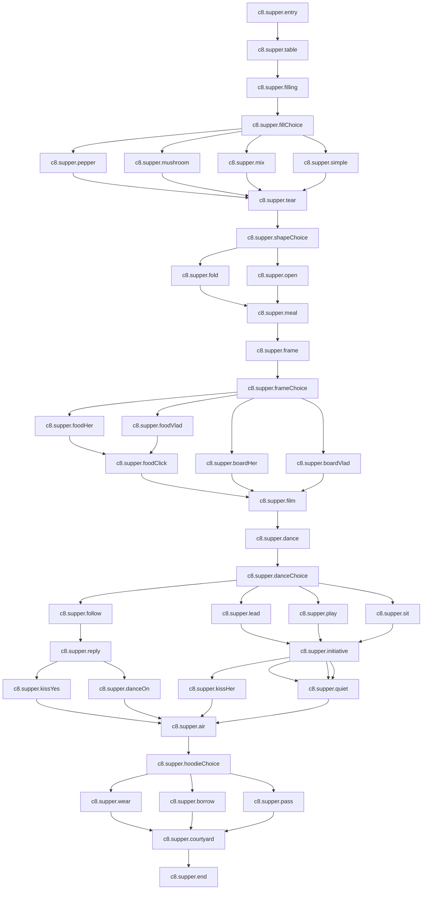

# Глава 8 · «Половина кухни»

Актуальный runtime content24, `scriptRevision: 6` от 23 ноября 2026. Ужин и смена иллюстраций описаны в [ТЗ готовки](CHAPTER_08_COOKING_LOGIC_AND_SVG_SPEC_2026_11_23.md). Сценарное ядро — [NARRATIVE_CORE.md](NARRATIVE_CORE.md).

Вход: `c8.supper.entry`. Узлов: 40. Основных реплик: 201.

### `c8.supper.entry` · dialogue

Фон: `bg.supper8.kitchen`; персонаж: `vlad.apron.smile`.

1. **Описание:** Влад открывает дверь уже в тёмном кухонном фартуке. Поперёк кармана тянется белый след от муки, а из кухни пахнет печёным перцем и обжаренными грибами.
   - Эффекты после действия: `[{"kind":"set","key":"c8Place","value":"home"}]`.
2. **Ты:** Смотрю, вопрос с единственным фартуком решён ещё до моего прихода.
3. **Влад:** я человек слова. правда, стоило его завязать и достать муку, как я тут же оставил на себе автограф.
4. **Ты:** Зато теперь нам обоим не страшно испачкаться.
5. **Влад:** на это я и рассчитывал. проходи, стол освободил — теперь моя маленькая кухня официально рассчитана на двоих.
6. **Описание:** Ты оставляешь сумку с фотоаппаратом у стены и моешь руки; Влад подаёт чистое сухое полотенце.
7. **Описание:** На столе уже ждут две тарелки — ты берёшь верхнюю и ставишь на свою сторону.
→ `c8.supper.table`

### `c8.supper.table` · dialogue

Фон: `bg.supper8.kitchen`; персонаж: `vlad.apron.smile`.

1. **Описание:** За тарелкой, прислонённая к фарфоровой сахарнице, стоит твоя открытка из галереи — «Скол» повёрнут прямо к твоему стулу.
   - Условие: `c7GalleryGift = "chip"`.
2. **Ты:** Ты поставил «Скол» прямо сюда! Под лампой каждую светлую крупинку видно.
   - Условие: `c7GalleryGift = "chip"`.
3. **Влад:** поставил напротив твоего места. утром пил кофе, смотрел на неё и вспоминал тот зал.
   - Условие: `c7GalleryGift = "chip"`.
4. **Описание:** Ты чуть сдвигаешь сахарницу, чтобы открытка оставалась на виду.
   - Условие: `c7GalleryGift = "chip"`.
5. **Описание:** За тарелкой, у сахарницы, стоит подаренная тобой синяя открытка «Просвета» — в свете кухонной лампы полоска двери на ней будто светится.
   - Условие: `c7GalleryGift = "blue"`.
6. **Ты:** Ты поставил «Просвет» прямо к нашему столу! Вечером под лампой эта дверь кажется ещё уютнее.
   - Условие: `c7GalleryGift = "blue"`.
7. **Влад:** утром она мне подняла настроение. пил кофе, смотрел на неё и думал, как ты сегодня придёшь.
   - Условие: `c7GalleryGift = "blue"`.
8. **Описание:** Ты придвигаешь сахарницу чуть глубже, оставляя синюю дверь на виду.
   - Условие: `c7GalleryGift = "blue"`.
9. **Описание:** Под кухонной лампой сложены две салфетки, а посередине стола Влад заранее поставил деревянную подставку под горячее.
   - Условие: `c7GalleryGift = "none"`.
10. **Ты:** Думаешь, наше будущее блюдо сюда поместится?
   - Условие: `c7GalleryGift = "none"`.
11. **Влад:** я ради тебя даже цветок с подоконника переселил — места хватит на любой кулинарный эксперимент.
   - Условие: `c7GalleryGift = "none"`.
12. **Влад:** план был такой: завернуть одну большую лепёшку с начинкой, подрумянить до хруста и нарезать на двоих. одобряешь?
13. **Ты:** Одобряю. Только начинку собираем в четыре руки.
14. **Влад:** ради этого и звал. одному у этой доски стоять совсем не то.
→ `c8.supper.filling`

### `c8.supper.filling` · dialogue

Фон: `bg.supper8.kitchen`; персонаж: `vlad.apron.smile`.

1. **Описание:** Влад выставляет у разделочной доски красный перец в масле, обжаренные грибы, сыр и свежую зелень.
2. **Описание:** Когда он поворачивается к свету, ты замечаешь у него на скуле небольшой белый мазок муки.
3. **Ты:** Подожди, шеф-повар. Не двигайся секунду.
   - Интонация: с усмешкой.
4. **Описание:** Ты тянешься и аккуратно стираешь муку с его скулы. Влад на секунду замирает с тёркой в руках, чуть удивлённый твоим жестом, а потом тихо хмыкает:
5. **Влад:** спасибо… я бы так весь вечер и ходил. а если честно, можешь стирать её подольше.
6. **Ты:** Тогда мы точно останемся без ужина. Кто у нас отвечает за сыр?
7. **Влад:** я и моя тёрка полностью в твоём распоряжении. выбирай, с чего начинаем.
→ `c8.supper.fillChoice`

### `c8.supper.fillChoice` · choice

Фон: `bg.supper8.kitchen`; персонаж: `vlad.apron.smile`.

Вопрос: Чем наполним лепёшку?
- `pepper` — «Возьму перец и сыр» → `c8.supper.pepper` · эффекты `[{"kind":"set","key":"c8Filling","value":"pepper"}]`
- `mushroom` — «Возьму грибы и сыр» → `c8.supper.mushroom` · эффекты `[{"kind":"set","key":"c8Filling","value":"mushroom"}]`
- `mix` — «Смешаем перец, грибы и сыр» → `c8.supper.mix` · эффекты `[{"kind":"set","key":"c8Filling","value":"mix"}]`
- `simple` — «Возьму просто сыр и зелень» → `c8.supper.simple` · эффекты `[{"kind":"set","key":"c8Filling","value":"simple"}]`

### `c8.supper.pepper` · dialogue

Фон: `bg.supper8.kitchen`; персонаж: `vlad.apron.smile`.

1. **Ты:** Берём сладкий перец. Побольше красного, чтобы он ярко смотрелся сквозь расплавленный сыр.
2. **Влад:** отличный выбор. приступаю к обязанностям сырного ассистента.
3. **Описание:** Вы работаете у одной узкой столешницы: ты режешь перец тонкими полосками, Влад рядом натирает сыр.
4. **Ты:** Кажется, сыра у тебя там уже на два ресторана.
5. **Влад:** сыра много не бывает. вот расплавится — сама скажешь спасибо.
6. **Описание:** Ты протягиваешь ему полоску сладкого перца на пробу; Влад перехватывает её, кивает с видом критика и возвращается к тёрке.
→ `c8.supper.tear`

### `c8.supper.mushroom` · dialogue

Фон: `bg.supper8.kitchen`; персонаж: `vlad.apron.smile`.

1. **Ты:** Конечно грибы. Они так пахли ещё с порога, что у меня не было шансов выбрать другое.
2. **Влад:** знал, чем тебя заманить. специально обжарил их до корочки перед твоим приходом.
3. **Описание:** У одной доски места немного — вы работаете слаженно, передавая миску и нож без лишних слов.
4. **Ты:** Вот эти самые румяные кусочки оставлю на видном месте.
5. **Влад:** попробуй один прямо сейчас — надо же проверить шеф-повара.
6. **Описание:** Он подаёт тебе поджаристый ломтик на кончике вилки; получается действительно вкусно, и Влад явно доволен твоей оценкой.
→ `c8.supper.tear`

### `c8.supper.mix` · dialogue

Фон: `bg.supper8.kitchen`; персонаж: `vlad.apron.smile`.

1. **Ты:** Давай соединим всё вместе: с меня красный перец, с тебя грибы и сыр.
2. **Влад:** настоящий кооператив на кухне. мне нравится твой подход.
3. **Описание:** Вы по очереди отправляете в общую миску яркий перец, грибы и горку сыра; на маленькой кухне руки то и дело пересекаются над одной доской.
4. **Ты:** По-моему, получилось идеально.
5. **Влад:** ещё бы. с таким напарником невкусно получиться не может.
→ `c8.supper.tear`

### `c8.supper.simple` · dialogue

Фон: `bg.supper8.kitchen`; персонаж: `vlad.apron.smile`.

1. **Ты:** Давай сделаем простую классику — сыр и свежую зелень, без долгой нарезки.
2. **Влад:** с радостью. быстрее управимся у доски — больше времени останется на сам вечер.
3. **Описание:** Ты рвёшь ароматные листочки зелени, пока Влад натирает сыр и смешивает всё в одной миске.
→ `c8.supper.tear`

### `c8.supper.tear` · dialogue

Фон: `bg.supper8.kitchen`; персонаж: `vlad.apron.smile`.

Отображение: `adviser-aside`.
1. **Описание:** Ты придерживаешь край доски, Влад разворачивает тонкий лист лепёшки — и сухой сгиб посередине расходится прямо в руках на две половины.
2. **Описание:** Вы со смехом пытаетесь сложить края внахлёст, но шов снова раскрывается: один большой рулет на сковороде точно распадётся.
3. **Влад:** ну вот. мой грандиозный план рухнул на глазах. зато теперь у каждого буквально своя половина кухни.
4. **Ты:** Не спеши сдаваться. Разделим каждую половину ещё пополам — получится ровно четыре порции, по две на каждого. Так выйдет даже вкуснее.
5. **Ангел:** Из четырёх кусочков получатся аккуратные закрытые конвертики на сковороде.
6. **Дьяволёнок:** А если запечь все четыре порции открытыми в духовке, сверху будет хрустящая золотистая корочка сыра!
→ `c8.supper.shapeChoice`

### `c8.supper.shapeChoice` · choice

Фон: `bg.supper8.kitchen`; персонаж: `vlad.apron.smile`.

Вопрос: Как изменим план?
- `fold` — «Сложим маленькие конверты и подрумяним на сковороде» → `c8.supper.fold` · эффекты `[{"kind":"set","key":"c8Shape","value":"fold"}]`
- `open` — «Оставим порции открытыми и запечём» → `c8.supper.open` · эффекты `[{"kind":"set","key":"c8Shape","value":"open"}]`

### `c8.supper.fold` · dialogue

Фон: `bg.supper8.kitchen`; персонаж: `vlad.apron.smile`.

1. **Ты:** Сложим четыре маленьких конвертика и обжарим до хруста. Поверни сковороду ручкой ко мне.
2. **Описание:** Влад сдвигается чуть в сторону, поворачивает ручку сковороды к тебе и освобождает место у плиты, чтобы тебе было удобно.
3. **Описание:** Ты выкладываешь начинку с перцем на первый квадратик и подгибаешь край, а Влад подхватывает готовый конвертик лопаткой.
   - Условие: `c8Filling = "pepper"`.
4. **Описание:** Ты выкладываешь грибы с сыром на первый кусочек и сворачиваешь уголки, а Влад аккуратно переносит конверт на сковороду.
   - Условие: `c8Filling = "mushroom"`.
5. **Описание:** Ты придерживаешь края лепёшки, Влад помогает загнуть непослушный уголок, и первый конвертик вы отправляете на сковороду вместе.
   - Условие: `c8Filling = "mix"`.
6. **Описание:** Влад быстро складывает сырные конвертики рядом, а ты снимаешь лопаткой первую подрумянившуюся порцию.
   - Условие: `c8Filling = "simple"`.
7. **Влад:** смотри, у самого первого уголок всё-таки приоткрылся.
8. **Ты:** Не трогай его — там сейчас зажарится самое вкусное сырное ушко.
9. **Описание:** Расплавленный сыр у края схватывается золотистой корочкой, и по кухне расходится такой домашний запах, что уходить от плиты не хочется. Влад аккуратно перекладывает все четыре румяных конвертика со сковороды на общее блюдо.
10. **Влад:** чур это хрустящее ушко на первом делим строго пополам.
→ `c8.supper.meal`

### `c8.supper.open` · dialogue

Фон: `bg.supper8.kitchen`; персонаж: `vlad.apron.smile`.

1. **Ты:** Разложим все четыре кусочка на противне открытыми — пусть сыр сверху запечётся золотистой шапкой.
2. **Влад:** гениально. тогда каждый уголок будет хрустеть. сейчас разогрею духовку.
3. **Описание:** Влад достаёт противень, ловко обходя тебя в узком проходе между столом и плитой, и расстилает пергамент.
4. **Описание:** Ты распределяешь перец с сыром по первой порции, а Влад переносит наполненные ломтики на противень.
   - Условие: `c8Filling = "pepper"`.
5. **Описание:** Ты укладываешь грибы и сыр до самых краёв, а Влад рядом выравнивает порции на листе.
   - Условие: `c8Filling = "mushroom"`.
6. **Описание:** Влад кладёт начинку ложкой, а ты разравниваешь её до уголков — ваши руки двигаются над противнем почти синхронно.
   - Условие: `c8Filling = "mix"`.
7. **Описание:** Влад раскладывает сыр с зеленью по кусочкам, пока ты освобождаешь деревянную подставку на столе.
   - Условие: `c8Filling = "simple"`.
8. **Ты:** Смотри, у этой порции сыр лёг прямо до самого уголка — запечётся до хруста.
9. **Влад:** отлично. вот этот румяный край и будет нашим главным дегустационным укусом на двоих.
10. **Описание:** Через несколько минут Влад достаёт горячий противень и аккуратно перекладывает все четыре запечённые порции на общее блюдо на подставке: вокруг расплавленного сыра поднялись румяные края.
11. **Ты:** Тот самый уголок подрумянился лучше всех. Неси скорее к столу.
→ `c8.supper.meal`

### `c8.supper.meal` · dialogue

Фон: `bg.supper8.kitchen`; персонаж: `vlad.apron.smile`.

- Фон с индекса 15: `bg.supper8.kitchen`, `vlad.casual.smile`.
1. **Описание:** Вы садитесь за маленький стол друг напротив друга. Посередине на блюде дымятся четыре горячие порции; под абажуром уютно и тихо, за окном уже совсем стемнело.
2. **Описание:** Вы раскладываете по первому конвертику на тарелки. Ты отламываешь то самое хрустящее сырное ушко и передаёшь половину Владу через стол.
   - Условие: `c8Shape = "fold"`.
3. **Описание:** Вы берёте по первой порции на тарелки. Ты отламываешь тот самый румяный хрустящий край с сыром и передаёшь половину Владу через стол.
   - Условие: `c8Shape = "open"`.
4. **Ты:** Видишь эту яркую красную полоску перца? Я берегла её с самой доски.
   - Условие: `c8Filling = "pepper"`.
5. **Ты:** А вот и тот самый поджаристый гриб, который мы приметили.
   - Условие: `c8Filling = "mushroom"`.
6. **Ты:** Смотри, твои грибы и мой перец встретились в самом лучшем кусочке.
   - Условие: `c8Filling = "mix"`.
7. **Ты:** Сыр у края так вкусно подрумянился, и зелень здесь идеально к месту.
   - Условие: `c8Filling = "simple"`.
8. **Влад:** осторожно, серединка ещё горячая.
9. **Описание:** Первую порцию вы съедаете почти без пауз — тесто хрустит, расплавленный сыр тянется, и на маленькой кухне становится совсем по-домашнему.
10. **Влад:** слушай… а хорошо, что лепёшка порвалась. в четырёх порциях хрустящих краёв оказалось в два раза больше.
11. **Описание:** Ужин оказывается неожиданно вкусным — вы смеётесь, обсуждаете, какой кусок удался лучше, и незаметно съедаете половину. На общем блюде остаются две порции: одна целая и одна, которую вы только что разломили на двоих.
12. **Описание:** Когда первый азарт стихает, за столом наступает спокойная, домашняя пауза. Влад смотрит на тебя через стол — без обычной шутки, чуть серьёзнее.
13. **Ты:** Ты часто ужинаешь вот так, за этим столом?
   - Интонация: тихо.
14. **Влад:** один — почти никогда. обычно перехватываю что-нибудь на ходу, потому что на пустой кухне слишком тихо.
15. **Влад:** я раньше думал, что дома хорошо, когда просто тихо и никто не трогает. а сейчас смотрю на тебя и понимаю… мне просто не хватало здесь тебя.
16. **Описание:** Сказано это так просто и беззащитно честно, что в комнате на секунду становится совсем тихо. Влад развязывает фартук и вешает его на спинку стула.
17. **Ты:** Мне тоже здесь очень хорошо, Влад. На нашей половине кухни.
18. **Влад:** она теперь твоя в любой вечер, когда захочешь прийти.
→ `c8.supper.frame`

### `c8.supper.frame` · dialogue

Фон: `bg.supper8.kitchen`; персонаж: `vlad.casual.smile`.

1. **Описание:** На деревянной доске ещё белеет мучной след, на блюде лежат оставшиеся две порции вашего ужина. Ты достаёшь из сумки плёночный аппарат — на счётчике «6».
2. **Ты:** Давай сохраним эту кухню на плёнке, пока всё не съели. Хочу помнить этот стол таким.
→ `c8.supper.frameChoice`

### `c8.supper.frameChoice` · choice

Фон: `bg.supper8.kitchen`; персонаж: `vlad.casual.smile`.

Вопрос: Что оставим на плёнке?
- `foodHer` — «Я сниму блюдо» → `c8.supper.foodHer` · эффекты `[{"kind":"set","key":"c8Frame","value":"foodHer"}]`
- `foodVlad` — «Влад, сними блюдо» → `c8.supper.foodVlad` · эффекты `[{"kind":"set","key":"c8Frame","value":"foodVlad"}]`
- `boardHer` — «Я сниму рабочий беспорядок» → `c8.supper.boardHer` · эффекты `[{"kind":"set","key":"c8Frame","value":"boardHer"}]`
- `boardVlad` — «Влад, сними рабочий беспорядок» → `c8.supper.boardVlad` · эффекты `[{"kind":"set","key":"c8Frame","value":"boardVlad"}]`

### `c8.supper.foodHer` · dialogue

Фон: `bg.supper8.kitchen`; персонаж: `vlad.casual.smile`.

1. **Ты:** Придвинь блюдо чуть ближе к лампе, а я сниму сверху.
2. **Описание:** Влад берётся за дальний край тарелки. В видоискателе остаются целая порция, разломленный на двоих кусочек и его пальцы на фарфоре.
3. **Влад:** руки из кадра убрать?
4. **Ты:** Нет, оставь пальцы на тарелке. Хочу, чтобы на снимке были и твои руки.
→ `c8.supper.foodClick`

### `c8.supper.foodVlad` · dialogue

Фон: `bg.supper8.kitchen`; персонаж: `vlad.casual.smile`.

1. **Ты:** Сними с твоей стороны стола — оттуда свет красиво ложится на золотистый край.
2. **Описание:** Ты передаёшь камеру Владу и придерживаешь блюдо. Он ловит в видоискатель две порции и твои пальцы на краю тарелки.
3. **Влад:** вот так идеально. наш ужин и твои руки в одном кадре.
→ `c8.supper.foodClick`

### `c8.supper.foodClick` · dialogue

Фон: `bg.supper8.kitchen`; персонаж: `vlad.casual.smile`.

1. **Описание:** Позади тарелки в кадр попадает нижний край твоей открытки из галереи со светлой выемкой скола.
   - Условие: `c7GalleryGift = "chip"`.
2. **Описание:** Позади тарелки в кадр попадает синяя открытка «Просвета» с полоской света.
   - Условие: `c7GalleryGift = "blue"`.
3. **Описание:** Позади тарелки под лампой белеет фарфоровая сахарница.
   - Условие: `c7GalleryGift = "none"`.
4. **Описание:** Ты нажимаешь кнопку спуска и прокручиваешь колёсико.
   - Условие: `c8Frame = "foodHer"`.
   - Эффекты после действия: `[{"kind":"set","key":"c8Film","value":"key"}]`.
5. **Описание:** Влад нажимает спуск, прокручивает колёсико и возвращает камеру тебе.
   - Условие: `c8Frame = "foodVlad"`.
   - Эффекты после действия: `[{"kind":"set","key":"c8Film","value":"key"}]`.
→ `c8.supper.film`

### `c8.supper.boardHer` · dialogue

Фон: `bg.supper8.kitchen`; персонаж: `vlad.casual.smile`.

1. **Ты:** Я сниму нашу разделочную доску. Поверни её тем краем к лампе.
2. **Описание:** Влад поворачивает доску: в кадре остаются ложка, крошки и белый мучной след от ваших пальцев, похожий на запятую.
3. **Влад:** красивый росчерк. интересно, чей это след — твой или мой?
4. **Ты:** Теперь уже общий.
5. **Описание:** Ты нажимаешь спуск и прокручиваешь колёсико плёнки.
   - Эффекты после действия: `[{"kind":"set","key":"c8Film","value":"key"}]`.
→ `c8.supper.film`

### `c8.supper.boardVlad` · dialogue

Фон: `bg.supper8.kitchen`; персонаж: `vlad.casual.smile`.

1. **Ты:** Сними нашу доску сам — хочу увидеть, как этот беспорядок выглядит твоими глазами.
2. **Описание:** Ты передаёшь ему аппарат. Влад наклоняется с камерой над столешницей, ловя доску, ложку и мучную запятую у края.
3. **Влад:** самая честная фотография вечера. сразу видно, что готовили с душой.
4. **Описание:** Он нажимает спуск, прокручивает колёсико и возвращает аппарат тебе.
   - Эффекты после действия: `[{"kind":"set","key":"c8Film","value":"key"}]`.
→ `c8.supper.film`

### `c8.supper.film` · dialogue

Фон: `bg.supper8.kitchen`; персонаж: `vlad.casual.smile`.

1. **Описание:** Пока Влад разливает по кружкам горячий чай, ты успеваешь поймать ещё один кадр — его самого у плиты, смеющегося с полотенцем через плечо. А потом, когда вы снова сидите под лампой и ты, подперев щёку ладонью с пылинкой муки на пальцах, слушаешь его, Влад неожиданно поднимает аппарат и с коротким щелчком снимает тебя через стол.
2. **Описание:** У него такой довольный и чуть виноватый вид, что спорить не хочется. На счётчике остаётся «3»; ты убираешь камеру в сумку, а Влад сдвигает тарелки к краю.
   - Эффекты после действия: `[{"kind":"set","key":"c8Film","value":"nine"}]`.
→ `c8.supper.dance`

### `c8.supper.dance` · dialogue

Фон: `bg.supper8.kitchen`; персонаж: `vlad.casual.smile`.

1. **Описание:** Ты встаёшь из-за стола, чтобы поправить сумку. Влад поднимается следом и останавливается прямо перед тобой — теперь между вами нет ни стола, ни тарелок.
2. **Описание:** На кухне горит только лампа над столом; за окном глухо шумит вечерний город.
3. **Описание:** Влад делает полшага ближе и протягивает раскрытую ладонь — голос звучит тихо и немного взволнованно:
4. **Влад:** подожди, не уходи к двери. потанцуешь со мной здесь, без всякой музыки? мне весь вечер хочется просто побыть к тебе поближе.
→ `c8.supper.danceChoice`

### `c8.supper.danceChoice` · choice

Фон: `bg.supper8.kitchen`; персонаж: `vlad.casual.smile`.

Вопрос: Как тебе хочется продолжить вечер?
- `follow` — «Шагнуть в его объятия: “Веди”» → `c8.supper.follow` · эффекты `[{"kind":"set","key":"c8Step","value":"follow"}]`
- `lead` — «Положить руки ему на плечи: “Вести буду я”» → `c8.supper.lead` · эффекты `[{"kind":"set","key":"c8Step","value":"lead"}]`
- `play` — «Улыбнуться и начать с игривого шага» → `c8.supper.play` · эффекты `[{"kind":"set","key":"c8Step","value":"play"}]`
- `sit` — «Я останусь за столом. Посиди со мной» → `c8.supper.sit` · эффекты `[{"kind":"set","key":"c8Step","value":"sit"}]`

### `c8.supper.follow` · dialogue

Фон: `bg.supper8.kitchen`; персонаж: `vlad.casual.warm`.

1. **Ты:** Иди сюда. Веди.
2. **Описание:** Ты вкладываешь ладонь в его руку и шагаешь ближе. Вторая рука Влада мягко ложится тебе на талию.
3. **Влад:** здесь совсем мало места… так что шаги будут самыми медленными.
   - Интонация: тихо.
4. **Ты:** Мне большего места и не нужно.
5. **Описание:** Вы почти не двигаетесь по маленькой кухне — просто медленно покачиваетесь под лампой. Сквозь тонкую футболку чувствуется, как часто бьётся его сердце.
6. **Влад:** вот так… я бы простоял с тобой хоть до утра.
7. **Описание:** Шаги сами собой замирают. Ты поднимаешь голову; Влад смотрит на тебя сверху вниз, не отрываясь, и тихо спрашивает:
8. **Влад:** можно я тебя поцелую?
→ `c8.supper.reply`

### `c8.supper.lead` · dialogue

Фон: `bg.supper8.kitchen`; персонаж: `vlad.casual.warm`.

1. **Ты:** Пойдём. Но сегодня вести буду я.
2. **Описание:** Ты сама шагаешь к нему и кладёшь руки ему на плечи, уводя на свободный пятачок у окна. Ладони Влада ложатся тебе на талию.
3. **Влад:** я полностью в твоей власти. куда поворачиваем?
4. **Ты:** Не смотри под ноги. Смотри только на меня.
5. **Описание:** Он поднимает глаза — и от того, насколько вы близко, ваш медленный шаг сам собой затихает на одном месте.
6. **Влад:** когда я смотрю на тебя с такого расстояния, я вообще забываю, как двигаться.
   - Интонация: тихо.
7. **Описание:** Он замирает на расстоянии одного вдоха, давая тебе самой решить, каким будет следующий шаг.
→ `c8.supper.initiative`

### `c8.supper.play` · dialogue

Фон: `bg.supper8.kitchen`; персонаж: `vlad.casual.laugh`.

1. **Ты:** Потанцуем. Только начнём с твоего фирменного шага вокруг кухонного стула.
2. **Влад:** демонстрирую высший пилотаж танцев на пяти квадратных метрах.
3. **Описание:** Он галантно подаёт тебе руку, и первые несколько секунд вы с тихим смехом кружитесь на маленьком свободном пятачке у окна.
4. **Описание:** Но когда на повороте ты оказываешься совсем близко к нему, смех вдруг сам собой стихает.
5. **Ты:** А дальше — уже без шуток.
   - Интонация: тихо.
6. **Описание:** Влад перестаёт усмехаться; его рука на твоей спине становится чуть увереннее, и вы замираете в тишине на расстоянии одного вдоха.
→ `c8.supper.initiative`

### `c8.supper.sit` · dialogue

Фон: `bg.supper8.kitchen`; персонаж: `vlad.casual.smile`.

1. **Ты:** Посиди со мной ещё немного здесь, у лампы. Мне так уютно за твоим столом.
2. **Влад:** с радостью. мне главное — просто быть рядом с тобой.
3. **Описание:** Вместо того чтобы сесть обратно напротив, Влад придвигает свой стул сбоку к твоему.
4. **Описание:** Он складывает оставшиеся порции в контейнер на завтра, а потом оборачивается к тебе и тихо накрывает твою ладонь своей на краю стола.
5. **Ты:** Теперь завтра в обед у тебя тоже будет наш ужин.
6. **Влад:** я бы предпочёл, чтобы и завтра за этим столом сидела ты.
7. **Описание:** В тишине кухни он чуть подаётся ближе, не отпуская твоей руки и глядя прямо в глаза.
→ `c8.supper.initiative`

### `c8.supper.reply` · choice

Фон: `bg.supper8.kitchen`; персонаж: `vlad.casual.smile`.

Вопрос: Что ответишь?
- `kissYes` — «Не отводить взгляд и потянуться к его губам» → `c8.supper.kissYes`
- `danceOn` — «Прижаться щекой к его плечу и просто постоять так» → `c8.supper.danceOn`

### `c8.supper.kissYes` · dialogue

Фон: `bg.supper8.kitchen`; персонаж: `vlad.casual.warm`.

1. **Ты:** Да…
2. **Описание:** Кухня вокруг будто отступает. Ты поднимаешь лицо, и Влад медленно наклоняется навстречу, на долю секунды замирая у твоих губ — словно вспоминая вчерашний вечер у галереи.
   - Условие: `c7GalleryFarewell = "cheek"`.
3. **Описание:** Вместо лишних слов ты сама сокращаешь последний сантиметр между вами, чувствуя, как его пальцы на твоей спине чуть вздрагивают.
   - Условие: `c7GalleryFarewell = "words"`.
4. **Описание:** Его губы касаются твоих сначала осторожно и почти невесомо, будто он проверяет, не спугнёт ли этот момент, а когда ты отвечаешь, Влад тихо выдыхает и притягивает тебя ближе — поцелуй становится глубже и спокойнее, таким настоящим, что забываешь обо всём вокруг.
   - Эффекты после действия: `[{"kind":"set","key":"c8LipKiss","value":"yes"}]`.
5. **Описание:** Когда вы наконец медленно отстраняетесь, он не разжимает объятий, на секунду прислоняясь лбом к твоему.
6. **Влад:** я давно об этом думал… даже не представляешь, как сильно.
   - Интонация: тихо, чуть сбившись с дыхания.
7. **Ты:** И я.
8. **Описание:** Он ещё раз коротко касается губами уголка твоих губ, прежде чем вы отступаете друг от друга.
→ `c8.supper.air`

### `c8.supper.danceOn` · dialogue

Фон: `bg.supper8.kitchen`; персонаж: `vlad.casual.smile`.

1. **Ты:** Давай сейчас просто постоим вот так. Мне хорошо у тебя на плече.
2. **Влад:** иди ко мне.
3. **Описание:** Ты опускаешь голову ему на плечо, и Влад спокойно смыкает руки у тебя на спине. Вы ещё немного покачиваетесь в тишине кухни, никуда не спеша.
   - Эффекты после действия: `[{"kind":"set","key":"c8LipKiss","value":"no"}]`.
→ `c8.supper.air`

### `c8.supper.initiative` · choice

Фон: `bg.supper8.kitchen`; персонаж: `vlad.casual.smile`.

Вопрос: Твой следующий шаг
- `kiss` — «Притянуть его ближе и поцеловать» → `c8.supper.kissHer`
- `leadQuiet` — «Прижаться к его плечу, завершая танец» при `c8Step = "lead"` → `c8.supper.quiet`
- `playQuiet` — «Уткнуться ему в плечо и обнять» при `c8Step = "play"` → `c8.supper.quiet`
- `sitQuiet` — «Положить голову ему на плечо у стола» при `c8Step = "sit"` → `c8.supper.quiet`

### `c8.supper.kissHer` · dialogue

Фон: `bg.supper8.kitchen`; персонаж: `vlad.casual.warm`.

1. **Описание:** Ты чуть приподнимаешься со стула и кладёшь ладонь на его щеку; Влад тут же придвигается навстречу.
   - Условие: `c8Step = "sit"`.
2. **Описание:** Остановившись посреди кухни, ты не убираешь рук с его шеи, а мягко тянешь его к себе.
   - Условие: `c8Step = "lead"`.
3. **Описание:** Смех стихает в тишине кухни; ты кладёшь ладони ему на грудь и поднимаешь лицо.
   - Условие: `c8Step = "play"`.
4. **Ты:** Влад… поцелуй меня.
   - Интонация: тихо.
5. **Влад:** иди ко мне.
6. **Описание:** Ты тянешься к нему, и его губы встречают твои в долгом, по-настоящему искреннем первом поцелуе. Влад крепко обнимает тебя за спину, вторая рука скользит к твоему затылку — в этой близости нет ни капли спешки, только живое тепло.
   - Эффекты после действия: `[{"kind":"set","key":"c8LipKiss","value":"yes"}]`.
7. **Влад:** мне так давно этого хотелось… я сегодня весь вечер еле держался.
   - Интонация: тихо, совсем рядом.
8. **Ты:** Мне тоже хотелось.
9. **Описание:** Вы ещё пару секунд стоите, не разжимая рук и переводя дыхание, прежде чем медленно отстраниться.
→ `c8.supper.air`

### `c8.supper.quiet` · dialogue

Фон: `bg.supper8.kitchen`; персонаж: `vlad.casual.smile`.

1. **Описание:** Ты замедляешь шаг и прижимаешься щекой к его плечу; Влад спокойно обнимает тебя за спину.
   - Условие: `c8Step = "lead"`.
2. **Ты:** Вот так… самая лучшая точка в танце.
   - Условие: `c8Step = "lead"`.
   - Эффекты после действия: `[{"kind":"set","key":"c8LipKiss","value":"no"}]`.
3. **Описание:** Ты обнимаешь его, и Влад сжимает тебя в ответ, коротко касаясь губами твоей макушки.
   - Условие: `c8Step = "play"`.
4. **Влад:** самый уютный танец в моей жизни.
   - Условие: `c8Step = "play"`.
   - Эффекты после действия: `[{"kind":"set","key":"c8LipKiss","value":"no"}]`.
5. **Описание:** Ты кладёшь голову ему на плечо, и Влад спокойно приобнимает тебя одной рукой, не выпуская твоих пальцев.
   - Условие: `c8Step = "sit"`.
6. **Ты:** Как же у тебя дома спокойно.
   - Условие: `c8Step = "sit"`.
   - Эффекты после действия: `[{"kind":"set","key":"c8LipKiss","value":"no"}]`.
→ `c8.supper.air`

### `c8.supper.air` · dialogue

Фон: `bg.supper8.kitchen`; персонаж: `vlad.casual.smile`.

1. **Описание:** Влад приоткрывает створку окна, чтобы впустить на разогретую кухню свежий ночной воздух. С улицы сразу тянет прохладой.
2. **Описание:** Заметив, как ты чуть поёжилась, он берёт со спинки стула своё мягкое объёмное худи:
3. **Влад:** накинь моё худи, а то продрогнешь у окна. а если хочешь — можешь прямо в нём сегодня поехать домой.
→ `c8.supper.hoodieChoice`

### `c8.supper.hoodieChoice` · choice

Фон: `bg.supper8.kitchen`; персонаж: `vlad.casual.smile`.

Вопрос: Возьмёшь худи?
- `wear` — «Надену сейчас, пока мы здесь» → `c8.supper.wear`
- `borrow` — «Надену и поеду в нём домой» → `c8.supper.borrow`
- `pass` — «Спасибо, мне рядом с тобой и так тепло» → `c8.supper.pass`

### `c8.supper.wear` · dialogue

Фон: `bg.supper8.kitchen`; персонаж: `vlad.casual.smile`.

1. **Описание:** Ты надеваешь худи — мягкая ткань сразу укрывает тебя с запасом и едва уловимо пахнет тем самым свежим парфюмом и домом.
   - Эффекты после действия: `[{"kind":"set","key":"c8Hoodie","value":"evening"}]`.
2. **Описание:** Первый длинный рукав ты подворачиваешь сама, а за второй берётся Влад: аккуратно закатывает манжету на твоём запястье и на секунду задерживает твою руку в своей.
3. **Влад:** вот теперь по размеру. знаешь… тебе в моих вещах идёт даже слишком сильно.
4. **Ты:** Погреюсь в нём до выхода, а у двери верну.
→ `c8.supper.courtyard`

### `c8.supper.borrow` · dialogue

Фон: `bg.supper8.kitchen`; персонаж: `vlad.casual.smile`.

1. **Ты:** С удовольствием надену и прямо в нём поеду домой — на улице уже прохладно.
2. **Описание:** Ты надеваешь его объёмное худи поверх своей одежды — мягкая ткань сразу укрывает тебя и едва уловимо пахнет тем самым его парфюмом. Первый рукав подворачиваешь сама, а второй аккуратно закатывает Влад.
   - Эффекты после действия: `[{"kind":"set","key":"c8Hoodie","value":"borrowed"}]`.
3. **Влад:** тебе невероятно идёт. в кармане там, кажется, ничего лишнего нет — оставляй у себя до нашей следующей встречи.
→ `c8.supper.courtyard`

### `c8.supper.pass` · dialogue

Фон: `bg.supper8.kitchen`; персонаж: `vlad.casual.smile`.

1. **Ты:** Спасибо, мне рядом с тобой и так совсем не холодно.
2. **Влад:** тогда я просто прикрою окно.
   - Эффекты после действия: `[{"kind":"set","key":"c8Hoodie","value":"none"}]`.
3. **Описание:** Влад закрывает створку и возвращается к столу, пока ты достаёшь из сумки телефон.
→ `c8.supper.courtyard`

### `c8.supper.courtyard` · dialogue

Фон: `bg.supper8.kitchen`; персонаж: `vlad.casual.smile`.

1. **Ты:** Слушай, Влад… в этот раз моя очередь звать тебя на свидание. Я нашла закрытый вечерний кинодворик — там крутят старое кино под открытым небом, в гирляндах.
2. **Описание:** Ты открываешь на экране афишу сеанса: на рисунке старый раскрытый чемодан, а поверх вещей с невозмутимым видом сидит пушистый кот.
3. **Влад:** судя по лицу этого кота, без него никто никуда не уедет.
4. **Ты:** Вот и проверим. Пойдёшь со мной в этот дворик?
5. **Влад:** с тобой — куда угодно, а в кинодворик тем более. скинь время, я буду ждать у арки.
6. **Описание:** Вы сверяете вечер показа, ты убираешь телефон и берёшь сумку с вашим фотоаппаратом.
7. **Описание:** В прихожей ты снимаешь худи и отдаёшь Владу; он прижимает ткань к груди и усмехается: «теперь оно пахнет тобой».
   - Условие: `c8Hoodie = "evening"`.
8. **Описание:** Ты надеваешь пальто прямо поверх его худи — уходить в ночной город в нём удивительно уютно.
   - Условие: `c8Hoodie = "borrowed"`.
9. **Описание:** Вы выходите в полутёмную прихожую к двери.
   - Условие: `c8Hoodie = "none"`.
10. **Ты:** Тогда до встречи в кинодворике, Влад.
11. **Влад:** до кино. и помни: твоя половина моей кухни всегда тебя ждёт.
12. **Описание:** У порога Влад придерживает дверь, провожая тебя взглядом.
   - Вариант при `c8LipKiss = "yes"`: На пороге в полумраке прихожей Влад ещё раз притягивает тебя к себе и коротко, нежно целует на прощание, прежде чем открыть дверь.
→ `c8.supper.end`

### `c8.supper.end` · end

Открытка: `c8.supper`; endingId: `c8.supper`.
