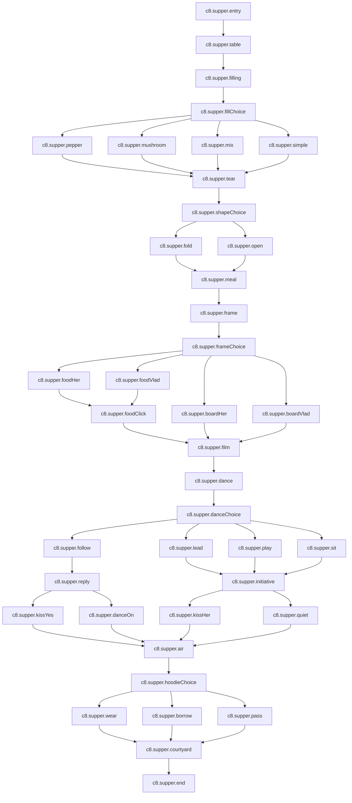

# Глава 8 · «Половина кухни»

Сценарное зеркало редакции content26, `scriptRevision: 7`. [Исходник главы](../src/content/chapters/ch08.ts) · [Сценарное ядро](NARRATIVE_CORE.md). Порядок готовки и съёмки описан в [основе второго сезона](SEASON_02_BIBLE.md).

Вход: `c8.supper.entry`. Узлов: 40. Основных реплик: 213.

### `c8.supper.entry` · dialogue

Фон: `bg.supper8.kitchen`; персонаж: `vlad.apron.smile`.

1. **Описание:** Влад открывает дверь уже в тёмном кухонном фартуке. Поперёк кармана тянется белый след от муки, а из кухни пахнет печёным перцем и обжаренными грибами.
   - Эффекты после действия: `[{"kind":"set","key":"c8Place","value":"home"}]`.
2. **Ты:** Смотрю, вопрос с единственным фартуком решён ещё до моего прихода.
   - Эмоция Влада: `laugh`.
3. **Влад:** я человек слова. правда, стоило его завязать и достать муку, как я тут же оставил на себе автограф.
   - Эмоция Влада: `laugh`.
4. **Ты:** Зато теперь нам обоим не страшно испачкаться.
5. **Влад:** на это я и рассчитывал. проходи, стол освободил — теперь моя маленькая кухня официально рассчитана на двоих.
6. **Описание:** Ты оставляешь сумку с фотоаппаратом у стены и моешь руки; Влад подаёт чистое сухое полотенце.
   - Вариант при `c7GalleryFarewell = "cheek"`: Ты оставляешь сумку с фотоаппаратом у стены и моешь руки; Влад подаёт чистое полотенце и на секунду задерживает взгляд на твоих губах — будто вчерашний перекрёсток всё ещё с вами в этой кухне.
7. **Описание:** На столе уже ждут две тарелки — ты берёшь верхнюю и ставишь на свою сторону.
→ `c8.supper.table`

### `c8.supper.table` · dialogue

Фон: `bg.supper8.kitchen`; персонаж: `vlad.apron.smile`.

1. **Описание:** За тарелкой, прислонённая к фарфоровой сахарнице, стоит твоя открытка из галереи — «Скол» повёрнут прямо к твоему стулу.
   - Условие: `c7GalleryGift = "chip"`.
2. **Ты:** Ты поставил «Скол» прямо сюда! Под лампой каждую светлую крупинку видно.
   - Условие: `c7GalleryGift = "chip"`.
3. **Влад:** поставил напротив твоего места. утром пил кофе, смотрел на неё и вспоминал тот зал.
   - Условие: `c7GalleryGift = "chip"`.
4. **Описание:** Ты чуть сдвигаешь сахарницу, чтобы открытка оставалась на виду.
   - Условие: `c7GalleryGift = "chip"`.
5. **Описание:** За тарелкой, у сахарницы, стоит подаренная тобой синяя открытка «Просвета» — в свете кухонной лампы полоска двери на ней будто светится.
   - Условие: `c7GalleryGift = "blue"`.
6. **Ты:** Ты поставил «Просвет» прямо к нашему столу! Вечером под лампой эта дверь кажется ещё уютнее.
   - Условие: `c7GalleryGift = "blue"`.
7. **Влад:** утром она мне подняла настроение. пил кофе, смотрел на неё и думал, как ты сегодня придёшь.
   - Условие: `c7GalleryGift = "blue"`.
8. **Описание:** Ты придвигаешь сахарницу чуть глубже, оставляя синюю дверь на виду.
   - Условие: `c7GalleryGift = "blue"`.
9. **Описание:** На краю стола у сложенных салфеток стоит керамическая вазочка с ветками осенних сухоцветов, а посередине ждёт деревянная подставка под горячее.
   - Условие: `c7GalleryGift = "none"`.
10. **Ты:** О, сухоцветы на кухне! Неожиданно.
   - Условие: `c7GalleryGift = "none"`.
11. **Влад:** схватил по дороге в лавке у метро — показалось, без них стол совсем уж пустой.
   - Условие: `c7GalleryGift = "none"`.
12. **Описание:** Рядом, у края стола, стоит небольшая керамическая вазочка с осенними сухоцветами — Влад пожимает плечами, мол, купил по дороге, чтобы стол не выглядел пустым.
   - Условие: `c7GalleryGift = "chip"`.
13. **Описание:** Рядом, у края стола, стоит небольшая керамическая вазочка с осенними сухоцветами — Влад пожимает плечами, мол, купил по дороге, чтобы стол не выглядел пустым.
   - Условие: `c7GalleryGift = "blue"`.
14. **Влад:** план на вечер такой: завернуть большую лепёшку с начинкой, подрумянить до хруста и разделить на двоих.
   - Эмоция Влада: `thinking`.
   - Вариант при `teamName = "dumpling"`: план на вечер такой: команда «Пельмень и партнёры» официально выходит из телевизора на настоящую кухню. завернём большую лепёшку с начинкой и подрумяним до хруста.
   - Вариант при `teamName = "calm"`: план на вечер такой: бригада «Два спокойных человека» переходит от виртуальных бутербродов к настоящей плите. соберём большую хрустящую лепёшку на двоих.
   - Вариант при `teamName = "accident"`: план на вечер такой: наш «Отдел случайных побед» открывает филиал на настоящей кухне. завернём большую лепёшку с начинкой и обжарим до корочки.
15. **Ты:** Звучит отлично! И начинку собираем в четыре руки.
16. **Влад:** ради этого и звал. одному у этой доски стоять совсем не так интересно.
   - Эмоция Влада: `smile`.
→ `c8.supper.filling`

### `c8.supper.filling` · dialogue

Фон: `bg.supper8.kitchen`; персонаж: `vlad.apron.smile`.

1. **Описание:** Влад закатывает рукава футболки до середины предплечий и выставляет к широкой доске красный перец в масле, обжаренные грибы, сыр и пучок свежей зелени — движения у него точные и неторопливые.
2. **Описание:** Когда он поворачивается к свету лампы, ты замечаешь у него на скуле небольшой белый мазок муки.
3. **Ты:** Подожди, шеф-повар. Замри на секунду.
   - Интонация: с усмешкой.
4. **Описание:** Ты шагаешь ближе и большим пальцем стираешь муку с его скулы. Кожа под пальцами горячая; Влад перехватывает взгляд, не отступая ни на миллиметр:
   - Эмоция Влада: `surprised`.
   - Вариант при `c7GalleryFarewell = "cheek"`: Ты шагаешь ближе и стираешь муку с его скулы — почти в том самом месте, где вчера коснулась его губами. Влад замирает с тёркой в руках, прямо встречая твой взгляд:
5. **Влад:** вообще-то я готов ввести на кухне новое правило шефа: за каждый мазок муки время проверки увеличивается вдвое.
   - Эмоция Влада: `smile`.
6. **Ты:** Тогда ужин рискует переехать на завтрак. Кто отвечает за сыр?
7. **Влад:** тёрку беру на себя, и тут у меня железный принцип — сыра жалеть нельзя. выбирай основу начинки.
   - Эмоция Влада: `laugh`.
→ `c8.supper.fillChoice`

### `c8.supper.fillChoice` · choice

Фон: `bg.supper8.kitchen`; персонаж: `vlad.apron.smile`.

Вопрос: Чем наполним лепёшку?
- `pepper` — «Возьму перец и сыр» → `c8.supper.pepper` · эффекты `[{"kind":"set","key":"c8Filling","value":"pepper"}]`
- `mushroom` — «Возьму грибы и сыр» → `c8.supper.mushroom` · эффекты `[{"kind":"set","key":"c8Filling","value":"mushroom"}]`
- `mix` — «Смешаем перец, грибы и сыр» → `c8.supper.mix` · эффекты `[{"kind":"set","key":"c8Filling","value":"mix"}]`
- `simple` — «Возьму просто сыр и зелень» → `c8.supper.simple` · эффекты `[{"kind":"set","key":"c8Filling","value":"simple"}]`

### `c8.supper.pepper` · dialogue

Фон: `bg.supper8.kitchen`; персонаж: `vlad.apron.smile`.

1. **Ты:** Берём сладкий перец. Побольше красного, чтобы он ярко смотрелся сквозь расплавленный сыр.
2. **Влад:** ой, перец без грибов — это почти салат. ладно, спасу положение двойной порцией сыра.
3. **Описание:** Вы работаете у одной узкой столешницы: ты режешь перец тонкими полосками, Влад рядом натирает сыр.
4. **Ты:** Кажется, сыра у тебя там уже на два ресторана.
   - Эмоция Влада: `laugh`.
5. **Влад:** сыра много не бывает. вот расплавится — сама признаешь, что я был прав.
   - Эмоция Влада: `laugh`.
6. **Описание:** Ты протягиваешь ему полоску сладкого перца на пробу; Влад перехватывает её с твоих пальцев, чуть задев их губами, и нехотя кивает: ладно, вкусно.
→ `c8.supper.tear`

### `c8.supper.mushroom` · dialogue

Фон: `bg.supper8.kitchen`; персонаж: `vlad.apron.smile`.

1. **Ты:** Конечно грибы. Они так пахли ещё с порога, что у меня не было шансов выбрать другое.
2. **Влад:** знал, чем тебя заманить. специально обжарил их до корочки перед твоим приходом.
3. **Описание:** У одной доски места немного — вы работаете слаженно, передавая миску и нож без лишних слов.
4. **Ты:** Вот эти самые румяные кусочки оставлю на видном месте.
5. **Влад:** эй, руки прочь от лучших кусков до сковороды! ладно, один на пробу — проверь шефа.
6. **Описание:** Он подносит к тебе поджаристый ломтик на кончике вилки, придерживая ладонью снизу; ты пробуешь прямо с вилки, не отводя взгляда — вкус насыщенный, и Влад с довольной усмешкой ждёт вердикта.
   - Эмоция Влада: `smile`.
→ `c8.supper.tear`

### `c8.supper.mix` · dialogue

Фон: `bg.supper8.kitchen`; персонаж: `vlad.apron.smile`.

1. **Ты:** Давай соединим всё вместе: с меня красный перец, с тебя грибы и сыр.
2. **Влад:** спорим, мы сейчас жадно намешаем столько, что лепёшка просто не закроется?
3. **Описание:** Вы работаете плечом к плечу у одной доски: яркий перец, тёплые грибы и щедрая горка сыра собираются в общую миску.
4. **Ты:** Не каркай, всё поместится.
   - Эмоция Влада: `laugh`.
5. **Влад:** ладно, если развалится — официально записываю это на твою половину кухни.
   - Эмоция Влада: `laugh`.
→ `c8.supper.tear`

### `c8.supper.simple` · dialogue

Фон: `bg.supper8.kitchen`; персонаж: `vlad.apron.smile`.

1. **Ты:** Давай сделаем простую классику — сыр и свежую зелень, без долгой нарезки.
2. **Влад:** я полчаса жарил грибы, а она выбирает «просто сыр и зелень»! ладно, твоя половина кухни — твои правила.
3. **Описание:** Ты рвёшь свежие листочки зелени, пока Влад натирает сыр прямо рядом с твоим плечом.
4. **Ты:** Ты специально встал так близко, чтобы контролировать каждую веточку?
5. **Влад:** слежу, чтобы ты не сэкономила на зелени. ну и стоять рядом с тобой правда приятнее, чем тереть сыр в одиночку.
   - Эмоция Влада: `smile`.
→ `c8.supper.tear`

### `c8.supper.tear` · dialogue

Фон: `bg.supper8.kitchen`; персонаж: `vlad.apron.smile`.

Реплики советчиков идут отдельной вставкой.

1. **Описание:** Ты придерживаешь край доски, Влад разворачивает тонкий лист лепёшки — и сухой сгиб посередине расходится прямо в руках на две половины.
   - Эмоция Влада: `surprised`.
2. **Описание:** Вы со смехом пытаетесь сложить края внахлёст, но шов снова раскрывается: один большой рулет на сковороде точно распадётся.
   - Эмоция Влада: `laugh`.
3. **Влад:** ну вот. мой грандиозный план рухнул на глазах. зато теперь у каждого буквально своя половина кухни.
   - Эмоция Влада: `laugh`.
4. **Ты:** Не спеши сдаваться. Разделим каждую половину ещё пополам — получится ровно четыре порции, по две на каждого. Так выйдет даже вкуснее.
   - Эмоция Влада: `thinking`.
5. **Ангел:** Из четырёх аккуратных конвертиков на сковороде всё равно получится отличный горячий ужин.
6. **Дьяволёнок:** Он наверняка планировал аккуратный рулет по учебнику! Предложи запечь открытыми с сырной корочкой — пусть выкручивается на ходу!
→ `c8.supper.shapeChoice`

### `c8.supper.shapeChoice` · choice

Фон: `bg.supper8.kitchen`; персонаж: `vlad.apron.smile`.

Вопрос: Как изменим план?
- `fold` — «Сложим маленькие конверты и подрумяним на сковороде» → `c8.supper.fold` · эффекты `[{"kind":"set","key":"c8Shape","value":"fold"}]`
- `open` — «Оставим порции открытыми и запечём» → `c8.supper.open` · эффекты `[{"kind":"set","key":"c8Shape","value":"open"}]`

### `c8.supper.fold` · dialogue

Фон: `bg.supper8.kitchen`; персонаж: `vlad.apron.thinking`.

1. **Ты:** Сложим четыре маленьких конвертика и обжарим до хруста. Поверни сковороду ручкой ко мне.
2. **Описание:** Влад сдвигается чуть в сторону, поворачивает ручку сковороды к тебе и остаётся стоять совсем рядом — у маленькой плиты ваши плечи почти соприкасаются.
3. **Описание:** Ты выкладываешь начинку с перцем на первый квадратик и подгибаешь край, а Влад подхватывает готовый конвертик лопаткой.
   - Условие: `c8Filling = "pepper"`.
4. **Описание:** Ты выкладываешь грибы с сыром на первый кусочек и сворачиваешь уголки, а Влад аккуратно переносит конверт на сковороду.
   - Условие: `c8Filling = "mushroom"`.
5. **Описание:** Ты придерживаешь края лепёшки, Влад помогает загнуть непослушный уголок, и первый конвертик вы отправляете на сковороду вместе.
   - Условие: `c8Filling = "mix"`.
6. **Описание:** Влад быстро складывает сырные конвертики рядом, а ты снимаешь лопаткой первую подрумянившуюся порцию.
   - Условие: `c8Filling = "simple"`.
7. **Влад:** смотри, у самого первого уголок всё-таки приоткрылся.
8. **Ты:** Не трогай его — там сейчас зажарится самое вкусное сырное ушко.
   - Эмоция Влада: `smile`.
9. **Описание:** Влад наклоняется ближе, заглядывая в сковороду через твоё плечо; в узком проходе у плиты его ладонь мягко ложится тебе на поясницу, пока он тянется свободной рукой за лопаткой.
   - Эмоция Влада: `surprised`.
   - Вариант при `c6Gesture = "none" и c7GalleryFarewell = "words"`: Влад наклоняется ближе, заглядывая в сковороду через твоё плечо, и аккуратно тянется за лопаткой с края столешницы.
10. **Влад:** вообще-то я мог обойти стол с другой стороны. но отсюда вид на нашу сковородку куда лучше.
   - Эмоция Влада: `warm`.
   - Интонация: вполголоса, с полуулыбкой.
11. **Описание:** Расплавленный сыр у края схватывается золотистой корочкой, и по кухне расходится тёплый, пряный запах жареного теста. Влад аккуратно перекладывает все четыре румяных конвертика со сковороды на общее блюдо.
   - Эмоция Влада: `smile`.
12. **Влад:** чур это хрустящее ушко на первом делим строго пополам.
   - Эмоция Влада: `smile`.
→ `c8.supper.meal`

### `c8.supper.open` · dialogue

Фон: `bg.supper8.kitchen`; персонаж: `vlad.apron.thinking`.

1. **Ты:** Разложим все четыре кусочка на противне открытыми — пусть сыр сверху запечётся золотистой шапкой.
2. **Влад:** гениально. тогда каждый уголок будет хрустеть. сейчас разогрею духовку.
   - Эмоция Влада: `laugh`.
3. **Описание:** Влад достаёт противень, проходя совсем близко за твоей спиной в узком проходе между столом и плитой — его ладонь на секунду легко касается твоего локтя, — и расстилает пергамент.
4. **Описание:** Ты распределяешь перец с сыром по первой порции, а Влад переносит наполненные ломтики на противень.
   - Условие: `c8Filling = "pepper"`.
5. **Описание:** Ты укладываешь грибы и сыр до самых краёв, а Влад рядом выравнивает порции на листе.
   - Условие: `c8Filling = "mushroom"`.
6. **Описание:** Влад кладёт начинку ложкой, а ты разравниваешь её до уголков — ваши руки двигаются над противнем почти синхронно.
   - Условие: `c8Filling = "mix"`.
7. **Описание:** Влад раскладывает сыр с зеленью по кусочкам, пока ты освобождаешь деревянную подставку на столе.
   - Условие: `c8Filling = "simple"`.
8. **Ты:** Смотри, у этой порции сыр лёг прямо до самого уголка — запечётся до хруста.
   - Эмоция Влада: `smile`.
9. **Влад:** отлично. вот этот румяный край и будет нашим главным дегустационным укусом на двоих.
   - Эмоция Влада: `smile`.
10. **Описание:** Пока сыр плавится в духовке, вы стоите рядом, прислонившись к столешнице. Жар от печки согревает маленькую кухню; Влад смотрит уже не на таймер, а прямо на тебя.
   - Эмоция Влада: `warm`.
11. **Ты:** Шеф, если совсем не смотреть на духовку, мы пропустим золотистую корочку.
   - Интонация: тихо.
12. **Влад:** за корочку я спокоен, у меня все минуты посчитаны. а вот оторвать от тебя взгляд — задача куда сложнее.
   - Эмоция Влада: `warm`.
13. **Описание:** Через несколько минут Влад достаёт горячий противень и аккуратно перекладывает все четыре запечённые порции на общее блюдо на подставке: вокруг расплавленного сыра поднялись румяные края.
14. **Ты:** Тот самый уголок подрумянился лучше всех. Неси скорее к столу.
→ `c8.supper.meal`

### `c8.supper.meal` · dialogue

Фон: `bg.supper8.kitchen`; персонаж: `vlad.apron.smile`.

- Фон с индекса 15: `bg.supper8.kitchen`, `vlad.casual.smile`.
1. **Описание:** Вы садитесь за маленький стол друг напротив друга. Посередине на блюде дымятся четыре горячие порции; под абажуром уютно и тихо, за окном уже совсем стемнело.
2. **Описание:** Вы раскладываете по первому конвертику на тарелки. Ты отламываешь то самое хрустящее сырное ушко и передаёшь половину Владу через стол.
   - Условие: `c8Shape = "fold"`.
3. **Описание:** Вы берёте по первой порции на тарелки. Ты отламываешь тот самый румяный хрустящий край с сыром и передаёшь половину Владу через стол.
   - Условие: `c8Shape = "open"`.
4. **Ты:** Видишь эту яркую красную полоску перца? Я берегла её с самой доски.
   - Условие: `c8Filling = "pepper"`.
5. **Ты:** А вот и тот самый поджаристый гриб, который мы приметили.
   - Условие: `c8Filling = "mushroom"`.
6. **Ты:** Смотри, твои грибы и мой перец встретились в самом лучшем кусочке.
   - Условие: `c8Filling = "mix"`.
7. **Ты:** Сыр у края так вкусно подрумянился, и зелень здесь идеально к месту.
   - Условие: `c8Filling = "simple"`.
8. **Влад:** осторожно, серединка ещё горячая.
   - Эмоция Влада: `thinking`.
9. **Описание:** Первую порцию вы съедаете почти без пауз — тесто хрустит, расплавленный сыр тянется, и на маленькой кухне становится совсем по-домашнему.
10. **Влад:** слушай… а хорошо, что лепёшка порвалась. в четырёх порциях хрустящих краёв оказалось в два раза больше.
   - Эмоция Влада: `laugh`.
11. **Описание:** Ужин оказывается неожиданно вкусным — вы смеётесь, обсуждаете, какой кусок удался лучше, и незаметно съедаете половину. На общем блюде остаются две порции: одна целая и одна, которую вы только что разломили на двоих.
   - Эмоция Влада: `laugh`.
12. **Описание:** Когда первый азарт стихает, на кухне наступает тёплая, тихая пауза — слышно только, как остывает чайник. Влад смотрит на тебя через маленький стол уже без обычной шутки, удивительно серьёзно.
   - Эмоция Влада: `thinking`.
13. **Ты:** Ты часто ужинаешь вот так, за этим столом?
   - Эмоция Влада: `thinking`.
   - Интонация: тихо.
14. **Влад:** один — почти никогда. обычно перехватываю что-нибудь на ходу, потому что на пустой кухне слишком тихо.
   - Эмоция Влада: `thinking`.
15. **Влад:** я раньше думал, что дома хорошо, когда просто тихо и никто не трогает. а сейчас смотрю на тебя и понимаю… мне просто не хватало здесь тебя.
   - Эмоция Влада: `thinking`.
16. **Описание:** Влад развязывает фартук, вешает его на спинку стула и на секунду задерживает взгляд на твоих губах.
   - Эмоция Влада: `warm`.
17. **Ты:** Мне тоже у тебя очень хорошо, Влад. На нашей половине кухни.
18. **Влад:** она за тобой закреплена бессрочно — в любой вечер, когда захочешь прийти.
   - Эмоция Влада: `smile`.
→ `c8.supper.frame`

### `c8.supper.frame` · dialogue

Фон: `bg.supper8.kitchen`; персонаж: `vlad.casual.smile`.

1. **Описание:** Воздух за столом всё ещё держит это тихое тепло. На деревянной доске белеет мучной след, на блюде лежат оставшиеся две порции вашего ужина. Ты достаёшь из сумки плёночный аппарат — на счётчике «6».
2. **Ты:** Давай сохраним эту кухню на плёнке, пока всё не съели. Хочу помнить этот стол таким.
→ `c8.supper.frameChoice`

### `c8.supper.frameChoice` · choice

Фон: `bg.supper8.kitchen`; персонаж: `vlad.casual.smile`.

Вопрос: Что оставим на плёнке?
- `foodHer` — «Я сниму блюдо» → `c8.supper.foodHer` · эффекты `[{"kind":"set","key":"c8Frame","value":"foodHer"}]`
- `foodVlad` — «Влад, сними блюдо» → `c8.supper.foodVlad` · эффекты `[{"kind":"set","key":"c8Frame","value":"foodVlad"}]`
- `boardHer` — «Я сниму рабочий беспорядок» → `c8.supper.boardHer` · эффекты `[{"kind":"set","key":"c8Frame","value":"boardHer"}]`
- `boardVlad` — «Влад, сними рабочий беспорядок» → `c8.supper.boardVlad` · эффекты `[{"kind":"set","key":"c8Frame","value":"boardVlad"}]`

### `c8.supper.foodHer` · dialogue

Фон: `bg.supper8.kitchen`; персонаж: `vlad.casual.awkward`.

1. **Ты:** Придвинь блюдо чуть ближе к лампе, а я сниму сверху.
2. **Описание:** Влад берётся за дальний край тарелки. В видоискателе остаются целая порция, разломленный на двоих кусочек и его пальцы на фарфоре.
3. **Влад:** руки из кадра убрать?
4. **Ты:** Нет, оставь пальцы на тарелке. Хочу, чтобы на снимке были и твои руки.
→ `c8.supper.foodClick`

### `c8.supper.foodVlad` · dialogue

Фон: `bg.supper8.kitchen`; персонаж: `vlad.casual.smile`.

1. **Ты:** Сними с твоей стороны стола — оттуда свет красиво ложится на золотистый край.
2. **Описание:** Ты передаёшь камеру Владу и придерживаешь край керамического блюда. Он ловит в видоискатель две румяные порции и твои ладони в тёплом свете абажура.
3. **Влад:** вот так идеально. наш ужин и твои руки в одном кадре.
→ `c8.supper.foodClick`

### `c8.supper.foodClick` · dialogue

Фон: `bg.supper8.kitchen`; персонаж: `vlad.casual.smile`.

1. **Описание:** Позади тарелки в кадр попадает нижний край твоей открытки из галереи со светлой выемкой скола.
   - Условие: `c7GalleryGift = "chip"`.
2. **Описание:** Позади тарелки в кадр попадает синяя открытка «Просвета» с полоской света.
   - Условие: `c7GalleryGift = "blue"`.
3. **Описание:** Позади тарелки под лампой белеет фарфоровая сахарница.
   - Условие: `c7GalleryGift = "none"`.
4. **Описание:** Ты нажимаешь кнопку спуска и прокручиваешь колёсико.
   - Условие: `c8Frame = "foodHer"`.
   - Эффекты после действия: `[{"kind":"set","key":"c8Film","value":"key"}]`.
5. **Описание:** Влад нажимает спуск, прокручивает колёсико и возвращает камеру тебе.
   - Условие: `c8Frame = "foodVlad"`.
   - Эффекты после действия: `[{"kind":"set","key":"c8Film","value":"key"}]`.
→ `c8.supper.film`

### `c8.supper.boardHer` · dialogue

Фон: `bg.supper8.kitchen`; персонаж: `vlad.casual.awkward`.

1. **Ты:** Я сниму нашу разделочную доску. Поверни её тем краем к лампе.
2. **Описание:** Влад поворачивает доску: в кадре остаются ложка, крошки и белый мучной след от ваших пальцев, похожий на запятую.
3. **Влад:** красивый росчерк. интересно, чей это след — твой или мой?
4. **Ты:** Теперь уже общий.
5. **Описание:** Ты нажимаешь спуск и прокручиваешь колёсико плёнки.
   - Эффекты после действия: `[{"kind":"set","key":"c8Film","value":"key"}]`.
→ `c8.supper.film`

### `c8.supper.boardVlad` · dialogue

Фон: `bg.supper8.kitchen`; персонаж: `vlad.casual.smile`.

1. **Ты:** Сними нашу доску сам — хочу увидеть, как этот беспорядок выглядит твоими глазами.
2. **Описание:** Влад принимает у тебя аппарат и склоняется над столешницей, выстраивая в рамке деревянную доску, ложку и белую мучную запятую у края.
3. **Влад:** самая честная фотография вечера. сразу видно, что готовили с душой.
4. **Описание:** Он нажимает спуск, прокручивает колёсико и возвращает аппарат тебе.
   - Эффекты после действия: `[{"kind":"set","key":"c8Film","value":"key"}]`.
→ `c8.supper.film`

### `c8.supper.film` · dialogue

Фон: `bg.supper8.kitchen`; персонаж: `vlad.casual.smile`.

1. **Описание:** Пока Влад наливает по стаканам яблочный сидр, ты успеваешь поймать ещё один кадр — его самого у плиты, смеющегося с полотенцем через плечо. А потом, когда вы снова сидите под низким светом лампы и ты, подперев щёку ладонью с пылинкой муки на пальцах, ловишь его взгляд, Влад негромко поднимает аппарат и с коротким щелчком снимает тебя через стол — совсем близко.
   - Эмоция Влада: `laugh`.
2. **Описание:** Поверх объектива он смотрит уже совсем без шутки. На счётчике остаётся «3»; ты кладёшь камеру на край стола, а Влад ставит перед вами стаканы и убирает лишние тарелки, освобождая пространство.
   - Эффекты после действия: `[{"kind":"set","key":"c8Film","value":"nine"}]`.
→ `c8.supper.dance`

### `c8.supper.dance` · dialogue

Фон: `bg.supper8.kitchen`; персонаж: `vlad.casual.warm`.

1. **Описание:** Ужин давно закончен. Ты встаёшь из-за стола и делаешь пару шагов к тёмному окну, за которым глухо шумит вечерний город.
2. **Описание:** На кухне горит только тёплая лампа над столом; её свет мягко ложится на пол и на твои плечи.
3. **Описание:** Влад поднимается следом и останавливается прямо перед тобой — теперь между вами нет ни стола, ни тарелок. Он делает полшага ближе и открыто подаёт ладонь; голос звучит негромко и глубоко:
4. **Влад:** не спеши собираться. потанцуешь со мной здесь, без всякой музыки? мне весь вечер хотелось просто обнять тебя поближе.
   - Эмоция Влада: `warm`.
→ `c8.supper.danceChoice`

### `c8.supper.danceChoice` · choice

Фон: `bg.supper8.kitchen`; персонаж: `vlad.casual.smile`.

Вопрос: Как тебе хочется продолжить вечер?
- `follow` — «Шагнуть в его объятия: “Веди”» → `c8.supper.follow` · эффекты `[{"kind":"set","key":"c8Step","value":"follow"}]`
- `lead` — «Положить руки ему на плечи: “Вести буду я”» → `c8.supper.lead` · эффекты `[{"kind":"set","key":"c8Step","value":"lead"}]`
- `play` — «Улыбнуться и начать с игривого шага» → `c8.supper.play` · эффекты `[{"kind":"set","key":"c8Step","value":"play"}]`
- `sit` — «Я останусь за столом. Посиди со мной» → `c8.supper.sit` · эффекты `[{"kind":"set","key":"c8Step","value":"sit"}]`

### `c8.supper.follow` · dialogue

Фон: `bg.supper8.kitchen`; персонаж: `vlad.casual.warm`.

- Фон с индекса 6: `bg.supper8.kitchen`, `vlad.closeup.warm`.
1. **Ты:** Иди сюда. Веди.
2. **Описание:** Ты вкладываешь ладонь в его руку и шагаешь вплотную. Вторая ладонь Влада мягко, но уверенно ложится тебе на талию, и он притягивает тебя чуть ближе.
3. **Влад:** здесь совсем мало места… так что шаги будут самыми медленными.
   - Интонация: тихо.
4. **Ты:** Мне большего места и не нужно.
5. **Описание:** Вы почти не двигаетесь по маленькой кухне — просто медленно покачиваетесь под тёплой лампой. Сквозь тонкую футболку чувствуется, как часто и неровно бьётся его сердце, а рядом с шеей пахнет тем самым знакомым парфюмом.
6. **Влад:** вот так… я бы простоял с тобой хоть до утра.
7. **Описание:** Шаги сами собой замирают. Его ладонь на твоей спине притягивает тебя чуть плотнее, а вторая рука мягко ложится на твою щёку — давая секунду передумать или сделать последний шаг навстречу.
8. **Описание:** Ты поднимаешь голову; Влад смотрит на твои губы, затем прямо в глаза и спрашивает почти шёпотом:
9. **Влад:** можно я тебя поцелую?
   - Эмоция Влада: `warm`.
   - Интонация: почти шёпотом.
→ `c8.supper.reply`

### `c8.supper.lead` · dialogue

Фон: `bg.supper8.kitchen`; персонаж: `vlad.casual.warm`.

- Фон с индекса 4: `bg.supper8.kitchen`, `vlad.closeup.warm`.
1. **Ты:** Пойдём. Но сегодня вести буду я.
2. **Описание:** Ты сама шагаешь к нему и кладёшь руки ему на плечи, уводя на свободный пятачок у окна. Ладони Влада ложатся тебе на талию, чуть задерживаясь на изгибе спины.
3. **Влад:** я полностью в твоей власти. куда поворачиваем?
   - Эмоция Влада: `laugh`.
4. **Ты:** Не смотри под ноги. Смотри только на меня.
5. **Описание:** Он поднимает глаза — и от того, насколько вы близко, медленный шаг затихает на одном месте. Ты чувствуешь его горячее дыхание у своей щеки.
6. **Влад:** когда ты смотришь вот так в упор, все мои мысли разлетаются в одну секунду.
   - Эмоция Влада: `warm`.
   - Интонация: тихо.
7. **Описание:** Твои ладони скользят выше, к его затылку и мягким кудрям; Влад глухо выдыхает и замирает в одном вдохе от тебя, доверяя тебе решающий шаг.
→ `c8.supper.initiative`

### `c8.supper.play` · dialogue

Фон: `bg.supper8.kitchen`; персонаж: `vlad.casual.laugh`.

- Фон с индекса 4: `bg.supper8.kitchen`, `vlad.closeup.warm`.
1. **Ты:** Потанцуем. Только начнём с твоего фирменного шага вокруг кухонного стула.
2. **Влад:** демонстрирую высший пилотаж танцев на пяти квадратных метрах.
3. **Описание:** Он галантно подаёт тебе руку, и первые несколько секунд вы с тихим смехом кружитесь на маленьком свободном пятачке у окна.
4. **Описание:** На повороте ты чуть задеваешь край стула, и Влад инстинктивно притягивает тебя ближе, перехватывая обеими руками за талию, чтобы удержать. Расстояние между вами исчезает в одну секунду.
   - Эмоция Влада: `warm`.
5. **Описание:** Смех застревает на полуслове и сам собой тает — слышно только, как вы оба переводите дыхание.
   - Эмоция Влада: `warm`.
6. **Ты:** А дальше — уже без шуток.
   - Эмоция Влада: `warm`.
   - Интонация: тихо.
7. **Описание:** Усмешка сходит с его лица; ладонь на твоей спине становится теплее и увереннее, и вы замираете в полумраке на расстоянии одного вдоха.
   - Эмоция Влада: `warm`.
→ `c8.supper.initiative`

### `c8.supper.sit` · dialogue

Фон: `bg.supper8.kitchen`; персонаж: `vlad.casual.smile`.

- Фон с индекса 3: `bg.supper8.kitchen`, `vlad.casual.warm`.
1. **Ты:** Посиди со мной ещё немного здесь, у лампы. Мне так хорошо за твоим столом.
2. **Влад:** с радостью. мне главное — просто быть рядом с тобой.
3. **Описание:** Вместо того чтобы сесть обратно напротив, Влад придвигает свой стул совсем близко сбоку к твоему — так, что ваши колени почти соприкасаются под столом.
4. **Описание:** На кухне наступает мягкая ночная тишина. Он поворачивается к тебе, осторожно накрывает твою ладонь своей и большим пальцем едва заметно проводит по костяшкам.
5. **Ты:** Кажется, я сегодня совсем не хочу, чтобы этот вечер заканчивался.
   - Интонация: тихо.
6. **Влад:** тогда не торопись. я бы вообще оставил нас в этом вечере подольше.
7. **Описание:** Он чуть подаётся ближе, не торопя тебя — в этой тишине весь следующий шаг остаётся за тобой.
→ `c8.supper.initiative`

### `c8.supper.reply` · choice

Фон: `bg.supper8.kitchen`; персонаж: `vlad.casual.smile`.

Вопрос: Что ответишь?
- `kissYes` — «Не отводить взгляд и потянуться к его губам» → `c8.supper.kissYes`
- `danceOn` — «Прижаться щекой к его плечу и просто постоять так» → `c8.supper.danceOn`

### `c8.supper.kissYes` · dialogue

Фон: `bg.supper8.kitchen`; персонаж: `vlad.closeup.warm`.

1. **Ты:** Да…
   - Интонация: почти шёпотом.
2. **Описание:** Кухня вокруг будто отступает. Ты поднимаешь лицо, и Влад медленно наклоняется навстречу, на долю секунды замирая у самого уголка твоих губ — словно вспоминая вчерашний вечер у галереи и наконец доходя до конца.
   - Условие: `c7GalleryFarewell = "cheek"`.
3. **Описание:** Кухня вокруг будто отступает. Влад не торопится — на мгновение замирает в сантиметре от твоих губ, давая сердцу успеть за этим моментом, и ты сама едва заметно тянешься ему навстречу.
   - Условие: `c7GalleryFarewell = "words"`.
4. **Описание:** Его губы касаются твоих сначала осторожно, почти невесомо — как тихий вопрос. Но стоит тебе ответить и чуть сжать пальцами ткань его футболки, как Влад глухо выдыхает и притягивает тебя вплотную: поцелуй становится глубже, горячее и по-настоящему твоим — таким, от которого перехватывает дыхание и весь мир за стенами просто перестаёт существовать.
   - Эффекты после действия: `[{"kind":"set","key":"c8LipKiss","value":"yes"}]`.
5. **Описание:** Когда вы медленно отстраняетесь, он не выпускает тебя из рук — прислоняется лбом к твоему, и ты чувствуешь его частый, горячий пульс.
6. **Влад:** я думал об этом куда дольше, чем готов признаться… даже не представляешь, как сильно хотелось.
   - Эмоция Влада: `warm`.
   - Интонация: низко, чуть сбившись с дыхания.
7. **Ты:** Теперь представляю. И я тоже.
8. **Описание:** Он улыбается в ответ и ещё раз коротко, уже без тени сомнения, касается губами твоих, прежде чем вы отступаете на полшага.
→ `c8.supper.air`

### `c8.supper.danceOn` · dialogue

Фон: `bg.supper8.kitchen`; персонаж: `vlad.casual.smile`.

1. **Ты:** Давай сейчас просто постоим вот так. Мне хорошо у тебя на плече.
2. **Влад:** иди ко мне.
3. **Описание:** Ты опускаешь голову ему на плечо, и Влад спокойно смыкает руки у тебя на спине. Вы ещё немного покачиваетесь в тишине кухни, никуда не спеша.
   - Эффекты после действия: `[{"kind":"set","key":"c8LipKiss","value":"no"}]`.
→ `c8.supper.air`

### `c8.supper.initiative` · choice

Фон: `bg.supper8.kitchen`; персонаж: `vlad.casual.smile`.

Вопрос: Твой следующий шаг
- `kiss` — «Притянуть его ближе и поцеловать» → `c8.supper.kissHer`
- `leadQuiet` — «Прижаться к его плечу, завершая танец» → `c8.supper.quiet` · условие `c8Step = "lead"`
- `playQuiet` — «Уткнуться ему в плечо и обнять» → `c8.supper.quiet` · условие `c8Step = "play"`
- `sitQuiet` — «Положить голову ему на плечо у стола» → `c8.supper.quiet` · условие `c8Step = "sit"`

### `c8.supper.kissHer` · dialogue

Фон: `bg.supper8.kitchen`; персонаж: `vlad.closeup.warm`.

1. **Описание:** Ты чуть подаёшься к нему, свободной ладонью осторожно касаясь его щеки; Влад на секунду прикрывает глаза от твоего прикосновения и сразу наклоняется навстречу.
   - Условие: `c8Step = "sit"`.
2. **Описание:** Остановившись посреди кухни, ты не убираешь рук с его шеи, а мягко, не спеша тянешь его к себе, сокращая последний шаг между вами.
   - Условие: `c8Step = "lead"`.
3. **Описание:** Смех давно растаял в тишине кухни; ты кладёшь ладони ему на грудь, чувствуя частый стук сердца под футболкой, и поднимаешь лицо.
   - Условие: `c8Step = "play"`.
4. **Описание:** Он останавливается в одном вдохе от тебя — вчера ты замерла у самого уголка его губ, а сегодня уже не отводишь взгляда.
   - Условие: `c7GalleryFarewell = "cheek"`.
5. **Описание:** Вы на секунду замираете так близко, что слышно сбившееся дыхание друг друга — и эта пауза говорит громче любых слов.
   - Условие: `c7GalleryFarewell = "words"`.
6. **Ты:** Иди ко мне, Влад…
   - Интонация: тихо, почти на выдохе.
7. **Описание:** Ты первой касаешься его губ — сначала легко, чуть нерешительно, пробуя эту близость на вкус. На долю секунды Влад замирает, а потом его губы встречают твои в ответ уже горячо и глубоко: одна рука крепко обнимает тебя за спину, прижимая ближе, вторая скользит к твоему затылку, запутываясь пальцами в волосах — и в этом первом поцелуе нет ни спешки, ни сомнений, только живой жар и облегчение, что вы наконец перестали держаться на расстоянии.
   - Эффекты после действия: `[{"kind":"set","key":"c8LipKiss","value":"yes"}]`.
8. **Влад:** мне так давно этого хотелось… я сегодня весь вечер еле держался.
   - Интонация: тихо, совсем рядом с твоими губами.
9. **Ты:** Хорошо, что перестал держаться.
10. **Описание:** Вы ещё несколько секунд стоите, не разжимая рук и переводя дыхание, пока пульс медленно возвращается на место.
→ `c8.supper.air`

### `c8.supper.quiet` · dialogue

Фон: `bg.supper8.kitchen`; персонаж: `vlad.casual.smile`.

1. **Описание:** Ты замедляешь шаг и прижимаешься щекой к его плечу; Влад спокойно обнимает тебя за спину.
   - Условие: `c8Step = "lead"`.
2. **Ты:** Вот так… самая лучшая точка в танце.
   - Условие: `c8Step = "lead"`.
   - Эффекты после действия: `[{"kind":"set","key":"c8LipKiss","value":"no"}]`.
3. **Описание:** Ты обнимаешь его, и Влад сжимает тебя в ответ, коротко касаясь губами твоей макушки.
   - Условие: `c8Step = "play"`.
4. **Влад:** самый уютный танец в моей жизни.
   - Условие: `c8Step = "play"`.
   - Эффекты после действия: `[{"kind":"set","key":"c8LipKiss","value":"no"}]`.
5. **Описание:** Ты кладёшь голову ему на плечо, и Влад спокойно приобнимает тебя одной рукой, не выпуская твоих пальцев.
   - Условие: `c8Step = "sit"`.
6. **Ты:** Как же у тебя дома спокойно.
   - Условие: `c8Step = "sit"`.
   - Эффекты после действия: `[{"kind":"set","key":"c8LipKiss","value":"no"}]`.
→ `c8.supper.air`

### `c8.supper.air` · dialogue

Фон: `bg.supper8.kitchen`; персонаж: `vlad.casual.smile`.

1. **Описание:** Влад приоткрывает створку окна, чтобы впустить на разогретую кухню свежий ночной воздух. С улицы сразу тянет прохладой.
   - Вариант при `c8LipKiss = "yes"`: На разогретой кухне вдруг становится совсем жарко; Влад приоткрывает створку окна, впуская прохладный ночной воздух, но всё равно не отходит от тебя далеко.
2. **Описание:** Заметив, как ты чуть поёжилась, он берёт со спинки стула своё мягкое объёмное худи:
3. **Влад:** накинь моё худи, а то продрогнешь у окна. а если хочешь — можешь прямо в нём сегодня поехать домой.
→ `c8.supper.hoodieChoice`

### `c8.supper.hoodieChoice` · choice

Фон: `bg.supper8.kitchen`; персонаж: `vlad.casual.smile`.

Вопрос: Возьмёшь худи?
- `wear` — «Надену сейчас, пока мы здесь» → `c8.supper.wear`
- `borrow` — «Надену и поеду в нём домой» → `c8.supper.borrow`
- `pass` — «Спасибо, мне рядом с тобой и так тепло» → `c8.supper.pass`

### `c8.supper.wear` · dialogue

Фон: `bg.supper8.kitchen`; персонаж: `vlad.casual.smile`.

1. **Описание:** Ты надеваешь худи — мягкая ткань сразу укрывает тебя с запасом и едва уловимо пахнет тем самым свежим парфюмом и домом.
   - Эффекты после действия: `[{"kind":"set","key":"c8Hoodie","value":"evening"}]`.
2. **Описание:** Первый длинный рукав ты подворачиваешь сама, а за второй берётся Влад: аккуратно закатывает манжету на твоём запястье и на секунду задерживает твою руку в своей.
   - Эмоция Влада: `smile`.
3. **Влад:** вот теперь по размеру. знаешь… в моих вещах ты выглядишь опасно хорошо.
   - Эмоция Влада: `smile`.
4. **Ты:** Погреюсь в нём до выхода, а у двери верну.
→ `c8.supper.courtyard`

### `c8.supper.borrow` · dialogue

Фон: `bg.supper8.kitchen`; персонаж: `vlad.casual.smile`.

1. **Ты:** С удовольствием надену и прямо в нём поеду домой — на улице уже прохладно.
2. **Описание:** Ты надеваешь его объёмное худи поверх своей одежды — мягкая ткань сразу укрывает тебя и едва уловимо пахнет тем самым его парфюмом. Первый рукав подворачиваешь сама, а второй аккуратно закатывает Влад.
   - Эффекты после действия: `[{"kind":"set","key":"c8Hoodie","value":"borrowed"}]`.
3. **Влад:** тебе невероятно идёт. в кармане там, кажется, ничего лишнего нет — оставляй у себя до нашей следующей встречи.
   - Эмоция Влада: `smile`.
→ `c8.supper.courtyard`

### `c8.supper.pass` · dialogue

Фон: `bg.supper8.kitchen`; персонаж: `vlad.casual.smile`.

1. **Ты:** Спасибо, мне рядом с тобой и так совсем не холодно.
2. **Влад:** тогда я просто прикрою окно.
   - Эффекты после действия: `[{"kind":"set","key":"c8Hoodie","value":"none"}]`.
3. **Описание:** Влад закрывает створку и возвращается к столу, пока ты достаёшь из сумки телефон.
→ `c8.supper.courtyard`

### `c8.supper.courtyard` · dialogue

Фон: `bg.supper8.kitchen`; персонаж: `vlad.casual.smile`.

1. **Ты:** Слушай, Влад… в этот раз моя очередь звать тебя на свидание. Я нашла закрытый вечерний кинодворик — там крутят старое кино под открытым небом, в гирляндах.
2. **Описание:** Ты открываешь на экране афишу сеанса: на рисунке старый раскрытый чемодан, а поверх вещей с невозмутимым видом сидит пушистый кот.
   - Эмоция Влада: `laugh`.
3. **Влад:** судя по лицу этого кота, без него никто никуда не уедет.
   - Эмоция Влада: `laugh`.
4. **Ты:** Вот и проверим. Пойдёшь со мной в этот дворик?
5. **Влад:** с тобой — куда угодно, а в кинодворик тем более. скинь время, я буду ждать у арки.
6. **Описание:** Вы сверяете вечер показа; ты убираешь телефон и камеру в сумку.
7. **Описание:** В прихожей ты снимаешь худи и отдаёшь Владу; он прижимает ткань к груди и усмехается: «теперь оно пахнет тобой».
   - Условие: `c8Hoodie = "evening"`.
8. **Описание:** Ты надеваешь пальто прямо поверх его худи — уходить в ночной город в нём удивительно уютно.
   - Условие: `c8Hoodie = "borrowed"`.
9. **Описание:** Вы выходите в полутёмную прихожую к двери.
   - Условие: `c8Hoodie = "none"`.
10. **Ты:** Тогда до встречи в кинодворике, Влад.
11. **Влад:** до кино. и помни: твоя половина моей кухни всегда тебя ждёт.
12. **Описание:** У порога Влад придерживает дверь, провожая тебя взглядом.
   - Вариант при `c8LipKiss = "yes"`: На пороге в полумраке прихожей Влад ещё раз притягивает тебя к себе — его ладонь снова находит твою талию, и он целует тебя на прощание уже по-хозяйски нежно и чуть дольше, чем собирался, прежде чем наконец открыть дверь.
→ `c8.supper.end`

### `c8.supper.end` · end

Открытка: `c8.supper`; endingId: `c8.supper`.
