# Глава 9 · «С крышей разберёмся»

Актуальный runtime content24 · 22 ноября 2026. Источник авторского текста: [SEASON_01_02_POLISH_SPEC_2026_11_19.md](SEASON_01_02_POLISH_SPEC_2026_11_19.md). Сценарное ядро: [NARRATIVE_CORE.md](NARRATIVE_CORE.md).

Вход: `c9.courtyard.entry`. Узлов: 46. Основных реплик: 145.

```mermaid
flowchart TD
  c9.courtyard.entry
  c9.courtyard.entry --> c9.courtyard.hoodieRoute
  c9.courtyard.hoodieRoute
  c9.courtyard.hoodieRoute --> c9.courtyard.hoodie
  c9.courtyard.hoodieRoute --> c9.courtyard.camera
  c9.courtyard.hoodie
  c9.courtyard.hoodie --> c9.courtyard.camera
  c9.courtyard.camera
  c9.courtyard.camera --> c9.courtyard.frameChoice
  c9.courtyard.frameChoice
  c9.courtyard.frameChoice --> c9.courtyard.frameVlad
  c9.courtyard.frameChoice --> c9.courtyard.frameSeats
  c9.courtyard.frameChoice --> c9.courtyard.frameYard
  c9.courtyard.frameVlad
  c9.courtyard.frameVlad --> c9.courtyard.cameraEnd
  c9.courtyard.frameSeats
  c9.courtyard.frameSeats --> c9.courtyard.cameraEnd
  c9.courtyard.frameYard
  c9.courtyard.frameYard --> c9.courtyard.cameraEnd
  c9.courtyard.cameraEnd
  c9.courtyard.cameraEnd --> c9.courtyard.seats
  c9.courtyard.seats
  c9.courtyard.seats --> c9.courtyard.filmStart
  c9.courtyard.filmStart
  c9.courtyard.filmStart --> c9.courtyard.rain
  c9.courtyard.rain
  c9.courtyard.rain --> c9.courtyard.rainAside
  c9.courtyard.rainAside
  c9.courtyard.rainAside --> c9.courtyard.rainChoice
  c9.courtyard.rainChoice
  c9.courtyard.rainChoice --> c9.courtyard.canopy
  c9.courtyard.rainChoice --> c9.courtyard.arch
  c9.courtyard.rainChoice --> c9.courtyard.leave
  c9.courtyard.canopy
  c9.courtyard.canopy --> c9.courtyard.hoodieRainRoute
  c9.courtyard.arch
  c9.courtyard.arch --> c9.courtyard.hoodieRainRoute
  c9.courtyard.leave
  c9.courtyard.leave --> c9.courtyard.hoodieRainRoute
  c9.courtyard.hoodieRainRoute
  c9.courtyard.hoodieRainRoute --> c9.courtyard.warmth
  c9.courtyard.warmth
  c9.courtyard.warmth --> c9.courtyard.next
  c9.courtyard.next
  c9.courtyard.next --> c9.courtyard.nextCoop
  c9.courtyard.next --> c9.courtyard.nextOther
  c9.courtyard.nextCoop
  c9.courtyard.nextCoop --> c9.courtyard.nextDate
  c9.courtyard.nextOther
  c9.courtyard.nextOther --> c9.courtyard.nextDate
  c9.courtyard.nextDate
  c9.courtyard.nextDate --> c9.courtyard.afterPause
  c9.courtyard.afterPause
  c9.courtyard.afterPause --> c9.courtyard.earlyWalk
  c9.courtyard.afterPause --> c9.courtyard.bet
  c9.courtyard.bet
  c9.courtyard.bet --> c9.courtyard.betChoice
  c9.courtyard.betChoice
  c9.courtyard.betChoice --> c9.courtyard.betTogether
  c9.courtyard.betChoice --> c9.courtyard.betAlone
  c9.courtyard.betChoice --> c9.courtyard.betSkip
  c9.courtyard.betTogether
  c9.courtyard.betTogether --> c9.courtyard.resume
  c9.courtyard.betAlone
  c9.courtyard.betAlone --> c9.courtyard.resume
  c9.courtyard.betSkip
  c9.courtyard.betSkip --> c9.courtyard.resume
  c9.courtyard.resume
  c9.courtyard.resume --> c9.courtyard.betResult
  c9.courtyard.betResult
  c9.courtyard.betResult --> c9.courtyard.won
  c9.courtyard.betResult --> c9.courtyard.bothMissed
  c9.courtyard.betResult --> c9.courtyard.afterFilm
  c9.courtyard.won
  c9.courtyard.won --> c9.courtyard.afterFilm
  c9.courtyard.bothMissed
  c9.courtyard.bothMissed --> c9.courtyard.afterFilm
  c9.courtyard.afterFilm
  c9.courtyard.afterFilm --> c9.courtyard.lastShots
  c9.courtyard.earlyWalk
  c9.courtyard.earlyWalk --> c9.courtyard.lastShots
  c9.courtyard.lastShots --> c9.courtyard.lab
  c9.courtyard.lab
  c9.courtyard.lab --> c9.courtyard.goodbye
  c9.courtyard.goodbye
  c9.courtyard.goodbye --> c9.courtyard.goodbyeChoice
  c9.courtyard.goodbyeChoice
  c9.courtyard.goodbyeChoice --> c9.courtyard.kiss
  c9.courtyard.goodbyeChoice --> c9.courtyard.hug
  c9.courtyard.goodbyeChoice --> c9.courtyard.words
  c9.courtyard.kiss
  c9.courtyard.kiss --> c9.courtyard.kissAgain
  c9.courtyard.kiss --> c9.courtyard.kissFirst
  c9.courtyard.kissAgain
  c9.courtyard.kissAgain --> c9.courtyard.kissEnd
  c9.courtyard.kissFirst
  c9.courtyard.kissFirst --> c9.courtyard.kissEnd
  c9.courtyard.kissEnd
  c9.courtyard.kissEnd --> c9.courtyard.end
  c9.courtyard.hug
  c9.courtyard.hug --> c9.courtyard.end
  c9.courtyard.words
  c9.courtyard.words --> c9.courtyard.end
  c9.courtyard.end
```

### `c9.courtyard.entry` · dialogue

Фон: `bg.courtyard9.open`; персонаж: `vlad.city.smile`.

1. **Описание:** Влад ждёт у старой кирпичной арки кинодворика с небольшим крафтовым пакетом из пекарни. Из глубины двора уже светятся жёлтые гирлянды.
   - Эффекты после действия: `[{"kind":"set","key":"c9Place","value":"courtyard"}]`.
2. **Влад:** привет. пришёл первым и проверил периметр: кот с афиши пока скрывается, зато пахнет здесь отлично.
3. **Ты:** Привет. У кота подготовка к выходу на экран. Пойдём внутрь, я покажу тебе этот дворик.
4. **Описание:** Вы проходите мимо маленького окошка кассы. Над деревянными рядами натянуты нити лампочек, у кирпичной стены белеет экран, сбоку стоят столики под навесом.
5. **Ты:** Я влюбилась в это место, потому что сюда совсем не долетает шум дороги. Будто спрятались от города в старом саду.
6. **Влад:** да… здесь сразу хочется говорить вполголоса.
7. **Ты:** Билеты в наш тайный сад у меня в кармане.
8. **Влад:** тогда с меня официальный кинопровиант. ещё тёплый.
9. **Описание:** Он приоткрывает пакет: внутри пять крупных печений с шоколадом и корицей, одно с краю чуть надломилось по дороге.
→ `c9.courtyard.hoodieRoute`

### `c9.courtyard.hoodieRoute` · route

- При `c8Hoodie = "borrowed"` → `c9.courtyard.hoodie`
- Иначе → `c9.courtyard.camera`

### `c9.courtyard.hoodie` · dialogue

Фон: `bg.courtyard9.open`; персонаж: `vlad.city.smile`.

1. **Ты:** И кстати, твой главный согревающий артефакт с прошлого вечера вернулся к хозяину. Я тогда так в нём до дома и доехала.
2. **Описание:** Ты достаёшь из сумки аккуратно сложенное худи и протягиваешь Владу. Он принимает его и убирает в свою сумку с довольной усмешкой.
   - Эффекты после действия: `[{"kind":"set","key":"c9Hoodie","value":"returned"}]`.
3. **Влад:** знаешь, после того как ты в нём ходила, оно мне нравится гораздо больше. спасибо.
→ `c9.courtyard.camera`

### `c9.courtyard.camera` · dialogue

Фон: `bg.courtyard9.open`; персонаж: `vlad.city.smile`.

1. **Описание:** Под гирляндами держится сиреневый полумрак перед сеансом. Ты достаёшь из сумки ваш общий плёночный аппарат.
2. **Ты:** Смотри, осталось последние три кадра. Давай сегодня их доснимем и после фильма отдадим плёнку в проявку!
3. **Влад:** три кадра до того, как мы увидим всю нашу историю… давай первый снимем прямо сейчас.
→ `c9.courtyard.frameChoice`

### `c9.courtyard.frameChoice` · choice

Фон: `bg.courtyard9.open`; персонаж: `vlad.city.smile`.

Вопрос: Какой кадр оставишь с этого вечера?
- `vlad` — «Сниму тебя с этим пакетом под гирляндами» → `c9.courtyard.frameVlad` · эффекты `[{"kind":"set","key":"c9Frame","value":"vlad"}]`
- `seats` — «Давай снимем наши места до начала фильма» → `c9.courtyard.frameSeats` · эффекты `[{"kind":"set","key":"c9Frame","value":"seats"}]`
- `yard` — «Хочу поймать в кадр весь этот дворик» → `c9.courtyard.frameYard` · эффекты `[{"kind":"set","key":"c9Frame","value":"yard"}]`

### `c9.courtyard.frameVlad` · dialogue

Фон: `bg.courtyard9.open`; персонаж: `vlad.city.smile`.

1. **Ты:** Стой ровно там, под гирляндой, и пакет с печеньем не прячь.
2. **Описание:** Влад останавливается на фоне кирпичной арки и светящихся лампочек.
3. **Влад:** смотрю только на тебя. снимай.
4. **Описание:** Ты нажимаешь спуск, ловя его живой, открытый взгляд в видоискателе.
   - Эффекты после действия: `[{"kind":"set","key":"c9Film","value":"key"}]`.
→ `c9.courtyard.cameraEnd`

### `c9.courtyard.frameSeats` · dialogue

Фон: `bg.courtyard9.open`; персонаж: `vlad.city.smile`.

1. **Ты:** Положи пакет на наш ряд. Хочу снять наши два стула, пока вокруг тихо.
2. **Описание:** Два деревянных стула в последнем ряду стоят совсем рядом. Влад хочет выровнять их по линейке, но ты останавливаешь его.
3. **Ты:** Оставь так, чуть развёрнутыми друг к другу. Видно, что это места для двоих.
4. **Описание:** Ты снимаешь два стула под гирляндами и бумажный номерок ряда над ними.
   - Эффекты после действия: `[{"kind":"set","key":"c9Film","value":"key"}]`.
→ `c9.courtyard.cameraEnd`

### `c9.courtyard.frameYard` · dialogue

Фон: `bg.courtyard9.open`; персонаж: `vlad.city.smile`.

1. **Ты:** Подержи секунду мою сумку — отсюда вся арка и гирлянды помещаются в один кадр.
2. **Описание:** Ты снимаешь дворик от входа: старый плющ на кирпиче, нити лампочек и белый экран в глубине.
   - Эффекты после действия: `[{"kind":"set","key":"c9Film","value":"key"}]`.
3. **Влад:** а меня искать в последнем ряду, рядом с твоим местом и печеньем.
4. **Описание:** Ты опускаешь камеру и идёшь к нему.
→ `c9.courtyard.cameraEnd`

### `c9.courtyard.cameraEnd` · dialogue

Фон: `bg.courtyard9.open`; персонаж: `vlad.city.smile`.

1. **Описание:** На счётчике остаётся цифра «2». Ты убираешь аппарат обратно в сумку, пока дворик понемногу заполняется зрителями.
2. **Ты:** Последние два кадра прибережём на сам вечер — вдруг поймаем что-нибудь особенное.
3. **Влад:** договорились. только чур самый последний я всё-таки оставлю за собой.
→ `c9.courtyard.seats`

### `c9.courtyard.seats` · dialogue

Фон: `bg.courtyard9.open`; персонаж: `vlad.city.smile`.

1. **Описание:** Вы устраиваетесь в последнем, самом тихом ряду. Сотрудница напоминает, что у входа лежат пледы, и гасит боковые фонари.
2. **Описание:** Влад раскрывает пакет с печеньем: то самое надломленное он без слов забирает себе, а пакет с четырьмя целыми пододвигает к тебе.
3. **Описание:** Заметив эту маленькую хитрость, ты усмехаешься в темноте и чуть разворачиваешь свой стул к нему.
4. **Ты:** Ну что, смотрим? Только чур не подсказывать коту на экране.
5. **Влад:** договорились. хотя я планирую смотреть в основном на соседнее кресло.
→ `c9.courtyard.filmStart`

### `c9.courtyard.filmStart` · dialogue

Фон: `bg.courtyard9.open`; персонаж: `vlad.city.smile`.

1. **Описание:** Гирлянды гаснут, и на экране вспыхивает луч проектора: человек укладывает в чемодан рубашку, но стоит ему отвернуться, как пушистый кот сталкивает её на пол и залезает внутрь сам.
2. **Описание:** В темноте последнего ряда Влад поворачивает к тебе руку и переплетает свои пальцы с твоими.
   - Вариант при `c8LipKiss = "no" & c6Gesture = "none"`: В темноте последнего ряда становится прохладнее; Влад кладёт раскрытую ладонь на подлокотник рядом с твоей, не торопя тебя.
3. **Описание:** Ты чуть прислоняешься к нему, и за сюжетом следится уже вполглаза — в этой тишине и так удивительно спокойно.
   - Вариант при `c8LipKiss = "no" & c6Gesture = "none"`: Ты чуть разворачиваешься к экрану, чувствуя, как спокойно и надёжно сидится рядом с ним.
4. **Описание:** На экране герой ставит на стол старую фотографию и кладёт рядом ключ от двери.
5. **Описание:** И вдруг в тишине раздаётся глухой удар капли о полотно экрана, а следом прохладная тяжёлая капля падает прямо на руку.
→ `c9.courtyard.rain`

### `c9.courtyard.rain` · dialogue

Фон: `bg.courtyard9.open`; персонаж: `vlad.city.smile`.

1. **Описание:** За секунды с ночного неба обрушивается шумный ливень. На экране замирает стоп-кадр с ключом, у стены включается дежурный фонарь, и зрители со смехом бегут под навес.
2. **Сотрудница:** Друзья, пожалуйста, укройтесь пока под навесом или у арки! Мы прикроем проектор плёнкой — если туча пройдёт быстро, досмотрим финал!
3. **Описание:** Влад первым делом прикрывает твою голову полой своего расстёгнутого пальто, пока ты подхватываешь сумку, а он забирает со стула свёрнутый пакет с последним печеньем.
4. **Ты:** Влад, я так хотела устроить нам идеальный вечер в этом дворике… а тут опять ливень.
5. **Описание:** Вы останавливаетесь у края кирпичной стены; он стряхивает воду с рукава и смотрит на тебя совершенно серьёзно:
6. **Влад:** эй. это уже идеальный вечер, потому что ты позвала меня сюда.
7. **Ты:** В следующий раз буду выбирать места, где крыша входит в стоимость билета.
8. **Влад:** выбирай любое место, которое тебе нравится. а с крышей для нас я всегда разберусь.
→ `c9.courtyard.rainAside`

### `c9.courtyard.rainAside` · dialogue

Фон: `bg.courtyard9.open`; персонаж: `vlad.city.smile`.

Отображение: `adviser-aside`.
1. **Дьяволёнок:** Главное, что последнее печенье в пакете удалось спасти от потопа!
2. **Ангел:** А под шум такого дождя прятаться вдвоём под одной крышей ещё уютнее.
→ `c9.courtyard.rainChoice`

### `c9.courtyard.rainChoice` · choice

Фон: `bg.courtyard9.open`; персонаж: `vlad.city.smile`.

Вопрос: Как продолжим вечер?
- `canopy` — «Переждём под навесом. Хочу досмотреть с тобой» → `c9.courtyard.canopy` · эффекты `[{"kind":"set","key":"c9Rain","value":"canopy"}]`
- `arch` — «Спрячемся вдвоём под той тихой аркой у стены» → `c9.courtyard.arch` · эффекты `[{"kind":"set","key":"c9Rain","value":"arch"}]`
- `leave` — «Убежим отсюда вдвоём под дождь, к огням улицы» → `c9.courtyard.leave` · эффекты `[{"kind":"set","key":"c9Rain","value":"leave"}]`

### `c9.courtyard.canopy` · dialogue

Фон: `bg.courtyard9.canopy`; персонаж: `vlad.city.smile`.

1. **Описание:** Вы отступаете к дальнему угловому столику под глубоким навесом. Влад кладёт пакет с печеньем на сухое дерево и усаживает тебя в самый защищённый угол у стены.
2. **Ты:** Отсюда сквозь дождь как раз виден наш экран.
3. **Влад:** сиди здесь, я через секунду вернусь с пледом.
4. **Описание:** Он приносит большой плед из ящика у входа, разворачивает его и садится рядом, укрывая вас обоих от ночной сырости.
5. **Ты:** Под одним пледом дождь сразу кажется в два раза тише.
6. **Влад:** я бы на месте этого дождя вообще не торопился заканчиваться.
→ `c9.courtyard.hoodieRainRoute`

### `c9.courtyard.arch` · dialogue

Фон: `bg.courtyard9.arch`; персонаж: `vlad.city.smile`.

1. **Описание:** Ты тянешь Влада за руку в полутёмную нишу под сводчатой кирпичной аркой, где стоят два складных стула и ящик с пледами. Спереди вас отрезает от дворика завеса ливня.
2. **Ты:** Сотрудница кивнула — отсюда тоже можно смотреть, и мы здесь совсем одни.
3. **Влад:** лучшее место во всём дворике. иди сюда.
4. **Описание:** Влад сдвигает два стула к сухой стене, достаёт шерстяной плед и укрывает вас обоих.
5. **Ты:** Теперь у нас и своя крыша, и свой отдельный кинозал.
→ `c9.courtyard.hoodieRainRoute`

### `c9.courtyard.leave` · dialogue

Фон: `bg.courtyard9.open`; персонаж: `vlad.city.smile`.

1. **Ты:** Пойдём отсюда, Влад. Хочу просто пройтись с тобой по вечерним улицам, пока идёт дождь.
2. **Влад:** пойдём. с этой стороны вдоль домов сухой козырёк.
3. **Описание:** Вы выбегаете из арки на пустынный переулок и прячетесь под широким козырьком у светлой витрины маленькой булочной.
4. **Описание:** В стекле отражаются огни улицы и вы двое — промокшие на бегу, с блестящими от дождя волосами и смеющимися глазами.
5. **Ты:** Кот в фильме так и остался сидеть в чемодане, а мы сбежали.
6. **Влад:** и правильно сделали. здесь мне ни на какой экран отвлекаться не надо.
→ `c9.courtyard.hoodieRainRoute`

### `c9.courtyard.hoodieRainRoute` · route

- Иначе → `c9.courtyard.warmth`

### `c9.courtyard.warmth` · dialogue

Фон: `bg.courtyard9.canopy`; персонаж: `vlad.city.smile`.

- Фон при c9Rain = "arch": `bg.courtyard9.arch`, `vlad.city.smile`.
- Фон при c9Rain = "leave": `bg.courtyard9.open`, `vlad.city.smile`.
1. **Описание:** Ливень ровно барабанит по жестяному козырьку над вами, из-за чего под навесом приходится говорить почти вполголоса. Влажная от дождя прядь прилипла к твоей щеке; Влад осторожно убирает её тебе за ухо, и его пальцы на мгновение задерживаются у твоей скулы.
   - Вариант при `c9Rain = "arch"`: За пределами кирпичного свода сплошной стеной шумит вода. Под общим пледом сухо и тихо; заметив влажную от дождя прядь у твоей щеки, Влад осторожно убирает её тебе за ухо, и его пальцы на секунду задерживаются у твоей скулы.
   - Вариант при `c9Rain = "leave"`: Ливень гулко стучит по козырьку над витриной. Влад встаёт с внешнего края, закрывая тебя от брызг, и осторожно убирает влажную от дождя прядь с твоей щеки тебе за ухо.
2. **Описание:** Вы переглядываетесь под ровный шум дождя — прохлада улицы остаётся где-то совсем снаружи.
→ `c9.courtyard.next`

### `c9.courtyard.next` · route

- При `plan = "coop"` → `c9.courtyard.nextCoop`
- Иначе → `c9.courtyard.nextOther`

### `c9.courtyard.nextCoop` · dialogue

Фон: `bg.courtyard9.canopy`; персонаж: `vlad.city.smile`.

- Фон при c9Rain = "arch": `bg.courtyard9.arch`, `vlad.city.smile`.
- Фон при c9Rain = "leave": `bg.courtyard9.open`, `vlad.city.smile`.
1. **Ты:** Знаешь, у нас ведь осталось одно незаконченное дело с самой первой встречи. Ты обещал показать, как довести тех двух путешественников до их домика.
2. **Влад:** помню. та коробка на моей полке с первого вечера ждёт тебя.
3. **Ты:** Тогда в следующий раз берём из проявки наши фотографии и идём доводить путешественников до дома.
→ `c9.courtyard.nextDate`

### `c9.courtyard.nextOther` · dialogue

Фон: `bg.courtyard9.canopy`; персонаж: `vlad.city.smile`.

- Фон при c9Rain = "arch": `bg.courtyard9.arch`, `vlad.city.smile`.
- Фон при c9Rain = "leave": `bg.courtyard9.open`, `vlad.city.smile`.
1. **Влад:** слушай… давай в следующий раз наконец откроем ту самую настолку с двумя путешественниками, которую я уронил у твоих ног в первый вечер?
2. **Ты:** Ту, где нужно дойти вдвоём через реку до маленького домика?
3. **Влад:** да. доведём их до крыши — и заодно посмотрим готовые фотографии из проявки.
→ `c9.courtyard.nextDate`

### `c9.courtyard.nextDate` · dialogue

Фон: `bg.courtyard9.canopy`; персонаж: `vlad.city.smile`.

- Фон при c9Rain = "arch": `bg.courtyard9.arch`, `vlad.city.smile`.
- Фон при c9Rain = "leave": `bg.courtyard9.open`, `vlad.city.smile`.
1. **Ты:** Встретимся в «Паузе»? За нашим самым первым столиком у окна.
2. **Влад:** да. я принесу коробку, а с тебя — конверт со снимками.
3. **Описание:** Ты достаёшь телефон, и прямо под шум дождя вы выбираете вечер для следующей встречи.
→ `c9.courtyard.afterPause`

### `c9.courtyard.afterPause` · route

- При `c9Rain = "leave"` → `c9.courtyard.earlyWalk`
- Иначе → `c9.courtyard.bet`

### `c9.courtyard.bet` · dialogue

Фон: `bg.courtyard9.canopy`; персонаж: `vlad.city.smile`.

- Фон при c9Rain = "arch": `bg.courtyard9.arch`, `vlad.city.smile`.
- Фон при c9Rain = "leave": `bg.courtyard9.books`, `vlad.city.smile`.
1. **Описание:** В пакете между вами остаётся последнее большое печенье с корицей. Влад кивает на экран, который уже готовят к продолжению:
2. **Влад:** как думаешь, чем кончится фильм? мне кажется, герой никуда от своего кота не уедет — вернётся к ключу на столе.
3. **Ты:** Ставим последнее печенье на кон?
4. **Влад:** легко. какая твоя ставка?
→ `c9.courtyard.betChoice`

### `c9.courtyard.betChoice` · choice

Фон: `bg.courtyard9.canopy`; персонаж: `vlad.city.smile`.

- Фон при c9Rain = "arch": `bg.courtyard9.arch`, `vlad.city.smile`.
- Фон при c9Rain = "leave": `bg.courtyard9.books`, `vlad.city.smile`.
Вопрос: Какая у тебя версия?
- `together` — «Он поедет и возьмёт кота с собой» → `c9.courtyard.betTogether` · эффекты `[{"kind":"set","key":"c9Bet","value":"together"}]`
- `alone` — «Он уедет один, а кот останется ждать» → `c9.courtyard.betAlone` · эффекты `[{"kind":"set","key":"c9Bet","value":"alone"}]`
- `skip` — «Не хочу спорить. Давай сразу разделим пополам» → `c9.courtyard.betSkip` · эффекты `[{"kind":"set","key":"c9Bet","value":"skip"}]`

### `c9.courtyard.betTogether` · dialogue

Фон: `bg.courtyard9.canopy`; персонаж: `vlad.city.smile`.

- Фон при c9Rain = "arch": `bg.courtyard9.arch`, `vlad.city.smile`.
- Фон при c9Rain = "leave": `bg.courtyard9.books`, `vlad.city.smile`.
1. **Ты:** Я верю в счастливый финал: он поедет и обязательно заберёт кота с собой.
2. **Влад:** мне нравится, как ты всегда выбираешь вариант «быть вместе». смотрим.
→ `c9.courtyard.resume`

### `c9.courtyard.betAlone` · dialogue

Фон: `bg.courtyard9.canopy`; персонаж: `vlad.city.smile`.

- Фон при c9Rain = "arch": `bg.courtyard9.arch`, `vlad.city.smile`.
- Фон при c9Rain = "leave": `bg.courtyard9.books`, `vlad.city.smile`.
1. **Ты:** Думаю, он уедет по делам, а кот будет ждать его возвращения дома.
2. **Влад:** если промахнёмся оба — делим печенье пополам. хотя я в любом случае поделюсь.
→ `c9.courtyard.resume`

### `c9.courtyard.betSkip` · dialogue

Фон: `bg.courtyard9.canopy`; персонаж: `vlad.city.smile`.

- Фон при c9Rain = "arch": `bg.courtyard9.arch`, `vlad.city.smile`.
- Фон при c9Rain = "leave": `bg.courtyard9.books`, `vlad.city.smile`.
1. **Описание:** Влад разламывает последнее печенье пополам и протягивает большую половинку тебе.
→ `c9.courtyard.resume`

### `c9.courtyard.resume` · dialogue

Фон: `bg.courtyard9.open`; персонаж: `vlad.city.smile`.

- Фон при c9Rain = "arch": `bg.courtyard9.arch`, `vlad.city.smile`.
1. **Описание:** Дождь стихает до редких капель, и луч проектора снова оживает в темноте дворика.
2. **Описание:** Вы не снимаете общего пледа — так и досматриваете картину под навесом, рядом друг с другом.
   - Вариант при `c9Rain = "arch"`: Вы остаётесь в своей тихой арке под общим пледом, досматривая финал прямо оттуда.
3. **Описание:** На экране герой заворачивает рамку с фотографией в рубашку и ставит у двери открытую дорожную переноску с полотенцем внутри.
4. **Описание:** Кот обнюхивает край и сам забирается внутрь. В следующем кадре за окном вагона бегут ночные огни — человек и кот едут вместе.
5. **Описание:** Когда по экрану плывут титры, Влад коротко сжимает твои пальцы под пледом, и над двориком снова зажигаются гирлянды.
   - Вариант при `c8LipKiss = "yes"`: Когда по экрану плывут титры, Влад под пледом подносит твою руку к губам и коротко касается пальцев, пока над двориком снова зажигаются гирлянды.
→ `c9.courtyard.betResult`

### `c9.courtyard.betResult` · route

- При `c9Bet = "together"` → `c9.courtyard.won`
- При `c9Bet = "alone"` → `c9.courtyard.bothMissed`
- Иначе → `c9.courtyard.afterFilm`

### `c9.courtyard.won` · dialogue

Фон: `bg.courtyard9.open`; персонаж: `vlad.city.smile`.

- Фон при c9Rain = "arch": `bg.courtyard9.arch`, `vlad.city.smile`.
- Фон при c9Rain = "leave": `bg.courtyard9.books`, `vlad.city.smile`.
1. **Влад:** сдаюсь. твоя ставка на «ехать вместе» победила вчистую.
2. **Описание:** Он достаёт из пакета последнее печенье и торжественно вручает приз победителю.
3. **Ты:** Откусывай половину. Победила ведь команда.
4. **Влад:** с тобой даже проигрывать спор — одно удовольствие.
5. **Описание:** Вы делите печенье пополам, пока вокруг понемногу расходятся зрители.
→ `c9.courtyard.afterFilm`

### `c9.courtyard.bothMissed` · dialogue

Фон: `bg.courtyard9.open`; персонаж: `vlad.city.smile`.

- Фон при c9Rain = "arch": `bg.courtyard9.arch`, `vlad.city.smile`.
- Фон при c9Rain = "leave": `bg.courtyard9.books`, `vlad.city.smile`.
1. **Ты:** Ты оставлял дома человека, я кота — а они взяли и уехали вдвоём.
2. **Влад:** и правильно сделали. нечего расставаться, когда можно быть рядом.
3. **Описание:** Ты разламываешь последнее печенье пополам и протягиваешь Владу его долю.
→ `c9.courtyard.afterFilm`

### `c9.courtyard.afterFilm` · dialogue

Фон: `bg.courtyard9.open`; персонаж: `vlad.city.smile`.

- Фон при c9Rain = "arch": `bg.courtyard9.arch`, `vlad.city.smile`.
- Фон при c9Rain = "leave": `bg.courtyard9.books`, `vlad.city.smile`.
1. **Влад:** как же хорошо, что мы остались и досмотрели этот финал под одним пледом.
2. **Ты:** Да. Под дождём он получился даже уютнее.
3. **Описание:** Влад снимает плед, относит его в ящик у входа и возвращается к тебе.
→ `c9.courtyard.lastShots`

### `c9.courtyard.earlyWalk` · dialogue

Фон: `bg.courtyard9.books`; персонаж: `vlad.city.smile`.

- Фон с индекса 3: `bg.courtyard9.books-closed`, `vlad.city.smile`.
1. **Описание:** У соседнего с булочной крыльца вы замечаете маленький деревянный шкафчик уличного книгообмена: дверца приоткрыта, и нижний край книг намокает от косых капель.
2. **Ты:** Подожди секунду, Влад — давай закроем им дверцу, а то книги промокнут.
3. **Описание:** Влад придерживает стеклянную створку, пока ты переставляешь две книги на сухую верхнюю полку и поворачиваешь деревянную щеколду.
4. **Влад:** ну вот. этим путешественникам мы крышу тоже обеспечили.
5. **Описание:** Под козырьком у книжного шкафа Влад достаёт последнее печенье, разламывает пополам и протягивает половину тебе.
6. **Ты:** Фильм мы не досмотрели, зато получилась своя история под дождём.
7. **Влад:** наша мне нравится гораздо больше любого кино.
8. **Описание:** Дождь стихает до мелкой дымки, и воздух у крыльца становится совсем свежим.
→ `c9.courtyard.lastShots`

### `c9.courtyard.lastShots` · dialogue

Фон: `bg.courtyard9.open`; персонаж: `vlad.city.smile`.

- Фон при c9Rain = "arch": `bg.courtyard9.arch`, `vlad.city.smile`.
- Фон при c9Rain = "leave": `bg.courtyard9.books-closed`, `vlad.city.smile`.
1. **Ты:** Подожди секунду! У нас же остались ровно два последних кадра — давай доснимем их прямо сейчас, перед фотолабораторией.
2. **Описание:** Ты достаёшь аппарат и ловишь в видоискатель мокрый после ливня дворик: блестящие ряды, отражение гирлянд в лужах и край навеса, под которым вы пережидали дождь. Щёлк — на счётчике остаётся «1».
   - Эффекты после действия: `[{"kind":"set","key":"c9Film","value":"rain"}]`.
   - Вариант при `c9Rain = "arch"`: Ты достаёшь аппарат и снимаешь из-под свода тихой арки: мокрый блестящий дворик в кирпичном проёме, два сдвинутых стула и тёплый свет гирлянд. Щёлк — на счётчике остаётся «1».
   - Вариант при `c9Rain = "leave"`: Ты достаёшь аппарат и снимаешь закрытый от дождя книжный шкафчик, тёплую витрину булочной и блестящий от ливня ночной переулок. Щёлк — на счётчике остаётся «1».
3. **Влад:** а теперь отдавай камеру. я честно предупреждал, что самый последний кадр — за мной.
4. **Описание:** Ты передаёшь ему аппарат и поднимаешь взгляд к мокрым огонькам гирлянд — Влад с короткой улыбкой нажимает спуск. Колёсико проворачивается вхолостую: все двенадцать кадров отсняты.
   - Эффекты после действия: `[{"kind":"set","key":"c9Film","value":"empty"}]`.
   - Вариант при `c9Rain = "leave"`: Ты передаёшь ему аппарат и поднимаешь взгляд к размытым огням мокрого переулка — Влад с короткой улыбкой нажимает спуск. Колёсико проворачивается вхолостую: все двенадцать кадров отсняты.
5. **Ты:** Всё… плёнка закончилась. И самый последний кадр ты всё-таки потратил на меня!
6. **Влад:** и ни об одном кадре не жалею. скоро сама увидишь почему. пойдём сдадим её в проявку?
→ `c9.courtyard.lab`

### `c9.courtyard.lab` · dialogue

Фон: `bg.courtyard9.lab`; персонаж: `vlad.city.smile`.

1. **Описание:** За витриной маленькой фотолаборатории горит дежурная лампа. Дверь уже закрыта, но у входа висит деревянный бокс с конвертами для вечерней сдачи плёнок.
2. **Описание:** Ты достаёшь одноразовый аппарат. Влад держит плотный конверт раскрытым, пока ты вписываешь номер в квитанцию — перед тем как опустить камеру внутрь, вы оба на секунду задерживаетесь взглядом на потёртом корпусе.
3. **Влад:** даже немного жалко с ним расставаться. он с нами четыре свидания прожил — от набережной до сегодняшнего ливня.
   - Интонация: тихо.
4. **Ты:** Зато совсем скоро он вернётся к нам живыми фотографиями.
5. **Описание:** Ты заклеиваешь клапан, опускаешь пакет в ящик и прячешь квитанцию в кошелёк.
   - Эффекты после действия: `[{"kind":"set","key":"c9Film","value":"submitted"}]`.
6. **Ты:** Как только напечатают — я сразу заберу конверт и принесу в «Паузу». Не буду открывать без тебя.
7. **Влад:** договорились. откроем вместе за нашим столиком. очень хочу увидеть твоё лицо, когда ты посмотришь те кадры.
→ `c9.courtyard.goodbye`

### `c9.courtyard.goodbye` · dialogue

Фон: `bg.courtyard9.lab-red`; персонаж: `vlad.city.smile`.

1. **Описание:** Через пару шагов вы выходите к ночному перекрёстку. На мокром асфальте расплываются красные огни светофора, пахнет ночной свежестью.
2. **Описание:** Вам в разные стороны, но Влад останавливается у кирпичной стены, явно не спеша прощаться.
→ `c9.courtyard.goodbyeChoice`

### `c9.courtyard.goodbyeChoice` · choice

Фон: `bg.courtyard9.lab-red`; персонаж: `vlad.city.smile`.

Вопрос: Как попрощаешься?
- `kiss` — «Не отпускать его руку и притянуть его к себе» → `c9.courtyard.kiss`
- `hug` — «Крепко обнять его на прощание» → `c9.courtyard.hug`
- `words` — «Улыбнуться ему: “До встречи в кафе, Влад”» → `c9.courtyard.words`

### `c9.courtyard.kiss` · route

- При `c8LipKiss = "yes"` → `c9.courtyard.kissAgain`
- Иначе → `c9.courtyard.kissFirst`

### `c9.courtyard.kissAgain` · dialogue

Фон: `bg.courtyard9.lab-red`; персонаж: `vlad.city.smile`.

1. **Описание:** На светофоре загорается зелёный и спустя полминуты снова сменяется красным — но ни ты, ни Влад не смотрите на переход.
2. **Влад:** кажется, мы только что пропустили твой зелёный.
   - Интонация: тихо.
3. **Ты:** Я специально.
4. **Описание:** Ты тянешь его за руку в полутень у стены. Влад обхватывает твоё лицо ладонями и целует тебя — спокойно, глубоко и уверенно, без прежней робости.
   - Эффекты после действия: `[{"kind":"set","key":"c9LipKiss","value":"yes"},{"kind":"set","key":"c9Goodbye","value":"kiss"}]`.
5. **Описание:** Когда вы наконец отстраняетесь на полшага, он ещё пару секунд держит твои руки в своих.
6. **Ты:** Вот теперь — до нашей встречи в «Паузе».
   - Интонация: тихо.
7. **Влад:** теперь я точно не усну до этой встречи.
→ `c9.courtyard.kissEnd`

### `c9.courtyard.kissFirst` · dialogue

Фон: `bg.courtyard9.lab-red`; персонаж: `vlad.city.smile`.

1. **Описание:** На перекрёстке загорается и гаснет зелёный, но ты остаёшься на месте, держа его за руку.
2. **Ты:** Влад… подожди. Я ещё не хочу уходить.
   - Интонация: тихо.
3. **Описание:** Влад поворачивается к тебе в полутени у кирпичной стены; его ладонь осторожно касается твоей щеки.
4. **Описание:** Ты поднимаешь лицо, и он медленно наклоняется навстречу. Первый поцелуй на тихой мокрой улице получается долгим, удивительно нежным и спокойным — вторая его рука мягко притягивает тебя за талию.
   - Эффекты после действия: `[{"kind":"set","key":"c9LipKiss","value":"yes"},{"kind":"set","key":"c9Goodbye","value":"kiss"}]`.
5. **Влад:** как же хорошо, что ты меня остановила… я весь вечер под этим дождём думал только об этом.
   - Интонация: тихо.
→ `c9.courtyard.kissEnd`

### `c9.courtyard.kissEnd` · dialogue

Фон: `bg.courtyard9.lab`; персонаж: `vlad.city.smile`.

1. **Описание:** Когда снова загорается зелёный, ты медленно переходишь блестящую от дождя улицу, а Влад остаётся стоять на своём углу, провожая тебя взглядом.
→ `c9.courtyard.end`

### `c9.courtyard.hug` · dialogue

Фон: `bg.courtyard9.lab-red`; персонаж: `vlad.city.smile`.

1. **Описание:** Ты шагаешь ближе и крепко обнимаешь его. Влад тут же обнимает тебя в ответ, на секунду прижимаясь щекой к твоим волосам, прежде чем вы нехотя расходитесь у перехода.
   - Эффекты после действия: `[{"kind":"set","key":"c9LipKiss","value":"no"},{"kind":"set","key":"c9Goodbye","value":"hug"}]`.
2. **Ты:** До встречи за нашей настолкой, Влад.
3. **Влад:** до встречи. буду ждать тебя и наши фотографии.
→ `c9.courtyard.end`

### `c9.courtyard.words` · dialogue

Фон: `bg.courtyard9.lab-red`; персонаж: `vlad.city.smile`.

1. **Ты:** Спасибо тебе за этот дождливый киновечер, Влад. До встречи в «Паузе».
2. **Влад:** спасибо, что позвала. с тобой даже ливень превращается в лучшее свидание.
3. **Описание:** Он коротко сжимает твои пальцы на прощание и провожает тебя взглядом через мокрый перекрёсток.
   - Эффекты после действия: `[{"kind":"set","key":"c9LipKiss","value":"no"},{"kind":"set","key":"c9Goodbye","value":"words"}]`.
→ `c9.courtyard.end`

### `c9.courtyard.end` · end

Открытка: `c9.courtyard`; endingId: `c9.courtyard`.
