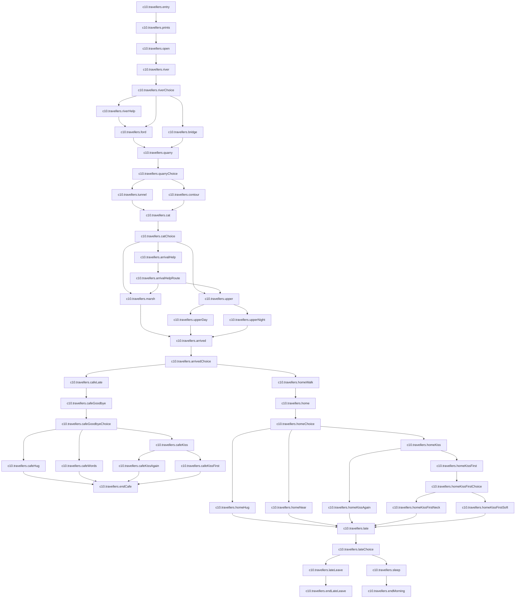

# Глава 10 · «Два путешественника»

Сценарное зеркало редакции content26. [Исходник главы](../src/content/chapters/ch10.ts) · [Сценарное ядро](NARRATIVE_CORE.md).

Вход: `c10.travellers.entry`. Узлов: 48. Основных реплик: 204.

### `c10.travellers.entry` · dialogue

Фон: `bg.travellers10.cafe`; персонаж: `vlad.city.smile`.

1. **Описание:** За окном «Паузы» горят вечерние фонари. Влад уже ждёт за вашим самым первым столиком; на соседнем стуле лежит та самая коробка с двумя путешественниками.
2. **Влад:** привет. видишь? коробка доехала без единой потери, всю дорогу держал обеими руками.
   - Эмоция Влада: `laugh`.
3. **Ты:** Привет! Растёшь на глазах. Теперь главное — не рассыпать жетоны, пока Нина несёт чай.
   - Эмоция Влада: `laugh`.
4. **Влад:** сегодня я за себя спокоен. особенно когда ты уже рядом.
5. **Описание:** Ты ставишь сумку у стула. Влад перекладывает коробку на край и вместо того, чтобы сесть напротив, переставляет свой стул сбоку к твоему — чтобы смотреть фотографии вместе.
6. **Нина:** Ваш чай уже заваривается! Оставьте мне только уголок стола под поднос.
7. **Описание:** Нина с хитрой улыбкой забирает салфетницу с края, оставляя вас вдвоём.
8. **Ты:** Уголок для чая оставим. А на всё остальное у нас сегодня большие планы.
→ `c10.travellers.prints`

### `c10.travellers.prints` · dialogue

Фон: `bg.travellers10.cafe`; персонаж: `vlad.city.smile`.

1. **Описание:** Ты достаёшь из сумки плотный бумажный конверт из фотолаборатории — из-под клапана выглядывают белые глянцевые края отпечатков.
2. **Ты:** Забрала час назад. Честно терпела всю дорогу и не заглянула ни в один снимок. Смотрим до игры?
   - Эмоция Влада: `surprised`.
3. **Влад:** открывай скорее. я с самой нашей первой прогулки у воды ждал этого момента.
   - Эмоция Влада: `surprised`.
4. **Описание:** Ты вынимаешь пачку фотографий. Влад придвигается ближе, чтобы свет лампы не бликовал на глянце, и с любопытством склоняется над стопкой.
5. **Описание:** На самом первом снимке — Влад у перил набережной: предзакатный свет лежит у него на скуле, а он смотрит прямо в камеру.
   - Вариант при `c6PhotoPlace = "upper" и c6PhotoSubject = "vlad"`: На самом первом снимке — Влад у перил верхней набережной: предзакатный свет лежит на его скуле, а он смотрит прямо на тебя.
   - Вариант при `c6PhotoPlace = "upper" и c6PhotoSubject = "her"`: На самом первом снимке — твой силуэт со спины на фоне светлого неба над вечерними крышами.
   - Вариант при `c6PhotoPlace = "upper" и c6PhotoSubject = "place"`: На самом первом снимке — тёмные скаты крыш и чистая полоса закатного неба между ними.
   - Вариант при `c6PhotoPlace = "water" и c6PhotoSubject = "vlad"`: На самом первом снимке — Влад у просвета перил, а позади в тёмной воде дрожат линии отражённой лестницы.
   - Вариант при `c6PhotoPlace = "water" и c6PhotoSubject = "her"`: На самом первом снимке — твой силуэт у самой воды среди отражений опрокинутой лестницы.
   - Вариант при `c6PhotoPlace = "water" и c6PhotoSubject = "place"`: На самом первом снимке — только тёмная вода и отражённая лестница, так что ты с усмешкой крутишь карточку, угадывая, где верх.
6. **Ты:** Именно этот первый кадр я больше всего боялась испортить.
7. **Влад:** получился отлично. дай рассмотреть поближе.
   - Эмоция Влада: `thinking`.
8. **Описание:** Он придерживает край снимка вместе с тобой, чуть наклоняя карточку к свету.
   - Эмоция Влада: `thinking`.
9. **Описание:** Следом идёт кадр у галереи: Влад стоит у высокой афиши, и белая диагональ плаката продолжается у его плеча.
   - Вариант при `c7GalleryFrame = "vlad"`: Следом идёт кадр у галереи: Влад стоит у высокой афиши, белая диагональ плаката продолжается у его плеча.
   - Вариант при `c7GalleryFrame = "her"`: Следом — твой силуэт на ступеньке галереи в полосе света из приоткрытой двери.
   - Вариант при `c7GalleryFrame = "both"`: Следом — ваше общее отражение в тёмном витринном стекле двери, где вы оба смотрите не в камеру, а друг на друга.
10. **Описание:** Дальше — ваша кухня: горячее блюдо под лампой, разломленный на двоих кусочек и пальцы Влада на дальнем краю тарелки.
   - Вариант при `c8Frame = "foodHer"`: Дальше — ваша кухня: горячее блюдо, снятое сверху, разломленный на двоих кусочек и пальцы Влада на краю тарелки.
   - Вариант при `c8Frame = "foodVlad"`: Дальше — блюдо, снятое с места Влада: золотистая корочка, разломленная порция и твои ладони на краю тарелки.
   - Вариант при `c8Frame = "boardHer"`: Дальше — деревянная доска на его кухне, крошки и белый мучной след от ваших пальцев, похожий на запятую.
   - Вариант при `c8Frame = "boardVlad"`: Дальше — деревянная доска, снятая Владом крупным планом: ложка, крошки и ваша общая мучная запятая.
11. **Описание:** Затем — сумерки кинодворика: Влад с бумажным пакетом печенья под огоньками гирлянд у кирпичной арки.
   - Вариант при `c9Frame = "vlad"`: Затем — сумерки кинодворика: Влад с пакетом печенья под огоньками гирлянд у кирпичной арки.
   - Вариант при `c9Frame = "seats"`: Затем — ваши два сдвинутых стула в последнем ряду кинодворика с пакетом печенья между ними.
   - Вариант при `c9Frame = "yard"`: Затем — весь кинодворик от кирпичной арки со старым плющом и нитями гирлянд над рядами.
12. **Описание:** Дальше в стопке — вечерняя улица у галереи, смеющийся Влад с полотенцем на плече у плиты и мокрый после ливня дворик с гирляндами в лужах.
   - Вариант при `c9Rain = "arch"`: Дальше в стопке — вечерняя улица у галереи, смеющийся Влад с полотенцем на плече у плиты и мокрый дворик из-под кирпичной арки.
   - Вариант при `c9Rain = "leave"`: Дальше в стопке — вечерняя улица у галереи, смеющийся Влад с полотенцем на плече у плиты и закрытый от дождя книжный шкафчик в ночном переулке.
13. **Описание:** А почти на половине оставшихся отпечатков — ты сама, пойманная Владом в те мгновения, когда ты даже не замечала объектив: у перил набережной с развевающимися на ветру волосами; со смехом у витрины галереи; и отдельно — тёплый кадр через его кухонный стол, где твои ладони обхватывают чашку под янтарной лампой, а на пальцах белеет крошечный след муки.
   - Эмоция Влада: `warm`.
   - Вариант при `c6PhotoPlace = "upper"`: А почти на половине оставшихся отпечатков — ты сама, пойманная Владом в те мгновения, когда ты даже не замечала объектив: у перил верхней дорожки на ветру; со смехом у витрины галереи; и отдельно — тёплый кадр через его кухонный стол, где твои ладони обхватывают чашку под янтарной лампой, а на пальцах белеет крошечный след муки.
14. **Описание:** На этих снимках ты совсем не позируешь — смеёшься, щуришься от ветра, держишь кружку — и от этого они кажутся живее всех остальных.
   - Эмоция Влада: `warm`.
15. **Влад:** я же говорил, что не жалею ни об одном кадре… отдашь мне вот этот, с нашей кухни? хочу поставить его дома.
   - Эмоция Влада: `smile`.
   - Интонация: негромко.
16. **Ты:** Конечно можно… они же наши общие. А вот смотри — самый маленький и косой кадр из начала плёнки!
17. **Описание:** На фотографии — гранитная дорожка набережной, край сумки и две пары вашей обуви рядом: тот самый случайный кадр, когда кнопка сработала сама.
18. **Влад:** лучшее доказательство, что мы уже тогда стояли совсем рядом. оставь его на столе у поля — пусть приносит удачу нашим путешественникам.
   - Эмоция Влада: `smile`.
19. **Описание:** Ты кладёшь снимок ваших ног у окна, отдаёшь Владу портрет с кухни, а остальные карточки убираешь в конверт, пока Нина ставит на край стола две чашки чая.
→ `c10.travellers.open`

### `c10.travellers.open` · dialogue

Фон: `bg.travellers10.cafe`; персонаж: `vlad.city.thinking`.

1. **Описание:** Влад снимает крышку с коробки. Внутри лежат складное поле, две деревянные фигурки путешественников, мостик и круглый жетон с горящим фонарём.
2. **Ты:** Вот и тот самый деревянный мостик из первого вечера.
   - Вариант при `plan = "coop"`: Ну что, показывай свой знаменитый мостик, который ждал нас с первого вечера.
3. **Влад:** сегодня наконец проверим его в деле.
   - Эмоция Влада: `smile`.
   - Вариант при `plan = "coop"`: дождался-таки моего любимого напарника.
4. **Описание:** Он раскладывает поле между вами. За извилистой рекой нарисован каменный карьер, а дальше тропа раздваивается перед маленьким домиком с крыльцом. Ты ставишь обе фигурки на стартовую клетку.
5. **Влад:** смотри: задача — довести обоих путешественников до домика раньше, чем погаснут вот эти пять жетонов солнца. в запасе у нас один мостик и один фонарь.
6. **Ты:** Фонарь выручает только один раз за всю дорогу?
7. **Влад:** да. можно потратить его, чтобы срезать путь сквозь тёмный тоннель в карьере, а можно поберечь на самый конец дороги, если у домика застанет ночь.
8. **Ты:** Значит, пойдём шаг в шаг.
9. **Влад:** именно. я веду эту фигурку, твоя — вот эта. и чур ни на одной клетке друг от друга не отставать.
   - Эмоция Влада: `laugh`.
→ `c10.travellers.river`

### `c10.travellers.river` · dialogue

Фон: `bg.travellers10.cafe`; персонаж: `vlad.city.thinking`.

1. **Описание:** Сразу за первой поляной путь преграждает быстрая река: прямо через неё нарисован переход для мостика, а ниже — мелкий каменистый брод.
2. **Влад:** можно сразу положить мостик здесь — потратим всего одно солнце и перейдём сухими.
3. **Ты:** Подожди, дай загляну в конец карты, к самому домику.
4. **Описание:** Ты приоткрываешь дальнюю складку поля: перед самым крыльцом домика через болото нарисован точно такой же значок мостика.
5. **Ты:** Смотри, он пригодится нам в самом конце! Если сейчас перейдём реку вброд, у дома сможем срезать через болото.
   - Эмоция Влада: `surprised`.
6. **Влад:** точно… я смотрел только под ноги, а ты уже проложила дорогу до самого дома. как решаем?
   - Эмоция Влада: `surprised`.
→ `c10.travellers.riverChoice`

### `c10.travellers.riverHelp` · dialogue

Фон: `bg.travellers10.cafe`; персонаж: `vlad.city.smile`.

1. **Влад:** я за твою идею — давай прибережём мостик для болота у дома, а реку перейдём вброд.
2. **Ты:** Договорились, тогда мостик остаётся в нашем общем запасе.
→ `c10.travellers.ford`

### `c10.travellers.ford` · dialogue

Фон: `bg.travellers10.cafe`; персонаж: `vlad.city.smile`.

1. **Описание:** Ты ведёшь свою фигурку через каменистый брод, а Влад тут же переставляет свою следом на ту же клетку. Вы убираете два жетона солнца, оставляя мостик рядом с фонарём.
   - Эффекты после действия: `[{"kind":"set","key":"c10River","value":"ford"}]`.
2. **Ты:** Теперь береги наш мостик до самого болота.
   - Эмоция Влада: `laugh`.
3. **Влад:** из рук не выпущу. стратегический запас.
   - Эмоция Влада: `laugh`.
→ `c10.travellers.quarry`

### `c10.travellers.bridge` · dialogue

Фон: `bg.travellers10.cafe`; персонаж: `vlad.city.smile`.

1. **Ты:** Давай поставим мостик прямо здесь — сэкономим солнце для дальней дороги.
2. **Описание:** Влад укладывает деревянный мостик поперёк нарисованной реки. Вы переводите обе фигурки на другой берег; у края поля остаются четыре солнца.
   - Эффекты после действия: `[{"kind":"set","key":"c10River","value":"bridge"}]`.
3. **Влад:** всё, первая переправа позади, и ноги не промочили.
4. **Ты:** Главное, что оба на одном берегу.
→ `c10.travellers.quarry`

### `c10.travellers.quarry` · dialogue

Фон: `bg.travellers10.cafe`; персонаж: `vlad.city.thinking`.

Реплики советчиков идут отдельной вставкой.

1. **Описание:** Дальше тропа упирается в крутой склон старого карьера: по верху вьётся обходная дорожка, внизу темнеет вход в подземный тоннель.
2. **Ты:** В тоннеле совсем темно, даже выхода не нарисовано. Пойдём в обход по верху?
3. **Влад:** смотри на маленький символ над входом — сейчас покажу в памятке.
4. **Описание:** Он берёт карточку-памятку и проводит пальцем по нужной строчке:
5. **Влад:** сквозная черта означает, что тоннель проходим за один ход. просто внутри придётся зажечь наш единственный фонарь.
6. **Ты:** Либо потратить фонарь здесь, либо пройти в обход за два солнца и сохранить свет на вечер у дома.
7. **Дьяволёнок:** Он опять сидит с видом гроссмейстера! Веди его в тёмный тоннель с одним фонарём — пусть хоть раз рискнёт без расчётов.
8. **Ангел:** А на верхней тропе просторно и видно всю долину — и фонарь останется целым на случай, если у самого дома опустится ночь.
→ `c10.travellers.quarryChoice`

### `c10.travellers.tunnel` · dialogue

Фон: `bg.travellers10.cafe`; персонаж: `vlad.city.smile`.

1. **Ты:** Пойдём сквозь тоннель. Зажжём фонарь и сбережём время до заката.
   - Вариант при `c10QuarryHelp = true`: Покажи короткий путь через тоннель, я за тобой.
2. **Описание:** Ты кладёшь жетон фонаря у входа, и вы переводите обе фигурки на другую сторону карьера. В коробку уходит всего одно солнце.
   - Эмоция Влада: `neutral`.
   - Эффекты после действия: `[{"kind":"set","key":"c10Quarry","value":"tunnel"}]`.
3. **Влад:** проскочили на одном дыхании. переворачиваем фонарь погасшей стороной.
   - Эмоция Влада: `neutral`.
4. **Ты:** Зато до домика теперь рукой подать.
→ `c10.travellers.cat`

### `c10.travellers.contour` · dialogue

Фон: `bg.travellers10.cafe`; персонаж: `vlad.city.smile`.

1. **Ты:** Пойдём лучше по верхней тропе. Хочу оставить фонарь на самый конец пути.
2. **Описание:** Ты ведёшь фигурку по высокой дуге над карьером, Влад двигает свою следом. Вы убираете два солнца, но жетон фонаря остаётся нетронутым.
   - Эффекты после действия: `[{"kind":"set","key":"c10Quarry","value":"contour"}]`.
3. **Влад:** красивый маршрут. и свет всё ещё при нас.
4. **Ты:** Теперь никакие сумерки у крыльца не страшны.
→ `c10.travellers.cat`

### `c10.travellers.cat` · dialogue

Фон: `bg.travellers10.cafe`; персонаж: `vlad.city.smile`.

1. **Описание:** Стоит тебе потянуться к последней складке поля, как на стол прыгает Пончик — и с совершенно довольным видом укладывается в открытую крышку коробки прямо поверх памятки.
   - Эмоция Влада: `surprised`.
2. **Влад:** так. кажется, наш домик заняли раньше, чем мы до него дошли.
   - Эмоция Влада: `surprised`.
3. **Ты:** И все правила собой накрыл, чтобы мы больше никуда не спешили.
   - Эмоция Влада: `laugh`.
4. **Описание:** Ты придвигаешь соседний стул со сложенным пледом, а Влад чешет Пончика за ухом, уговаривая перебраться на мягкую подстилку.
   - Эмоция Влада: `laugh`.
5. **Ты:** Иди сюда, пушистый контролёр.
   - Эмоция Влада: `laugh`.
6. **Описание:** Пончик с мурлыканьем переступает на плед и сворачивается калачиком рядом, а Влад освобождает памятку и убирает крышку на подоконник.
7. **Влад:** ну вот, у кота теперь отдельная резиденция, а у нас — финишная прямая.
8. **Описание:** Ты разглаживаешь последний участок карты перед домиком: к крыльцу ведут короткий переход через болото и длинная верхняя тропа.
   - Эмоция Влада: `thinking`.
9. **Влад:** можно было бы пойти в обход по сухой тропе сверху…
   - Условие: `c10River = "ford"`.
   - Эмоция Влада: `thinking`.
10. **Ты:** А наш сбережённый мостик? Смотри, здесь для него идеальное место!
   - Условие: `c10River = "ford"`.
11. **Описание:** Ты опускаешь деревянный мостик в выемки болотной переправы прямо перед крыльцом домика.
   - Условие: `c10River = "ford"`.
12. **Влад:** лёг как влитой. твоя дальновидность у реки спасла нам целый вечер.
   - Условие: `c10River = "ford"`.
   - Эмоция Влада: `smile`.
13. **Влад:** мостик мы оставили у первой реки, так что здесь пойдём по верхней тропинке.
   - Условие: `c10River = "bridge"`.
   - Эмоция Влада: `thinking`.
14. **Ты:** Давай чуть повернём поле к лампе, чтобы обоим было видно крыльцо.
   - Условие: `c10River = "bridge"`.
   - Эмоция Влада: `thinking`.
15. **Описание:** Вы вдвоём поворачиваете картонное поле так, что маленький домик оказывается ровно посередине.
   - Условие: `c10River = "bridge"`.
16. **Влад:** вот он. осталось всего два шага до нашего порога.
   - Условие: `c10River = "bridge"`.
→ `c10.travellers.catChoice`

### `c10.travellers.marsh` · dialogue

Фон: `bg.travellers10.cafe`; персонаж: `vlad.city.smile`.

1. **Описание:** Ты поправляешь деревянный мостик, а Влад переводит по нему обе фигурки сразу.
2. **Ты:** Прямо к крыльцу.
3. **Описание:** Две деревянные фигурки встают на последней клетке у двери домика, и Влад легонько стукает свою о твою, оставляя их рядом.
   - Эффекты после действия: `[{"kind":"set","key":"c10Arrival","value":"marsh"}]`.
4. **Влад:** дошли. и ещё солнце в запасе осталось.
→ `c10.travellers.arrived`

### `c10.travellers.arrived` · dialogue

Фон: `bg.travellers10.cafe`; персонаж: `vlad.city.smile`.

1. **Описание:** Несколько секунд вы не убираете фигурки с крыльца, а у края поля лежит тот самый случайный снимок с набережной, где рядом стоят ваши ботинки.
2. **Ты:** Подожди секунду, Влад. Смотри.
3. **Описание:** Ты придвигаешь фотографию к клетке с домиком: две фигурки на крыльце и вы двое на снимке рядом. Влад смотрит на них, потом поднимает глаза на тебя.
4. **Влад:** вот теперь маршрут официально пройден — от того коврика у двери до самого дома.
   - Эмоция Влада: `laugh`.
5. **Ты:** В следующей партии чур меняемся фигурками.
   - Эмоция Влада: `laugh`.
6. **Влад:** договорились. хотя моя уже привыкла ходить за твоей.
   - Эмоция Влада: `laugh`.
7. **Описание:** Вы не спеша складываете картонное поле и деревянные фигурки обратно в коробку.
8. **Описание:** За окном редкие прохожие спешат по пустой улице, а в зале остаётся только мягкий свет у вашего столика.
9. **Влад:** знаешь, теперь мне правда интересно, куда нас занесёт следующая карта — уже не картонная.
   - Эмоция Влада: `thinking`.
10. **Ты:** Ловлю тебя на слове.
11. **Нина:** Ребята, минут через пятнадцать буду закрывать кафе. Налить вам ещё чего-нибудь на дорожку?
12. **Влад:** спасибо, Нина, нам хватит.
13. **Описание:** Влад поворачивается к тебе — уже без обычной заминки:
14. **Влад:** я весь последний час ловил себя на том, что совсем не хочу сегодня прощаться с тобой у светофора. пойдём ко мне?
   - Эмоция Влада: `warm`.
→ `c10.travellers.arrivedChoice`

### `c10.travellers.cafeLate` · dialogue

Фон: `bg.travellers10.cafe`; персонаж: `vlad.city.smile`.

1. **Влад:** хорошо. тогда не спеши допивать чай — все эти пятнадцать минут наши.
2. **Описание:** Он убирает коробку в сумку и остаётся сидеть рядом, не торопя тебя.
3. **Ты:** Теперь я понимаю, почему ты так хотел сыграть в эту коробку именно со мной.
   - Эмоция Влада: `laugh`.
4. **Влад:** даже с учётом того, что Пончик пытался захватить наш дом на последнем ходу.
   - Эмоция Влада: `laugh`.
5. **Ты:** Он просто проверял, насколько мы дружная команда.
6. **Влад:** проверку мы прошли идеально.
7. **Описание:** Нина гасит дальние лампы в глубине зала, оставляя свет только у вашего окна. Вы спокойно допиваете чай, глядя на пустую ночную улицу.
8. **Описание:** У двери Влад помогает тебе надеть пальто. Нина переворачивает табличку на стекле на «Закрыто».
9. **Нина:** Доброй ночи вам! Коробку в этот раз целиком уносите?
10. **Ты:** Сегодня ни одного жетона на коврике не оставили!
→ `c10.travellers.cafeGoodbye`

### `c10.travellers.cafeGoodbye` · dialogue

Фон: `bg.cafe.exterior`; персонаж: `vlad.city.neutral`.

1. **Описание:** На улице тихо и свежо. Нина запирает дверь, прощается с вами и уходит за угол, оставляя вас вдвоём под погасшей вывеской «Паузы».
→ `c10.travellers.cafeGoodbyeChoice`

### `c10.travellers.cafeHug` · dialogue

Фон: `bg.cafe.exterior`; персонаж: `vlad.city.warm`.

1. **Ты:** Иди сюда, обниму тебя перед дорогой.
2. **Описание:** Ты шагаешь в его объятия, и Влад крепко прижимает тебя к себе, не отпуская добрую минуту посреди пустой улицы.
3. **Влад:** доброй ночи. конверт с фотографиями далеко не прячь — ещё будем пересматривать.
4. **Ты:** Обязательно. До скорой встречи, Влад.
5. **Описание:** У светофора ты оборачиваешься и машешь ему рукой; он отвечает тем же.
   - Эффекты после действия: `[{"kind":"set","key":"c10Finale","value":"cafe"}]`.
→ `c10.travellers.endCafe`

### `c10.travellers.cafeWords` · dialogue

Фон: `bg.cafe.exterior`; персонаж: `vlad.city.warm`.

1. **Ты:** Доброй ночи, Влад. Спасибо тебе за наших путешественников и за эти фотографии.
2. **Влад:** доброй ночи. спасибо, что прошла всю эту дорогу со мной.
3. **Описание:** Он коротко сжимает твою ладонь и долго смотрит вслед под светом ночных фонарей.
   - Эффекты после действия: `[{"kind":"set","key":"c10Finale","value":"cafe"}]`.
→ `c10.travellers.endCafe`

### `c10.travellers.homeWalk` · dialogue

Фон: `bg.travellers10.cafe`; персонаж: `vlad.city.smile`.

- Фон с индекса 5: `bg.travellers10.home`, `vlad.casual.warm`.
- Фон с индекса 3: `bg.cafe.exterior`, `vlad.city.smile`.
1. **Ты:** Пойдём к тебе. Я сегодня тоже не хочу с тобой расходиться.
2. **Описание:** Лицо Влада сразу светлеет — видно, как искренне он этому рад.
3. **Влад:** тогда забирай наши фотографии, а коробку я понесу. пойдём.
4. **Описание:** Вы прощаетесь с Ниной и выходите на пустую ночную улицу. В прохладном воздухе кружатся редкие листья, и идти вдвоём через тихие переулки удивительно спокойно.
   - Вариант при `c8LipKiss = "yes"`: Вы прощаетесь с Ниной и выходите на ночную улицу. Заметив, что твоя рука озябла, Влад переплетает ваши пальцы и прячет обе руки в глубокий карман своего пальто.
   - Вариант при `c9LipKiss = "yes"`: Вы прощаетесь с Ниной и выходите на ночную улицу. Заметив, что твоя рука озябла, Влад переплетает ваши пальцы и прячет обе руки в глубокий карман своего пальто.
5. **Описание:** Дорога до его дома кажется короткой — вы почти не разговариваете, просто идёте в одном шаге.
6. **Описание:** У двери квартиры Влад открывает замок, включает мягкий свет в прихожей и пропускает тебя внутрь первой.
   - Вариант при `c8LipKiss = "yes"`: В тишине полутёмного подъезда у двери Влад на секунду останавливается с ключами, приобнимает тебя и тихо касается губами твоего виска, прежде чем открыть замок.
   - Вариант при `c9LipKiss = "yes"`: В тишине полутёмного подъезда у двери Влад на секунду останавливается с ключами, приобнимает тебя и тихо касается губами твоего виска, прежде чем открыть замок.
→ `c10.travellers.home`

### `c10.travellers.home` · dialogue

Фон: `bg.travellers10.home`; персонаж: `vlad.casual.warm`.

- Фон с индекса 7: `bg.travellers10.home`, `vlad.closeup.warm`.
1. **Описание:** В комнате Влад не включает верхний свет — зажигает только тёплый торшер у дивана. На полке рядом с резным деревянным пазлом лежит ваш крафтовый конверт с набережной, а на втором геймпаде у экрана всё так же белеет бумажный стикер с созвездием.
   - Вариант при `c7GalleryGift = "chip"`: В комнате Влад зажигает только тёплый торшер у дивана. У монитора стоит твоя открытка «Скол», на полке рядом с резным деревянным пазлом лежит крафтовый конверт с жетонами, а на втором геймпаде белеет стикер с вашим созвездием.
   - Вариант при `c7GalleryGift = "blue"`: В комнате Влад зажигает только тёплый торшер у дивана. У монитора стоит твоя открытка «Просвет», на полке рядом с резным деревянным пазлом лежит крафтовый конверт с жетонами, а на втором геймпаде белеет стикер с вашим созвездием.
2. **Ты:** Странно, но у тебя тут уже чувствуешь себя как в знакомом месте. Даже сова на полке как родная.
   - Вариант при `herRecharge = "walk"`: Смотрю, сегодня не пришлось прятать кружки за семь минут до моего прихода?
   - Вариант при `herRecharge = "cozy"`: Смотрю, сегодня не пришлось прятать кружки за семь минут до моего прихода?
   - Вариант при `herRecharge = "hands"`: Смотрю, сегодня не пришлось прятать кружки за семь минут до моего прихода?
3. **Влад:** заметила? я даже не делал вид, что тут всегда порядок. кружку с утра всё-таки забыл в раковине — считай, полная степень доверия.
   - Эмоция Влада: `smile`.
   - Вариант при `herRecharge = "walk"`: сдался на полпути — кружка с утра до сих пор в раковине. считай, это высший уровень доверия.
   - Вариант при `herRecharge = "cozy"`: сдался на полпути — кружка с утра до сих пор в раковине. считай, это высший уровень доверия.
   - Вариант при `herRecharge = "hands"`: сдался на полпути — кружка с утра до сих пор в раковине. считай, это высший уровень доверия.
4. **Влад:** поставил воду на столик. кстати, для нашего следующего киновечера я уже держу в уме тот разговор под дождём.
   - Эмоция Влада: `smile`.
   - Вариант при `c9HerMovie = "drama"`: поставил воду на столик. кстати, пару сильных драм для нашего следующего вечера я уже отложил.
   - Вариант при `c9HerMovie = "warm"`: поставил воду на столик. кстати, я честно нашёл один светлый фильм по твоей части — но следующий всё равно будет мой.
   - Вариант при `c9HerMovie = "mystery"`: поставил воду на столик. кстати, нашёл один закрученный фильм — обещаю ставить на паузу не чаще трёх раз.
5. **Ты:** Иди уже сюда. Садись рядом.
6. **Описание:** Влад садится на диван совсем близко. Между вами больше нет ни столика кафе, ни игрового поля — только ночная тишина дома, где каждая мелочь уже хранит ваши встречи.
7. **Ты:** Путешественников до крыльца довели, и даже наш стикер на геймпаде дождался.
   - Интонация: тихо.
8. **Описание:** Влад поворачивается к тебе, глядя прямо и глубоко, и его ладонь тепло накрывает твою руку на диване:
   - Вариант при `c8LipKiss = "yes"`: Влад поворачивается к тебе, берёт твою ладонь и невесомо касается губами внутренней стороны твоего запястья, не отрывая взгляда, когда поднимает голову:
   - Вариант при `c9LipKiss = "yes"`: Влад поворачивается к тебе, берёт твою ладонь и невесомо касается губами внутренней стороны твоего запястья, не отрывая взгляда, когда поднимает голову:
9. **Влад:** я сейчас ровно там, куда шёл с самой первой рассыпанной коробки. рядом с тобой.
   - Эмоция Влада: `warm`.
→ `c10.travellers.homeChoice`

### `c10.travellers.homeHug` · dialogue

Фон: `bg.travellers10.home`; персонаж: `vlad.casual.warm`.

1. **Ты:** Обними меня, Влад. Хочу просто посидеть у тебя в руках.
2. **Описание:** Ты придвигаешься ближе и устраиваешь голову у него на груди. Влад тут же обнимает тебя обеими руками.
3. **Влад:** вот так удобно?
   - Интонация: тихо.
4. **Ты:** Идеально.
5. **Описание:** Он подкладывает диванную подушку тебе под локоть, неторопливо гладит тебя по спине, и под щекой слышно ровный стук его сердца.
→ `c10.travellers.late`

### `c10.travellers.homeNear` · dialogue

Фон: `bg.travellers10.home`; персонаж: `vlad.casual.warm`.

1. **Ты:** Мне сейчас так хорошо просто сидеть рядом с тобой, рука в руке.
2. **Влад:** тогда я весь здесь, рядом.
3. **Описание:** Ты откидываешься на подушки дивана, а Влад держит твою ладонь в своих руках, не нарушая эту уютную тишину.
4. **Описание:** На столике в неярком свете лампы белеет край конверта с фотографиями — слов сейчас действительно не нужно.
→ `c10.travellers.late`

### `c10.travellers.late` · dialogue

Фон: `bg.travellers10.home`; персонаж: `vlad.closeup.warm`.

1. **Описание:** Внизу по пустой улице проезжает ночная машина: мягкая полоса света скользит по потолку комнаты и тает в полумраке.
2. **Описание:** Время уже перевалило за полночь. Влад смотрит на тебя без обычных шуток:
3. **Влад:** уже совсем поздно. останешься сегодня у меня, или тебя проводить?
   - Эмоция Влада: `warm`.
   - Интонация: негромко.
→ `c10.travellers.lateChoice`

### `c10.travellers.lateLeave` · dialogue

Фон: `bg.travellers10.home`; персонаж: `vlad.casual.warm`.

1. **Ты:** Сегодня мне всё-таки нужно домой. Но проводи меня до двери.
2. **Влад:** конечно. главное — не забудь наш конверт с фотографиями.
3. **Описание:** В прихожей Влад помогает тебе надеть пальто и поправляет ремень сумки.
4. **Ты:** Игра остаётся у тебя на полке. В следующий раз за домик отвечаю я.
   - Эмоция Влада: `laugh`.
5. **Влад:** ловлю на слове. мой путешественник без твоего всё равно никуда не пойдёт.
   - Эмоция Влада: `laugh`.
6. **Описание:** У двери ты крепко обнимаешь его на прощание, и он на пару секунд прижимает тебя к себе, прежде чем открыть дверь на площадку.
   - Вариант при `c10HomeTender = "near"`: У двери Влад коротко сжимает твои ладони на дорожку и открывает дверь на освещённую площадку.
7. **Ты:** Доброй ночи, Влад.
8. **Влад:** доброй ночи. напиши сразу, как будешь дома, ладно?
9. **Описание:** Он не закрывает дверь, пока ты не спускаешься по лестнице.
   - Эффекты после действия: `[{"kind":"set","key":"c10Finale","value":"lateLeave"}]`.
→ `c10.travellers.endLateLeave`

### `c10.travellers.sleep` · dialogue

Фон: `bg.travellers10.home`; персонаж: `vlad.casual.warm`.

1. **Ты:** Останусь. Ехать через весь город сейчас совсем не хочется — давай просто поваляемся и уснём.
2. **Влад:** отлично. сейчас всё разложу, чтобы было удобно.
   - Вариант при `c10HomeTender = "near"`: конечно. сейчас всё разложу, чтобы тебе было удобно.
3. **Описание:** Влад достаёт второе одеяло и подушку, включает вполголоса старую музыку на фоне и убирает конверт с фотографиями на край стола.
4. **Ты:** Только про деревянные фигурки помни — без меня ни на клетку не двигай.
   - Эмоция Влада: `laugh`.
5. **Влад:** клянусь не мухлевать. партия закрыта официально.
   - Эмоция Влада: `laugh`.
6. **Описание:** Он гасит торшер. В полумраке вы ещё немного перекидываетесь короткими фразами, пока голоса сами не сходят на нет — Влад приобнимает тебя, и усталость долгого дня мягко отпускает.
   - Вариант при `c10HomeTender = "near"`: Он гасит торшер. В полумраке вы ещё немного перекидываетесь короткими фразами, пока усталость долгого дня мягко не отпускает.
7. **Ты:** Доброй ночи, Влад…
   - Интонация: сонно.
8. **Влад:** доброй ночи.
   - Интонация: тихо.
9. **Описание:** На столике в слабом свете уличного фонаря белеет конверт с вашими фотографиями, а на полке стоит коробка с двумя путешественниками, которые наконец дошли до дома.
   - Эффекты после действия: `[{"kind":"set","key":"c10Finale","value":"morning"}]`.
   - Вариант при `c7GalleryGift = "chip"`: На столике в слабом свете уличного фонаря белеет конверт с вашими фотографиями, у монитора стоит открытка из галереи, а на полке ждёт коробка с двумя путешественниками.
   - Вариант при `c7GalleryGift = "blue"`: На столике в слабом свете уличного фонаря белеет конверт с вашими фотографиями, у монитора стоит открытка из галереи, а на полке ждёт коробка с двумя путешественниками.
→ `c10.travellers.endMorning`

### `c10.travellers.cafeKissAgain` · dialogue

Фон: `bg.cafe.exterior`; персонаж: `vlad.closeup.intimate`.

1. **Ты:** Иди сюда.
   - Интонация: тихо.
2. **Описание:** Ты тянешь Влада за лацкан пальто ближе — ровно в том месте у двери, где десять встреч назад рассыпались жетоны.
   - Эмоция Влада: `surprised`.
3. **Описание:** Он обнимает тебя и целует — медленно, спокойно и глубоко, никуда не спеша в тишине пустой улицы.
   - Эффекты после действия: `[{"kind":"set","key":"c10LipKiss","value":"yes"}]`.
4. **Описание:** Отстранившись, он ещё пару секунд держит твою ладонь в своей.
5. **Влад:** доброй ночи… береги наши фотографии. и себя.
   - Интонация: тихо.
6. **Описание:** У светофора ты оборачиваешься — Влад всё ещё стоит под вывеской «Паузы», глядя тебе вслед.
   - Эффекты после действия: `[{"kind":"set","key":"c10Finale","value":"cafe"}]`.
→ `c10.travellers.endCafe`

### `c10.travellers.cafeKissFirst` · dialogue

Фон: `bg.cafe.exterior`; персонаж: `vlad.closeup.intimate`.

1. **Ты:** Влад… иди сюда на секунду.
   - Интонация: тихо.
2. **Описание:** Ты делаешь шаг ближе и кладёшь ладони ему на грудь — ровно там, где десять встреч назад между вами рассыпались жетоны.
   - Эмоция Влада: `surprised`.
3. **Описание:** Влад на секунду замирает, его руки осторожно ложатся тебе на талию.
   - Эмоция Влада: `surprised`.
4. **Описание:** Ты поднимаешься на носки, он наклоняется навстречу — и первый поцелуй под погасшей вывеской получается долгим, тихим и совершенно настоящим.
   - Эффекты после действия: `[{"kind":"set","key":"c10LipKiss","value":"yes"}]`.
5. **Ты:** Вот теперь — доброй ночи.
   - Интонация: тихо.
6. **Влад:** самая лучшая ночь… не хотелось тебя отпускать.
7. **Описание:** Обернувшись у перехода, ты видишь, что Влад всё ещё стоит у «Паузы» и машет тебе на прощание.
   - Эффекты после действия: `[{"kind":"set","key":"c10Finale","value":"cafe"}]`.
→ `c10.travellers.endCafe`

### `c10.travellers.cafeKiss` · route

- Если `c8LipKiss = "yes"` → `c10.travellers.cafeKissAgain`
- Если `c9LipKiss = "yes"` → `c10.travellers.cafeKissAgain`
- Иначе → `c10.travellers.cafeKissFirst`

### `c10.travellers.homeKissAgain` · dialogue

Фон: `bg.travellers10.home`; персонаж: `vlad.closeup.warm`.

1. **Описание:** Не отводя взгляда, ты подаёшься вперёд и кладёшь ладонь ему на шею, касаясь мягких кудрей на затылке.
2. **Влад:** иди ко мне…
   - Интонация: тихо.
3. **Описание:** Он обнимает тебя за талию, притягивая ближе, и целует — медленно, уверенно и глубоко, так что комната вокруг растворяется в полумраке.
   - Эффекты после действия: `[{"kind":"set","key":"c10LipKiss","value":"yes"}]`.
4. **Описание:** Ты отвечаешь ему, и через несколько долгих секунд его губы мягко скользят от уголка твоих губ по линии скулы ниже — к чувствительной коже шеи.
5. **Описание:** Ты невольно прикрываешь глаза, сжимая пальцы на его плечах, пока он оставляет на шее ещё один неторопливый, тихий поцелуй и просто прижимает тебя к себе.
→ `c10.travellers.late`

### `c10.travellers.homeKissFirst` · dialogue

Фон: `bg.travellers10.home`; персонаж: `vlad.closeup.warm`.

1. **Описание:** Ты придвигаешься ближе и кладёшь ладонь ему на щеку. Влад замирает на мгновение, его пальцы осторожно сжимают твоё запястье.
2. **Влад:** иди сюда… я так долго этого ждал.
   - Интонация: тихо.
3. **Описание:** Ты поднимаешь лицо, и он медленно наклоняется навстречу. Первый поцелуй в тишине комнаты начинается осторожно и бережно, а когда ты отвечаешь, становится тягучим, глубоким и удивительно настоящим.
   - Эффекты после действия: `[{"kind":"set","key":"c10LipKiss","value":"yes"}]`.
4. **Описание:** Когда вы на секунду останавливаетесь перевести дыхание, Влад не отстраняется — смотрит на тебя совсем близко, полностью отдавая тебе выбор, что будет дальше.
→ `c10.travellers.homeKissFirstChoice`

### `c10.travellers.homeKissFirstChoice` · choice

Фон: `bg.travellers10.home`; персонаж: `vlad.casual.warm`.

Вопрос: Как тебе хочется сейчас?
- `closer` — «Не отстраняться и притянуть его ещё ближе» → `c10.travellers.homeKissFirstNeck`
- `shoulder` — «Улыбнуться и устроиться у него на плече» → `c10.travellers.homeKissFirstSoft`

### `c10.travellers.homeKissFirstNeck` · dialogue

Фон: `bg.travellers10.home`; персонаж: `vlad.casual.warm`.

1. **Описание:** Ты не отводишь рук, а сама притягиваешь его чуть ближе. Влад тихо выдыхает, обнимая тебя крепче, и его губы мягко скользят от твоей щеки к линии шеи.
2. **Описание:** От этого неспешного, неожиданного прикосновения по коже пробегают мурашки; ты прижимаешься к нему, не желая нарушать тишину.
3. **Ты:** Как же хорошо, что мы пошли к тебе…
   - Интонация: тихо.
4. **Влад:** я сейчас точно никуда не спешу.
→ `c10.travellers.late`

### `c10.travellers.homeKissFirstSoft` · dialogue

Фон: `bg.travellers10.home`; персонаж: `vlad.casual.warm`.

1. **Описание:** Ты тихо выдыхаешь и устраиваешься щекой у него на плече. Влад сразу обнимает тебя в ответ, спокойно и без всякой спешки.
2. **Ты:** Как же хорошо, что мы пошли к тебе…
   - Интонация: тихо.
3. **Влад:** для меня это лучший вечер из всех десяти.
→ `c10.travellers.late`

### `c10.travellers.homeKiss` · route

- Если `c8LipKiss = "yes"` → `c10.travellers.homeKissAgain`
- Если `c9LipKiss = "yes"` → `c10.travellers.homeKissAgain`
- Иначе → `c10.travellers.homeKissFirst`

### `c10.travellers.upperDay` · dialogue

Фон: `bg.travellers10.cafe`; персонаж: `vlad.city.smile`.

1. **Описание:** Ты ведёшь свою фигурку по верхней тропе, Влад ставит свою рядом. Вы убираете последние два солнца, и перед самой дверью он легонько стукает своей фигуркой о твою.
   - Эффекты после действия: `[{"kind":"set","key":"c10Arrival","value":"upper"}]`.
2. **Ты:** Успели ровно к закату. И оба дома.
3. **Влад:** как я и обещал в первый вечер — либо доходим вдвоём, либо никак.
→ `c10.travellers.arrived`

### `c10.travellers.upperNight` · dialogue

Фон: `bg.travellers10.cafe`; персонаж: `vlad.city.smile`.

1. **Описание:** На первом шаге верхней тропы гаснет последний жетон солнца, и до крыльца остаётся ещё одна тёмная клетка.
   - Эмоция Влада: `thinking`.
2. **Ты:** А вот теперь — наш сбережённый фонарь!
   - Эмоция Влада: `thinking`.
3. **Описание:** Влад ставит светлый жетон фонаря между фигурками, и под этим маленьким нарисованным светом вы вместе переводите обоих путешественников на крыльцо.
   - Эмоция Влада: `thinking`.
   - Эффекты после действия: `[{"kind":"set","key":"c10Arrival","value":"upper"}]`.
4. **Влад:** пришли домой со своим собственным светом.
5. **Ты:** Как хорошо, что мы сберегли его на конец дороги.
→ `c10.travellers.arrived`

### `c10.travellers.upper` · route

- Если `c10River = "ford" и c10Quarry = "contour"` → `c10.travellers.upperNight`
- Иначе → `c10.travellers.upperDay`

### `c10.travellers.riverChoice` · choice

Фон: `bg.travellers10.cafe`; персонаж: `vlad.city.smile`.

Вопрос: Как перейдём реку?
- `ford` — «Вброд — два солнца, мостик сбережём на конец» → `c10.travellers.ford`
- `bridge` — «По мостику — одно солнце, поставим его здесь» → `c10.travellers.bridge`
- `help` — «Давай вместе прикинем лучшую дорогу» → `c10.travellers.riverHelp` · эффекты `[{"kind":"set","key":"c10RiverHelp","value":true}]`

### `c10.travellers.quarryChoice` · choice

Фон: `bg.travellers10.cafe`; персонаж: `vlad.city.smile`.

Вопрос: Как пройдём карьер?
- `tunnel` — «В тоннель — одно солнце и свет нашего фонаря» → `c10.travellers.tunnel`
- `contour` — «По верхней тропе — два солнца, фонарь оставим на вечер» → `c10.travellers.contour`
- `help` — «Покажи короткий путь, я пойду за тобой» → `c10.travellers.tunnel` · эффекты `[{"kind":"set","key":"c10QuarryHelp","value":true}]`

### `c10.travellers.catChoice` · choice

Фон: `bg.travellers10.cafe`; персонаж: `vlad.city.smile`.

Вопрос: Осталась дорога к домику
- `marsh` — «По нашему мостику через болото — прямо к крыльцу» → `c10.travellers.marsh` · условие `c10River = "ford"`
- `upper` — «По верхней тропе — два шага до домика» → `c10.travellers.upper`
- `help` — «Доведём их до крыльца одной рукой» → `c10.travellers.arrivalHelp` · эффекты `[{"kind":"set","key":"c10ArrivalHelp","value":true}]`

### `c10.travellers.arrivalHelp` · dialogue

Фон: `bg.travellers10.cafe`; персонаж: `vlad.city.smile`.

1. **Ты:** Давай сделаем этот последний ход вместе.
2. **Влад:** давай. рука в руку.
→ `c10.travellers.arrivalHelpRoute`

### `c10.travellers.arrivalHelpRoute` · route

- Если `c10River = "ford"` → `c10.travellers.marsh`
- Иначе → `c10.travellers.upper`

### `c10.travellers.arrivedChoice` · choice

Фон: `bg.travellers10.cafe`; персонаж: `vlad.city.smile`.

Вопрос: Как продолжим вечер?
- `cafe` — «Сегодня мне нужно домой. Но до закрытия побудем здесь вместе» → `c10.travellers.cafeLate` · эффекты `[{"kind":"set","key":"c10Continuation","value":"cafe"}]`
- `home` — «Пойдём к тебе. Я тоже совсем не хочу с тобой расходиться» → `c10.travellers.homeWalk` · эффекты `[{"kind":"set","key":"c10Continuation","value":"home"}]`

### `c10.travellers.cafeGoodbyeChoice` · choice

Фон: `bg.cafe.exterior`; персонаж: `vlad.city.warm`.

Вопрос: Под погасшей вывеской
- `kiss` — «Притянуть его к себе и поцеловать» → `c10.travellers.cafeKiss` · эффекты `[{"kind":"set","key":"c10CafeGoodbye","value":"kiss"}]`
- `hug` — «Крепко обнять его перед дорогой» → `c10.travellers.cafeHug` · эффекты `[{"kind":"set","key":"c10CafeGoodbye","value":"hug"}]`
- `words` — «Пожелать ему доброй ночи» → `c10.travellers.cafeWords` · эффекты `[{"kind":"set","key":"c10CafeGoodbye","value":"words"}]`

### `c10.travellers.homeChoice` · choice

Фон: `bg.travellers10.home`; персонаж: `vlad.casual.warm`.

Вопрос: Без поля между вами
- `kiss` — «Придвинуться к нему ближе и коснуться его губ» → `c10.travellers.homeKiss` · эффекты `[{"kind":"set","key":"c10HomeTender","value":"kiss"}]`
- `hug` — «Обнять его и устроиться у него на плече» → `c10.travellers.homeHug` · эффекты `[{"kind":"set","key":"c10HomeTender","value":"hug"}]`
- `near` — «Переплести с ним пальцы и посидеть рядом в тишине» → `c10.travellers.homeNear` · эффекты `[{"kind":"set","key":"c10HomeTender","value":"near"}]`

### `c10.travellers.lateChoice` · choice

Фон: `bg.travellers10.home`; персонаж: `vlad.casual.warm`.

Вопрос: Решить сейчас
- `lateLeave` — «Сегодня поеду домой. Проводи меня до двери» → `c10.travellers.lateLeave`
- `sleep` — «Останусь у тебя — просто поваляемся и уснём» → `c10.travellers.sleep`

### `c10.travellers.endCafe` · end

Открытка: `c10.travellers`; endingId: `c10.travellers`.

### `c10.travellers.endLateLeave` · end

Открытка: `c10.travellers`; endingId: `c10.travellers`.

### `c10.travellers.endMorning` · end

Открытка: `c10.travellers`; endingId: `c10.travellers`.

## Приглашение в реальность

Этот вечер ещё не снят.

Игрок выбирает формат встречи и видит ответ Влада в [TravellersInvitation](../src/ui/TravellersInvitation.tsx).
